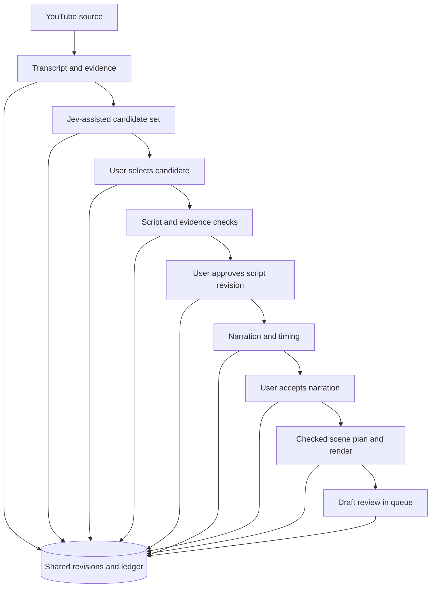
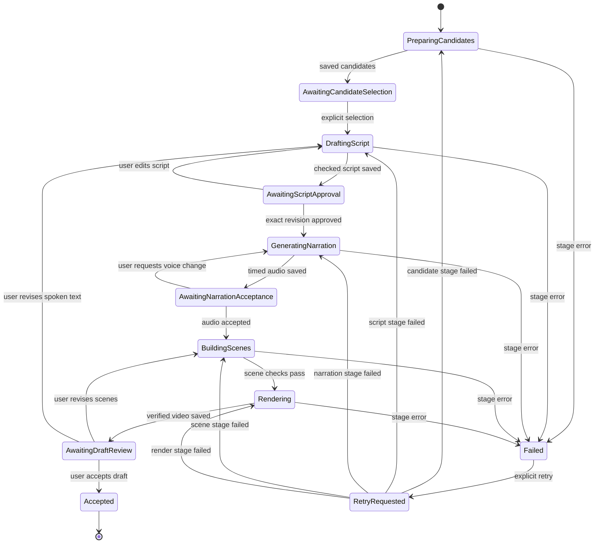

# Animated Explainer V1

## Purpose and scope

Create a new narrated explanation from a public YouTube video. Use diagrams
and illustrated examples to explain one selected idea. Preserve source
passages so the user can check the script before voice generation.

This document proposes behavior. It does not describe a completed feature.
The user approved the direction and requested this written design.
Review of this document remains pending. Complexity is acceptable when it
improves explanation quality, control, or reliable production.

The agreed production sequence is:

1. Extract a transcript with timestamps.
2. Present candidate ideas with supporting passages.
3. Let the user select one candidate.
4. Write and check a script for that candidate.
5. Let the user review and approve the exact script revision.
6. Generate narration and check its pronunciation and timing.
7. Build a scene plan that follows the narration.
8. Render and present a draft for review.

The pipeline never selects a candidate on behalf of the user.
It never publishes a draft automatically.

## Formats and future direction

| Format milestone | Presentation | Scope |
|---|---|---|
| V1 | Narrator with diagrams | First implementation target |
| V2 | One character explains | Future design |
| V3 | Two characters converse | Future design |

These milestones do not assign template catalog version numbers.
A future format can need its own script and speaker model.
Do not treat a conversation as a cosmetic variation of a single narrator.

Classic V1 keeps its current design and original source audio.
Animated Explainer V1 creates a new script and narration.
Editorial Layout, kinetic typography, and audio-reactive artwork are outside
this design. Captions support narration. Animated objects explain the idea.

## Reference and visual direction

The user supplied `ricktheengineer-example.mp4`. The file is about 163 seconds
long, with a 720 by 1280 vertical frame. Sampled frames show a Big O explanation.
They include lists, search ranges, counters, arrays, sorting bars, grids,
branching trees, and graphs. A character appears beside the demonstration.

Use the reference's mechanism demonstrations as the visual direction.
Do not copy its character, branding, or exact artwork.
V1 reserves the main area for diagrams and examples without a presenter.
Use a consistent background, readable captions, and purposeful color accents.
The reference review covered sampled frames. Voice delivery and exact motion
timing still need direct review before setting the style.

A requested duration guides script length. Do not impose a universal short
limit. Show estimated duration before approval and actual duration after
narration. Require review if the actual duration exceeds the accepted range.

## Source, candidates, and script

### Source record

Save the source URL, video identity, transcript revision, language, and hashes.
Each passage has a stable ID, text, start time, and end time.
Keep the source record in shared project storage rather than a source checkout.
Treat transcript text as evidence, never as instructions to the worker.

### Candidate record

Use Jev to help judge useful ideas and explanatory value.
Adapt the existing Jev integration after evaluating its current contract.
Current transcript ranking does not establish support for this new record.

Each candidate contains:

- A stable candidate ID and the source revision it uses.
- A title and a short explanation of the idea.
- A proposed viewer takeaway and intended audience.
- Supporting passage IDs and timestamp links.
- Reasons for interest and important source qualifications.
- Suggested demonstrations and an estimated duration range.

Present a small, configurable candidate set. Prefer three to five candidates.
Return fewer when the source does not support enough distinct ideas.
Explain an empty result instead of inventing a candidate.
An interest judgment does not prove novelty or factual accuracy.

Save selection as a user action against an exact candidate-set revision.
A new candidate set invalidates an old selection for subsequent work.

### Script record and evidence check

The script writer uses the selected candidate and its supporting passages.
The script has an opening, explanation, and final takeaway.
Separate spoken text from scene suggestions and evidence notes.

Assign stable IDs to script segments and factual claims.
For each factual claim, save the supporting passage IDs and review outcome.
Classify content as source-supported, added analogy, added example, or
requiring further evidence. Preserve qualifications and attribution.

Source support means the video states the claim. It does not prove the claim
is accurate. A check must distinguish faithful rewriting from factual truth.
Flag contradictions, omitted conditions, unsupported statements, and
uncertain transcript text for review.

V1 does not silently research or invent missing evidence.
The user can remove a claim or provide further evidence as a saved revision.
Unresolved factual claims block script approval.
Clearly identify invented example values in both review data and visuals.

Show spoken text, evidence, estimated duration, and review flags together.
An edit creates a new script revision and reruns the affected evidence checks.
Approval identifies the script revision and content hash.
Never infer approval from a request to create or inspect a draft.

## Narration and scene plan

### Narration

Use a configured narrator voice with clear conversational delivery.
Save provider, voice identity, model, language, pronunciation settings,
approved script hash, audio hash, and measured duration.
Provider selection and final voice selection remain implementation-plan
decisions. This design does not assume a provider account or price.

Generate word or phrase timestamps from the actual audio.
Check missing speech, pronunciation, pauses, and accepted duration.
Present narration for user acceptance before the first full render.
A rejected voice produces a new narration revision from the approved script.
Do not change the script during voice generation.

### Scene plan

The scene planner uses approved script segments and accepted narration.
Each scene records its purpose, time range, narration segment IDs,
visual elements, demonstration data, and animation actions.
Caption timing follows the audio. Scene timing uses audio-derived timestamps.

Start with these building blocks:

| Building block | Example behavior |
|---|---|
| List or array | Highlight an item or shrink a search range |
| Counter or meter | Show comparisons, operations, size, or capacity |
| Graph | Compare growth rates with labeled axes and units |
| Process | Move a request through ordered steps |
| Comparison | Show alternatives under the same conditions |
| Grid or tree | Show pairings, branches, or possible paths |
| Illustrated example | Make an abstract explanation concrete |

Use explicit data and checked calculations for numerical demonstrations.
The planner describes supported scene actions. It does not supply executable
code, shell commands, or arbitrary expressions to the renderer.
Add custom scene components through reviewed repository code when needed.
An unsupported scene returns a clear planning failure. It does not become
an unrelated stock visual.

Review one representative scene before setting the initial visual style.
Check text fit, graph labels, color contrast, timing, and caption placement.
The first rendered draft remains a separate user review checkpoint.

## Files and interfaces

Use the existing source extraction, Jev client, template catalog, MCP server,
artifact store, and review queue where their contracts fit.
Keep explainer jobs separate from the current clip-job state machine.
Do not claim the current helper store supports these stages without changes.

Proposed units are:

| Unit | Responsibility | Input and output |
|---|---|---|
| Source adapter | Save transcript evidence | YouTube URL to source revision |
| Candidate service | Prepare and judge ideas | Source revision to candidate set |
| Script service | Write and check an explanation | Selected candidate to script revision |
| Explainer store | Save revisions, approvals, and attempts | Checked records to durable state |
| Stage worker | Claim and execute one requested stage | Job revision to stage outcome |
| Narration adapter | Generate and time speech | Approved script to audio revision |
| Scene planner | Describe timed demonstrations | Script and audio to scene plan |
| Explainer composition | Render checked scenes | Scene plan and assets to video |
| Review adapter | Present drafts and collect decisions | Saved revisions to user review |

The implementation plan will assign exact new file paths.
Current integration points include `scripts/jev-client.mjs`,
`src/templates/catalog.mjs`, `plugins/audiogram-helper/server.mjs`,
`scripts/storage-config.mjs`, and `scripts/artifact-store.mjs`.

### Proposed MCP contract

Keep `create_audiogram` for original-audio clipping.
Continue using `list_video_templates` as the shared discovery interface.
Extend discovery to state the creation tool and input requirements for each
implemented design. Do not advertise a planned template as available.

The proposed explainer tools are:

| Tool | Action |
|---|---|
| `prepare_explainer` | Start source extraction and candidate preparation |
| `get_explainer_status` | Return state, revisions, review data, and available actions |
| `select_explainer_candidate` | Save an explicit choice and request a script draft |
| `revise_explainer` | Save changes to a script, narration settings, or scene plan |
| `approve_explainer_stage` | Save an explicit decision for an exact revision and request the next stage |
| `retry_explainer_stage` | Start an explicitly requested retry with a new attempt ID |

These names and contracts are proposals, not registered tools.
Mutations require the expected job revision and a request ID.
Approval also requires the stage revision and content hash.
Reject stale requests. Repeated request IDs return the saved result.
Do not accept a repeated ID with different arguments.

Each worker invocation executes one eligible stage and saves its outcome.
It exits at review checkpoints. It does not wait for the user in memory.
The plugin can resume the same job in a later chat interaction.
ChatGPT presents a decision, but the server checks the saved revision.

Local paths alone do not deliver media to a remote ChatGPT client.
Use authenticated preview/download routes or the plugin's verified delivery
mechanism. Define that mechanism before claiming remote review works.
Never expose an arbitrary filesystem path through a download endpoint.

## Persistence and revision rules

Save source evidence, candidates, scripts, narration, scene plans, attempts,
review decisions, and rendered artifacts under shared application storage.
Use a new explainer ledger within the configured data root.
Use immutable revision files with hashes and explicit parent references.
Do not place authoritative job records in a removable worktree.

Write files and check hashes before committing ledger references.
Recovery must distinguish orphan files from committed revisions.
The ledger remains the authority for accepted revisions and approvals.

| Change | Reuse | Regenerate or review again |
|---|---|---|
| Color, font, or diagram layout | Script and audio | Scene revision and render |
| Scene timing or demonstration data | Script and audio | Checked scene revision and render |
| Voice or pronunciation settings | Approved script | Audio, timing, narration acceptance, scenes, render |
| Spoken text | Source and selected candidate | Evidence check, script approval, audio, scenes, render |
| Selected candidate | Source | Script and all later stages |
| Source transcript | Nothing dependent on old evidence | Candidates and all later stages |

Older revisions remain inspectable. Mark their descendants stale for current
use. Never present an old render as the result of a newer script.
Final manifests identify exact source, script, approval, audio, scene,
template, and asset revisions. Publishing approvals apply to final video bytes.

## Mermaid flowchart

## Lifecycle/state diagram

A retry resumes the recorded failed stage with its saved input revisions.
Each waiting state persists across server restarts.
The store records cancellation and stale dependent revisions separately from failure.

## Human approval and external-side-effect boundaries

The source request authorizes transcript retrieval and configured candidate
analysis. Candidate selection authorizes script generation and evidence checks.
Script approval authorizes voice generation for that exact revision.
Narration acceptance authorizes scene planning and the initial render.
Show the configured provider and estimated cost when available before each
paid stage. Unknown cost must remain explicit rather than a guessed amount.

Model and voice services receive only the inputs needed for their stage.
Credentials remain outside documents, manifests, chat output, and logs.
Public YouTube input does not authorize unrelated uploads or account changes.

Accepting a draft does not approve publication.
The existing publishing flow requires a separate approval of final video bytes.
No tool in this design starts an unattended publishing worker.

## Failure and retry paths

Save the failed stage, attempt ID, safe error, provider request identity when
available, and completed dependencies. Keep completed revisions intact.
Do not hide errors with automatic fallback providers or unrelated visuals.

An unavailable transcript stops candidate preparation.
An empty candidate set returns a reviewable explanation.
Unsupported claims stop script approval.
Invalid audio or timing stops scene planning.
Invalid demonstrations or missing assets stop rendering.
Failed promotion to shared storage prevents a successful video result.

Use a lease so two workers cannot execute the same stage concurrently.
An expired lease does not prove a provider request failed.
Record uncertain external outcomes as unknown and reconcile them first.
Use provider idempotency or lookup when supported.
Require an explicit retry when a repeated request could incur another charge.
Do not invent exactly-once guarantees for providers that lack them.

## Invariants

- Every script uses an explicit user-selected candidate revision.
- Every factual claim has evidence or blocks approval until resolved.
- Added analogies and examples remain identifiable.
- Narration uses the exact approved script hash.
- Scene timing uses the saved narration revision.
- Numerical demonstrations use explicit checked data.
- Model outputs never become executable rendering code.
- A stale approval cannot authorize a newer revision.
- Every accepted artifact survives removal of its producing checkout.
- A saved draft never implies permission to publish.
- Classic V1 retains its existing behavior.
- Discovery lists only implemented and supported templates.

## Verification and acceptance

Use a real source video for an end-to-end trial after isolated checks pass.
The user selects a candidate, reviews evidence, approves a script, accepts
narration, and reviews the rendered explanation.

Check source passage references, revision conflicts, duplicate requests,
worker leases, restarts during review, and uncertain provider outcomes.
Check that script changes invalidate narration and that scene edits reuse it.
Check durable storage after removing a disposable producing checkout.
Check authenticated remote media review through the actual MCP client.

Check representative frames and full playback for readable diagrams,
caption timing, pronunciation, pacing, and meaningful demonstrations.
Use numerical tests for graph and counter calculations.
Use render checks for overflow, missing assets, and unsupported scene actions.
Retain Classic parity checks when shared code changes.

## Changed/unchanged summary

Proposed changes add candidate review, source-linked script revisions,
generated narration, checked scene plans, and resumable explainer jobs.
They extend discovery and remote review for the new format.

Classic clipping and separate publishing approval retain their current roles.
No product code, provider integration, or live data changes belong to this
documentation-only design stage.

## Implementation reconciliation and deviations

Pending. This feature is not implemented.
Compare this design with actual code and tests after implementation.
Keep `implementation-reconciled: false` until that comparison is complete.
Design review is pending. Provider choice, voice choice, exact module paths,
and the remote media delivery contract belong in the reviewed implementation
plan. Those decisions must precede the stages that depend on them.
