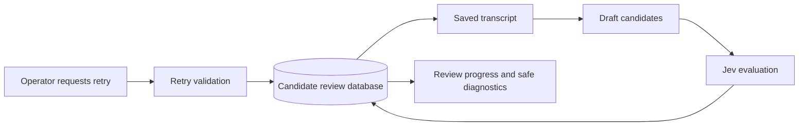
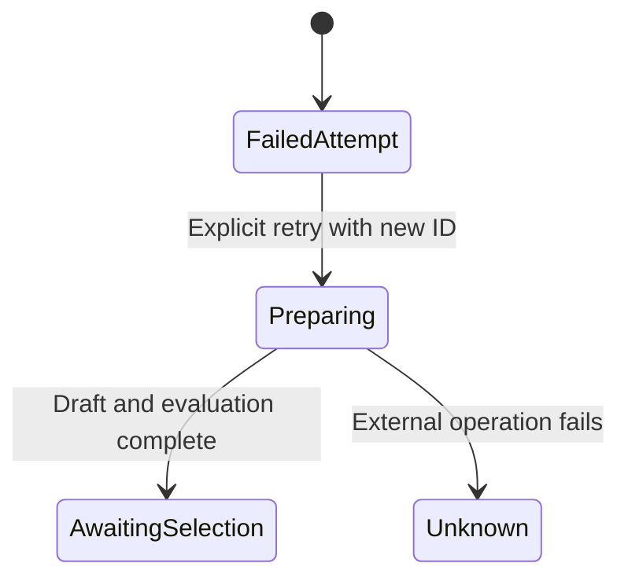

# Candidate review retry

An explicit retry creates a new attempt linked to a failed drafting attempt and reuses its saved transcript. The original attempt remains intact. Timeout diagnostics use an allowlist and do not expose private provider responses.

## Mermaid flowchart

## Lifecycle/state diagram

## Human approval and external-side-effect boundaries

Retry requires a deliberate request and a new attempt ID. Drafting and evaluation may incur external costs. No retry starts automatically and no video is rendered or published.

## Failure and retry paths

Only a saved unknown drafting attempt with an OAuth Responses timeout and a valid saved transcript may be retried. Each new ID is reserved once; concurrent attempts with the same ID cannot duplicate work. Errors remain attached to their attempts.

## Invariants

- Never change the original review or repeat transcript acquisition on retry.
- Never expose arbitrary exception messages, credentials or transcript content in diagnostics.
- An ambiguous paid operation is never repeated without explicit user action.

## Changed/unchanged summary

Changed: explicit CLI and MCP retry from saved transcript, safe timeout reporting, and an optional bounded `AUDIOGRAM_OAUTH_RESPONSES_TIMEOUT_MS` (120000–600000 ms, default 120000). The SDK timeout remains five seconds longer than the transport deadline. Unchanged: model, default deadline, candidate validation, Jev, and publication boundaries.

## Implementation reconciliation and deviations

The MCP retry reserves a new ID and starts one worker; repeated requests with the same ID return its existing progress. The CLI also accepts `--retry-review` and `--review-id`. Only an allowlisted timeout code is exposed publicly. The saved transcript is checked against its recorded fingerprint before reuse. No private provider text is exposed.

For a deliberate CLI retry, load the same environment as the MCP service, set `AUDIOGRAM_OAUTH_RESPONSES_TIMEOUT_MS=300000` if a longer deadline is desired, then run `node scripts/candidate-review-run.mjs --retry-review ORIGINAL_ID --review-id NEW_UUID`. The new ID is required and the retry can incur provider and Jev charges. For the MCP tool, the service must start with the desired environment setting; refresh the connected plugin after restarting it so the client discovers the new tool.

Fixture tests cover saved-transcript reuse, source mismatch, duplicate ID, safe diagnostics, bounded timeout configuration, and worker launch. A real explicit retry of `b874e59a-92a2-43db-9378-e9d078d38121` with a five-minute deadline produced `f1113081-430d-4b77-a7c6-cd6dc8513aaa`, with three candidates awaiting selection. The success does not establish that the deadline caused the original failure or that all future requests will succeed. No server was restarted.
