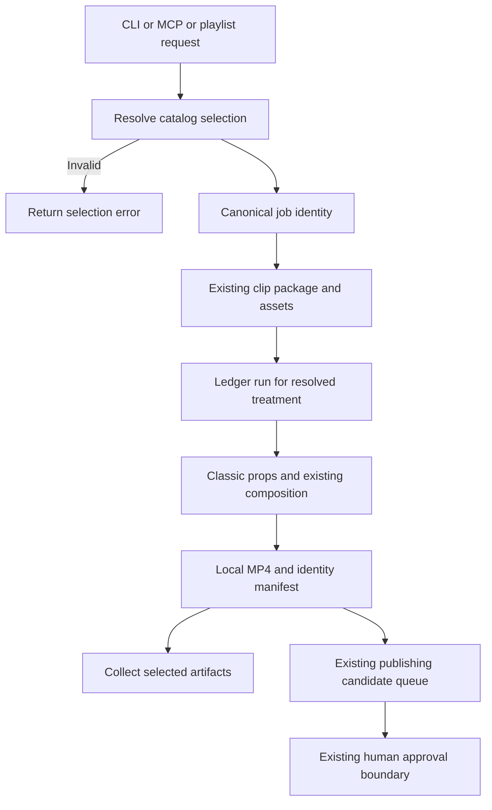
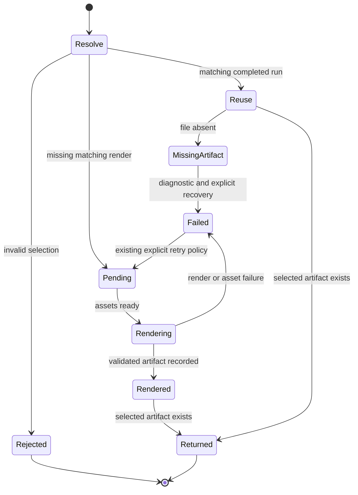

# Classic V1: preserve the current template and select variations

Design proposal, 2026-10-04. Reviewed against source; the user approved moving
to the implementation plan on 2026-10-04. No implementation or rendered parity is claimed by this document.
Inspected base: `main`, `195a8f4418ba5eaf47806506b474f4d31d4fcbe1`.

## Intent and scope

Name the existing visual design **Classic**, version **1**, with a **Default**
variation. Preserve thumbnail, title, oscilloscope waveform, transcript layout,
caption timing, fonts, colors and motion. Existing requests must keep working.
Future designs such as Editorial become separate templates. Variations are
named, validated presets belonging to a template, not arbitrary render flags.
Kinetic typography and audio-reactive artwork are excluded future directions.

The first implementation exposes only Classic / Default. Do not manufacture a
second visual preset to demonstrate the selector. A template is a composition
family; a variation is a preset; format is output geometry; version is an
immutable render contract. These are separate concepts.

## Current evidence and baseline decision

- `src/Root.tsx` registers `AudiogramBasic`, 1080x1920, with 30 fps supplied by
  metadata calculation. Defaults live here; layout lives in `src/Audiogram`.
- `scripts/treatment-registry.mjs` already registers `audiogram-basic@1` with
  audio, captions and thumbnail requirements, a props builder and H.264 output.
- The ledger deduplicates by clip package, treatment ID and treatment version.
  The runner also separates output paths by treatment ID and version.
- Both pipeline entry points choose this treatment explicitly. Single-URL
  result collection hardcodes it. Pending-run processing currently filters by
  video, but not by the requested treatment set.
- The helper plugin deduplicates active jobs by video today; its worker contract is
  URL-only. A future selection must pass through job identity and worker args. Completed helper
  jobs are not reused; completed render reuse is owned by the pipeline ledger.
- `/Users/kiwi/Downloads/preview.mp4` is a 1080x1080, 30 fps, approximately
  20.117-second visual reference. SHA-256:
  `7aac672f34f58990cd62b45a870bc4d0e5665966f80119f6679026d624c0c1ba`.
  A frame at 3 seconds was inspected. Its source inputs/provenance have not
  been reconstructed, so it is not yet a reproducible regression fixture.

Preserve current portrait behavior by default. Pending user decision: also
support a square format matching the supplied reference, or defer square.
Never change the dimensions of the existing treatment in place. If square is
included, it needs its own resolved render identity and verified baseline.

## Architecture and alternatives

Recommended: extend the existing treatment registry with a small shared
template catalog and resolver. Avoid a second independent rendering engine.
The catalog contains serializable IDs, labels, allowed variations and exact
treatment mappings; the Node registry owns asset-to-prop conversion, and the
Remotion composition owns rendering. Keep Node/database imports out of the
browser bundle. Validate catalog-to-registry mappings in tests.

Alternative: a single giant composition switching layouts by string. It is
initially simple but entangles future designs with Classic's behavior.
Alternative: a dynamic plugin framework. It adds discovery and compatibility
machinery without a present requirement. Neither is recommended.

Proposed selection contract:

```json
{"templateId":"classic","templateVersion":"1","variationId":"default"}
```

This resolves to the EXISTING `audiogram-basic@1` and `AudiogramBasic`.
Omitted selection resolves identically. The name Classic is a public label;
do not rename historical ledger records, output directories or composition IDs.
Unknown IDs, versions or unsupported combinations are errors, never silent
fallbacks. Treat empty strings as invalid, distinct from omitted fields.

Each future preset/format combination maps to a distinct versioned treatment
identity. This reuses ledger uniqueness and output isolation without a schema
migration. Store canonical selection in job metadata and an artifact manifest
alongside resolved props and treatment identity. The manifest is additive;
legacy artifact paths and consumers remain valid. Freeform styling overrides
are outside this first slice; admitting them later requires configuration-aware
cache identity. Existing direct Studio prop editing remains available but is
not evidence of matching the locked Default preset.

Keep `src/Audiogram` as Classic's implementation initially. Extract its current
default visual values into a dedicated Classic defaults module without changing
them. Both Studio defaults and the treatment props builder use those values,
so pipeline output no longer inherits mutable visual defaults accidentally.
Do not generalize caption/layout components for hypothetical templates yet.

## Selection surfaces and propagation

1. Single-URL CLI: optional `--template classic --template-version 1
   --variation default`; preserve URL-only behavior and JSON stdout.
2. Playlist pipeline: equivalent explicit environment configuration, using the
   same resolver and defaults. Keep visual selection separate from the clip
   ranking/selection recipe so changing visuals does not reselect source clips.
3. Remotion Studio: catalog-backed composition labels/selection. Retain
   `AudiogramBasic` for compatibility; do not register a duplicate just to rename
   it. With one preset the current composition is the selectable entry.
4. Helper MCP: optional matching fields forwarded through the local runner,
   persistent job store, worker and CLI. Job deduplication includes canonical
   render identity; omitted and explicit defaults match. Existing URL-only jobs
   are interpreted as Classic Default. A different template cannot reuse an active
   job for a different selection. Preserve one active job per video: a different
   selection while that video is busy returns a clear conflict, avoiding shared
   asset races. Include store migration/backward-read tests.

Resolve selection before metadata requests, asset acquisition or job writes.
Pass the resolved treatment set into run creation, pending-run execution and
artifact collection. Scope execution to selected treatments as well as video;
do not execute another preset's pending jobs merely because the video matches.
Add canonical identity to diagnostics without exposing private data.

## Mermaid flowchart



## Lifecycle/state diagram



## Human approval and external-side-effect boundaries

Review this DESIGN before product implementation. Naming/selecting a template
does not authorize publication. Existing acquisition may contact YouTube and
configured analysis services; reject invalid selections before those calls.
Rendering writes local artifacts and existing flows may enqueue a publishing
candidate. Queuing is not publishing. Preserve artifact-hash approvals; another
variation's artifact never inherits approval merely because its source matches.
No external writes, database migrations or renders were performed for this note.

## Failure and retry paths

Invalid selection fails early with allowed choices. Missing required assets
retain actionable diagnostics. Failed renders retain existing failure/retry
semantics and partial-file protection. Retry the same resolved identity; do not
switch presets. Missing historical files must not be reported as successful
reusable outputs. Queue failure and render success remain separate outcomes.

## Invariants

- Omission and explicit Classic Default have the same treatment, props and output.
- Existing composition ID, treatment ID/version and historical paths remain valid.
- Classic's default look is frozen; other templates cannot mutate its defaults.
- Different visual presets/formats have different durable render identities.
- Selection reaches job deduplication, pending execution and result collection.
- Clip selection and source assets can be reused across visual treatments.
- The first slice introduces no new visual style or publishing capability.

## Verification and acceptance

Before refactoring, capture a reproducible short local fixture from the inspected
base: audio, thumbnail, captions, exact props, dependency lock, font bytes,
renderer/browser version, dimensions and fps. Keep a manifest of asset hashes.
Use existing authorized local assets; use a visibly labeled synthetic fixture
for caption boundaries and long titles when needed. The supplied MP4 is a
human visual reference, not proof of source-level equivalence.

Render baseline and candidate in the same controlled environment. Compare
decoded pixels for every frame of the short fixture, rather than MP4 file
hashes. Require exact pixel equality for this selection-only refactor; investigate
environmental nondeterminism rather than silently relaxing the threshold.
Verify frame count, dimensions, fps and decoded audio parity. Inspect a contact
sheet covering start, active waveform, caption changes, and final frame, and
watch the short video for motion/audio continuity.

Focused automated checks:

- Resolver defaults, explicit values, invalid IDs/versions and foreign variations.
- Legacy and explicit Classic produce identical complete visual props.
- Inject a second test-only treatment: no cache collision, wrong pending render,
  artifact overwrite, or result leakage; no second production style is required.
- CLI, playlist configuration and MCP worker round-trip the selection; old calls
  still work. Plugin job recovery handles legacy and new job records.
- Existing registry, runner, ledger, clip processing, URL pipeline and plugin tests.
- `npm run lint`, relevant Node test suites, then feature-note reconciliation and
  `npm run verify:feature-docs` after actual implementation and parity verification.

Future template admission requires its own composition/schema, catalog entry,
asset contract, distinct treatment identity, local preview and regression fixture.
Changes to Classic's appearance require a new preset or version. Bug fixes may
retain the identity only when the frozen reference behavior remains compatible;
intentional pixel changes require explicit review and recorded baseline changes.

## Implementation reconciliation and deviations

DESIGN ONLY. Catalog, selector, locked defaults, job identity changes and visual
regression checks are proposed, not implemented. Implementation-plan review and the square
format decision remain pending. The portrait-preservation plan is recorded in
`docs/superpowers/plans/2026-10-04-classic-template-selection.md`; square is
deferred without changing the existing portrait default. Do not set COMPLETE until implementation,
verification and reconciliation have actually happened.

Changed: this architecture and acceptance contract are now written down.
Unchanged: all product code, output behavior, stored jobs and publishing rules.
