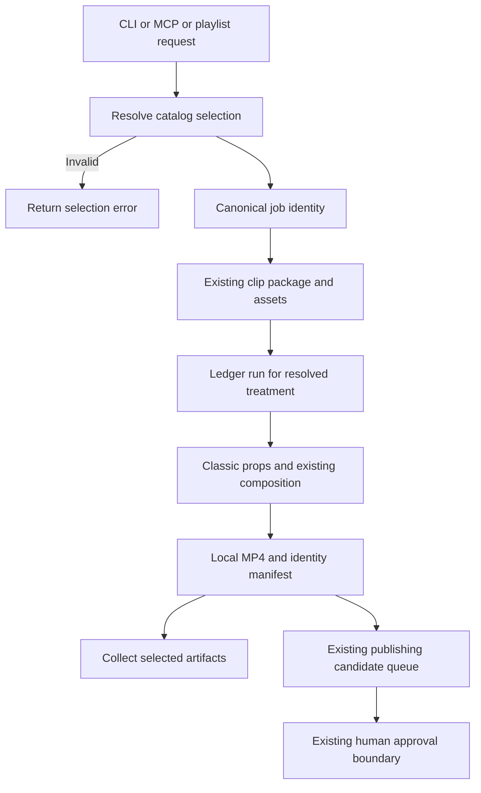
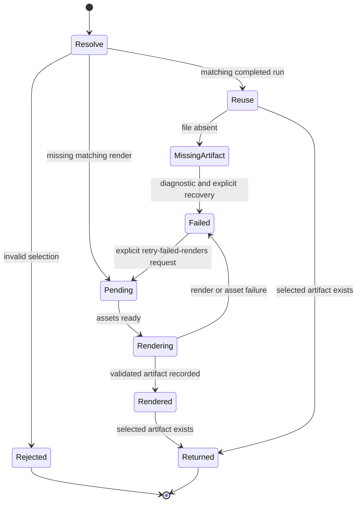

# Classic V1: preserve the current template and select variations

This design proposal dates from 2026-10-04.
The design review used the source code.
The user approved the implementation-plan stage on 2026-10-04.
The implementation now preserves the inspected Classic output.
The reconciliation section records the tests, render evidence and remaining limits.
Inspected base: `main`, `195a8f4418ba5eaf47806506b474f4d31d4fcbe1`.

## Plain-language overview

We will keep the current video design and name it Classic.
Later, the user can choose another design without changing Classic.

| Part | Purpose |
| --- | --- |
| Template catalog | Lists the available designs and their variations. |
| Treatment registry | Connects a choice to its composition, inputs and output settings. |
| Renderer | Starts Remotion and saves the video file. |
| Classic template | Draws the thumbnail, title, waveform and transcript. |

The first catalog contains one choice: **Classic / Default**.
Requests without a choice use Classic / Default.
Existing requests continue to work.

The request follows these steps:

1. The user provides a YouTube URL and an optional template choice.
2. The system checks the choice before downloading or processing content.
3. The pipeline selects clips and prepares audio, thumbnails and captions.
4. The renderer uses the selected template to create each video.
5. The system returns the video files.

Background jobs must remember the choice while each video renders.
This prevents a job from returning a video that uses another template.

We will render the same short sample before and after the code changes.
We will compare every decoded video frame and the audio.
We will also watch the result.

The first implementation succeeds when these conditions hold:

- The current design looks and sounds the same.
- The user can select Classic / Default explicitly.
- Requests without a selection still produce Classic.
- The system remembers the choice and returns the correct video.

Editorial remains outside this implementation.

## Intent and scope

Name the existing visual design **Classic**, version **1**, with a **Default** variation.
Preserve thumbnail, title, oscilloscope waveform, transcript layout, caption timing, fonts, colors and motion.
Existing requests must continue to work.
Future designs such as Editorial become separate templates.
A variation is a named preset within a template.
The resolver checks each preset.
Arbitrary render flags do not define variations.
The user excluded kinetic typography and audio-reactive artwork from future work.

The first implementation exposes only Classic / Default.
Do not manufacture a second visual preset to demonstrate the selector.
Use these terms consistently:

- **Template:** a family of visual compositions.
- **Variation:** a named preset within a template.
- **Format:** the output geometry.
- **Version:** an immutable rendering contract.
- **Treatment:** a registry entry that maps assets and props to a composition and output settings.
- **Canonical selection:** the complete, checked selection after the resolver applies defaults.
- **Artifact:** a rendered output file.
- **Manifest:** a file that records an artifact's inputs and identity.
- **Parity:** identical decoded frames and audio under the same rendering conditions.

## Inspected baseline and format decision

- `src/Root.tsx` registers `AudiogramBasic`, 1080x1920, with 30 fps supplied by metadata calculation.
  Defaults live here.
  Layout lives in `src/Audiogram`.
- `scripts/treatment-registry.mjs` already registers `audiogram-basic@1` with audio, captions and thumbnail requirements, a props builder and H.264 output.
- The ledger deduplicates by clip package, treatment ID and treatment version.
  The runner also separates output paths by treatment ID and version.
- Both pipeline entry points choose this treatment explicitly.
  Single-URL result collection hardcodes it.
  Pending-run processing currently filters by video, but not by the requested treatment set.
- The helper plugin deduplicates active jobs by video today.
  Its worker contract is URL-only.
  A future selection must pass through job identity and worker args.
  The helper does not reuse completed jobs.
  The pipeline ledger controls reuse of completed renders.
- `/Users/kiwi/Downloads/preview.mp4` is a 1080x1080, 30 fps, approximately 20.117-second visual reference.
  SHA-256: `7aac672f34f58990cd62b45a870bc4d0e5665966f80119f6679026d624c0c1ba`.
  The review included a frame at 3 seconds.
  The review did not reconstruct the source inputs or their origin.
  Thus, this video is not yet a reproducible regression fixture.

Preserve current portrait behavior by default.
Pending user decision: also support a square format matching the supplied reference, or defer square.
Never change the dimensions of the existing treatment in place.
If the implementation includes square, that format needs its own resolved render identity and checked baseline.

## Architecture and alternatives

Recommended: extend the existing treatment registry with a small shared template catalog and resolver.
Avoid a second independent rendering engine.
The catalog contains serializable IDs, labels, allowed variations and exact treatment mappings.
The Node registry converts assets to props.
The Remotion composition renders the video.
Keep Node/database imports out of the browser bundle.

Check catalog-to-registry mappings in tests.

Alternative: a single giant composition switching layouts by string.
It is initially simple but entangles future designs with Classic's behavior.
Alternative: a dynamic plugin framework.
It adds discovery and compatibility machinery without a present requirement.
This design recommends neither alternative.

Selection contract:

```json
{"templateId":"classic","templateVersion":"1","variationId":"default"}
```

This resolves to the EXISTING `audiogram-basic@1` and `AudiogramBasic`.
Omitted selection resolves identically.
The name Classic is a public label.
Do not rename historical ledger records, output directories or composition IDs.
Unknown IDs, versions or unsupported combinations are errors, never silent fallbacks.
Treat empty strings as invalid, distinct from omitted fields.

Each future preset/format combination maps to a distinct versioned treatment identity.
This reuses ledger uniqueness and output isolation without a schema migration.
Store canonical selection in job metadata and an artifact manifest alongside resolved props and treatment identity.
The manifest is additive.
Legacy artifact paths and consumers remain valid.
Freeform styling overrides are outside this first slice.

Admitting them later requires configuration-aware cache identity.
Existing direct Studio prop editing remains available but is not evidence of matching the locked Default preset.

Keep `src/Audiogram` as Classic's implementation initially.
Extract its current default visual values into a dedicated Classic defaults module without changing them.
Studio and the treatment props builder use the same values.
This prevents accidental changes to pipeline output from mutable visual defaults.
Do not generalize caption/layout components for hypothetical templates yet.

## Selection surfaces and propagation

1.
   Single-URL CLI: optional `--template classic --template-version 1 --variation default`.
   Preserve URL-only behavior and JSON stdout.
2.
   Playlist pipeline: equivalent explicit environment configuration, using the same resolver and defaults.
   Keep visual selection separate from the clip ranking/selection recipe so changing visuals does not reselect source clips.
3.
   Remotion Studio: catalog-backed composition labels/selection.
   Retain `AudiogramBasic` for compatibility.
   Do not register a duplicate just to rename it.
   With one preset the current composition is the selectable entry.
4.
   Helper MCP: optional matching fields forwarded through the local runner, persistent job store, worker and CLI.
   Job deduplication uses the canonical render identity.
   Omitted and explicit defaults match.
   The resolver treats existing URL-only jobs as Classic Default.
   A different template cannot reuse an active job for a different selection.

   Preserve one active job per video.
   A different selection returns a clear conflict while that video is busy.
   This prevents races when jobs acquire shared assets.
   Include store migration/backward-read tests.

Resolve selection before metadata requests, asset acquisition or job writes.
Pass the resolved treatment set into run creation, pending-run execution and artifact collection.
Scope execution to selected treatments as well as video.
Do not execute another preset's pending jobs merely because the video matches.
Add canonical identity to diagnostics without exposing private data.

## Mermaid flowchart



## Lifecycle/state diagram



## Human approval and external-side-effect boundaries

Review this DESIGN before product implementation.
Naming/selecting a template does not authorize publication.
Existing acquisition may contact YouTube and configured analysis services.
Reject invalid selections before those calls.
Rendering writes local artifacts and existing flows may enqueue a publishing candidate.
Queuing is not publishing.

Preserve artifact-hash approvals.
Another variation's artifact never inherits approval merely because its source matches.
Development used local renders and temporary test databases.
The implementation did not migrate the user's live job database or publish media.

## Failure and retry paths

Invalid selection fails early with allowed choices.
Missing required assets retain actionable diagnostics.
Retry extension design (2026-10-05): expose `--retry-failed-renders` on the single-URL CLI.
Without this option, failed renders remain failed.
With this option, reset only failed runs for the selected video and treatment
whose clip assets are ready. Keep the same run identity and locked template settings.
Record the previous error and retry time in a separate durable audit table.
Reset the run and write the audit entry in one transaction.
Completed runs and other videos or treatments remain unchanged.
A second render failure remains failed until another explicit request.
This option does not retry asset acquisition failures, missing completed files,
or publication. It does not add automatic retries or a helper/playlist retry option.
Existing partial-file protection remains in place.
Do not run overlapping CLI requests for the same video; the existing processor
has no cross-process render claim. This extension does not introduce one.
The pipeline must not report missing historical files as successful reusable outputs.

Queue failure and render success remain separate outcomes.

## Invariants

- Omission and explicit Classic Default have the same treatment, props and output.
- Existing composition ID, treatment ID/version and historical paths remain valid.
- Classic's default appearance remains fixed.
  Other templates cannot mutate its defaults.
- Different visual presets/formats have different durable render identities.
- Selection reaches job deduplication, pending execution and result collection.
- Visual treatments can reuse clip selection and source assets.
- The first slice introduces no new visual style or publishing capability.

## Verification and acceptance

Before refactoring, capture a reproducible short local fixture from the inspected base.
Include these inputs and settings:

- Audio, thumbnail and captions.
- Exact props and the dependency lock.
- Font bytes and renderer/browser versions.
- Dimensions and frame rate.

Keep a manifest of asset hashes.
Use existing authorized local assets.
Use a visibly labeled synthetic fixture for caption boundaries and long titles when needed.
The supplied MP4 is a human visual reference, not proof of source-level equivalence.

Render baseline and candidate in the same controlled environment.
Compare decoded pixels for every frame of the short fixture, rather than MP4 file hashes.
Require exact pixel equality for this selection-only refactor.
Investigate environmental nondeterminism rather than silently relaxing the threshold.
Check frame count, dimensions, fps and decoded audio parity.
Inspect a contact sheet with the start, active waveform, caption changes and final frame.

Watch the short video for continuous motion and audio.

Focused automated checks:

- Resolver defaults, explicit values, invalid IDs/versions and foreign variations.
- Legacy and explicit Classic produce identical complete visual props.
- Inject a second test-only treatment: no cache collision, wrong pending render, artifact overwrite, or result leakage.
  The test does not require a second production style.
- The CLI, playlist configuration and MCP worker preserve the selection through each stage.
  Old calls still work.
  Plugin job recovery handles legacy and new job records.
- Existing registry, runner, ledger, clip processing, URL pipeline and plugin tests.
- `npm run lint`, relevant Node test suites, then feature-note reconciliation and `npm run verify:feature-docs` after actual implementation and parity verification.

Each future template requires these items:

- Its own composition and schema.
- A catalog entry and asset contract.
- A distinct treatment identity.
- A local preview and regression fixture.

Changes to Classic's appearance require a new preset or version.
Bug fixes may retain the identity only when the frozen reference behavior remains compatible.
Intentional pixel changes require explicit review and recorded baseline changes.

## Implementation reconciliation and deviations

Retry extension reconciliation (2026-10-05): the single-URL CLI now forwards an
explicit boolean retry request to the processor. The processor resets only
failed runs for the selected video and treatment with ready clip assets.
The ledger saves the previous error and reset time in `treatment_run_retries`
and resets the same run in a single transaction. This additive table is created
when an existing ledger opens; existing table contracts and schema version remain unchanged.
No live user database was opened during verification.

The focused suite passed 47 tests. It covers a failed first attempt, no implicit
retry, another failed retry, successful recovery, unchanged completed clips,
selection isolation, persisted audit history, existing-database compatibility,
and rollback of both audit and reset on failure. Artifact-list assertions now
compare sets because the fixture writes files asynchronously and its completion
order is not the output ordering contract.
The earlier retry arrow was unsupported. It now describes the explicit CLI option.
Helper and playlist retry surfaces remain deferred. Existing concurrent-render
limitations remain unchanged.

The existing selection implementation follows the documented selection flow.
The catalog resolves Classic / Default to `audiogram-basic@1` and `AudiogramBasic`.
Studio and the props builder use the same Classic defaults.
The CLI, playlist pipeline and helper worker preserve the canonical selection.
The pipeline scopes pending runs, failures and returned files to that treatment.

The helper store adds the render identity and selection in a transaction.
Existing records receive Classic / Default without changing their IDs, statuses or results.
Matching active requests reuse a job.
Another template for the same active video returns a conflict.
The existing index still permits only one active job per video.

Each new render records a manifest before the runner reports success.
A manifest failure prevents the completion callback.
Historical MP4s remain valid without manifests.
A missing selected MP4 now fails the request, even when other selected files exist.
The failure response includes paths for the remaining valid files.

The implementation includes these documented adjustments:

- The catalog exports the JSON defaults through a typed module. No TypeScript JSON configuration change was necessary.
- The existing generic renderer still accepts treatments outside the catalog. Those manifests contain a null selection.
- User-selected production requests always use a checked catalog selection.
- `BEGIN IMMEDIATE` serializes job lookup and insertion. No post-insert uniqueness retry is necessary for these transactions.
- The missing-file check covers partial batches as well as empty batches.
- The visual review used sampled frames and exact decoded media comparison. It did not include real-time audiovisual playback.

### Verification evidence

The baseline source revision is `9f48744`.
The baseline contains 180 frames at 1080x1920 and 30 fps.
The fixture uses six seconds of synthetic audio and synthetic text.
The committed manifest records input, font, dependency and baseline hashes.
Local videos and font files remain under `out/classic-regression/`.

Both candidate renders matched all baseline frames and decoded audio:

- The composition render used omitted template selection.
- The treatment runner used explicit Classic / Default selection and wrote its manifest.

The real comparison command rejected a deliberately changed video.
The review included frames at the start, during waveform activity, during caption changes and at the end.
The fixture lives in `tests/fixtures/classic-v1/`.
The comparison tool is `scripts/verify-classic-parity.mjs`.

The focused suite passed 73 tests with no failures or skips.
Lint and TypeScript checks passed.
The Remotion bundle build passed.
The full pipeline suite passed 327 of 328 tests with no skips.
The failing test is `authorized OAuth smoke requires dedicated credentials before network` in `scripts/clip-selector-smoke.test.mjs`.
The same test fails on the untouched base revision `195a8f4`.
The failure concerns existing OAuth credential isolation, outside template selection.
Do not describe the full suite as green.

No live YouTube/provider workflow or installed-host MCP session formed part of verification.
Plugin tests exercised the local MCP server, temporary databases and a real CLI subprocess.
Square output remains deferred.
Editorial remains outside this feature.

Changed: template selection, fixed Classic defaults, selected-run isolation, manifests and helper job metadata.
Unchanged: Classic's decoded reference output, internal treatment identity, historical output paths, clip-selection recipe and publication approval rules.


## Input content identity extension

Implemented and reconciled for discussion_r4180848782.
The runner tests passed all 11 cases. The broader focused suite passed 45 tests.
Tests cover hashes for all required roles, same-path replacement, mutation and
deletion during rendering, invalid inputs and unchanged legacy render paths.
Lint and TypeScript passed. A real six-second Classic render produced a version-2
manifest and matched all 180 baseline frames and decoded audio.
The local render is `out/treatments/audiogram-basic/1/synthetic-classic/input-hash-v2/clip-1.mp4`.
No private source inputs or live job databases formed part of verification.
New render manifests use version 2 and include an inputAssets list.
Each required input has its role, project-relative path, byte count and SHA-256 hash.
Hash all required inputs before starting the renderer. Hash the same inputs again
after the renderer exits and before writing the manifest or accepting the MP4.
Reject missing, unreadable, non-file, ambiguous or out-of-project inputs.
Reject the render when an input hash or size differs between checks.
No completion callback runs for rejected renders.
Preserve older manifests and historical output reuse without rewriting them.
This check identifies the inputs; it does not archive them or reconstruct deleted files.
Before/after checks cannot detect a temporary change restored before the final check.
Immutable render-input snapshots remain outside this bounded change.
The helper-job diagram comment is outside this change.


## Large caption metadata compatibility

Design (2026-10-06): transcript acquisition stopped before clip selection for
_U-O5lYhJ7Q because yt-dlp metadata exceeded its 10 MiB stdout limit.
A read-only metadata lookup returned 10,590,936 bytes. The existing initial
metadata lookup accepts 64 MiB. Align transcript command output with that
bounded limit. Keep the canonical transcript limit unchanged at 524,288 bytes.
Flow: public metadata lookup → bounded command output → caption selection → transcript.
Oversized command output still fails. Do not change credentials, provider,
render retry policy or the user's database.
Reconciled: command output is bounded at 64 MiB and transcript text retains its
524,288-byte limit. A real subprocess regression emitted 11 MiB of JSON.
All 25 transcript, analysis and single-URL tests passed; lint and TypeScript passed.
The live check fetched public metadata only. No AI selection or rendering was rerun.
Failed analysis jobs remain terminal under the existing behavior. For this manual
test, a new AUDIOGRAM_PACKAGE_VERSION starts a separate attempt and preserves
the failed job history; retry-failed-renders does not reset analysis failures.
