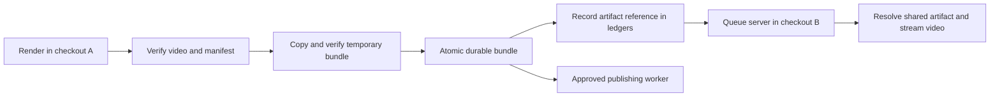
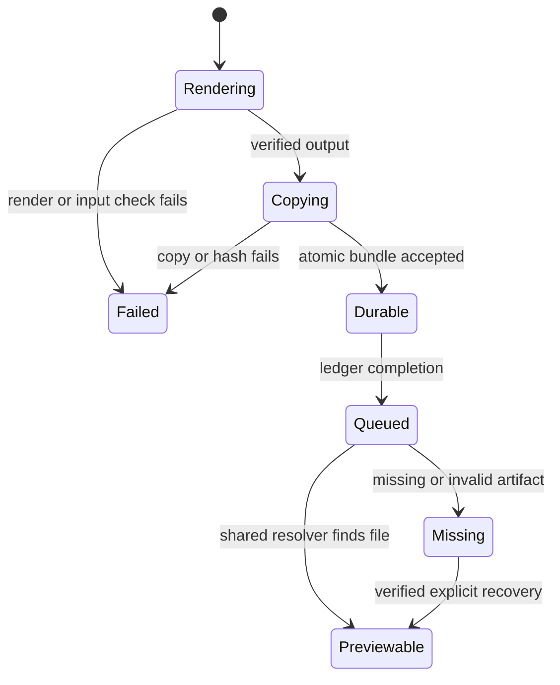

# Durable local artifact storage

The user approved a shared artifact directory independent of source checkouts.
A successful render must remain playable after its producing checkout is removed.

## Storage contract

AUDIOGRAM_DATA_ROOT defaults to ~/Library/Application Support/Audiogram Inbox.
Processing and publishing database defaults and accepted artifacts use this root.
Explicit database overrides remain supported. PUBLISHING_DB is a legacy alias
for INSTAGRAM_PUBLISHING_DB_PATH; conflicting values fail rather than choose silently.
AUDIOGRAM_ARTIFACT_ROOT may select another absolute durable artifact directory.
The artifact directory must be outside the rendering checkout.

New artifacts have an `artifacts/<video-sha256>/<manifest-sha256>/video.mp4`
reference. Resolve these references against the shared artifact directory.
Legacy out/... references resolve against a caller-supplied checkout only.
Accepted artifacts include video and manifest in an immutable content-addressed
bundle. Copy to a temporary directory, verify hashes, then atomically rename.
An existing bundle must match; never overwrite different bytes.
Render intermediates and generated input assets remain checkout-local.
The manifest identifies original inputs but does not preserve those inputs.

## Mermaid flowchart

## Lifecycle/state diagram

## Human approval and external-side-effect boundaries
Rendering and copying write local files. Queueing remains separate from publishing.
No provider calls or publication form part of storage tests or migration.
Migration is explicit and uses specified source checkouts and database paths.
Preserve item IDs, captions, state, approval hashes and schedules.
No source file deletion forms part of migration.
Do not alter unrelated working tree files or run databases implicitly.

## Failure and retry paths
Failed durable promotion must not report a completed render or enqueue it.
Orphan accepted bundles are safe to reuse after a failed ledger write.
Migration checks saved publishing hashes before copying and changing paths.
Missing or changed sources remain unresolved and are reported.
Migration operations are idempotent; separate database transactions may complete
independently, so rerunning reconciles any interrupted path updates.
The UI displays a missing-preview message and the API returns a stable error.
Reject traversal and symlink escapes. Retain publishing's open-file hash checks.

## Invariants
- All production consumers use one shared configuration and artifact resolver.
- A durable reference never resolves relative to a source checkout.
- Every accepted bundle contains verified video and manifest bytes.
- Historical records change location only after content verification.
- Existing legacy records remain readable from their original checkout until migrated.
- Removing a producing checkout cannot remove its accepted durable artifacts.

## Implementation reconciliation and deviations
Implemented and reconciled against the shared configuration, bundle store,
renderer, both pipelines, helper validator, preview server and publishing worker.
The acceptance test renders in A, records the queue item in shared storage,
deletes A, validates the result from B, retrieves identical bytes over HTTP,
and exercises a publishing worker with a fake provider. No live publication occurs.
Tests cover copy failure, immutable bundle reuse/collision, containment,
missing previews, legacy import, unchanged approval metadata and an interrupted
publishing/processing database migration recovered after source removal.

Verification: 381 pipeline tests and 46 helper/UI tests pass without skips.
Lint and TypeScript pass. A real six-second Classic render into the durable store
matches all 180 decoded baseline frames and audio. The preserved baseline hash
was checked before comparison. An initial comparison invocation omitted its
required manifest argument; the follow-up used the exported decoded-media
comparison with an explicit baseline hash check. No claim is made that all
fixture/font dependency provenance checks were repeated.

The read-only live migration preview verified the three trial videos in both
ledgers and reported five unresolved older references. No live ledger updates
or source deletions were applied. Deploy this version to every reader before
applying migration because older servers cannot resolve artifacts/... references.

Documented limits: original input files and rendering workspaces remain local to
the checkout. Historical helper result JSON is not rewritten by migration; only
new helper results use durable references. Migration preserves queue IDs and
approvals and does not consolidate conflicting queue records. Per-job diagnostic
and helper database defaults retain their existing checkout-local configuration.
This feature unifies accepted artifact storage and processing/publishing path
configuration; it does not move credentials, helper diagnostics or source inputs.

Changed: storage configuration, artifact acceptance, references and consumers.
Unchanged: Classic pixels, clip selection and publication approval requirements.
