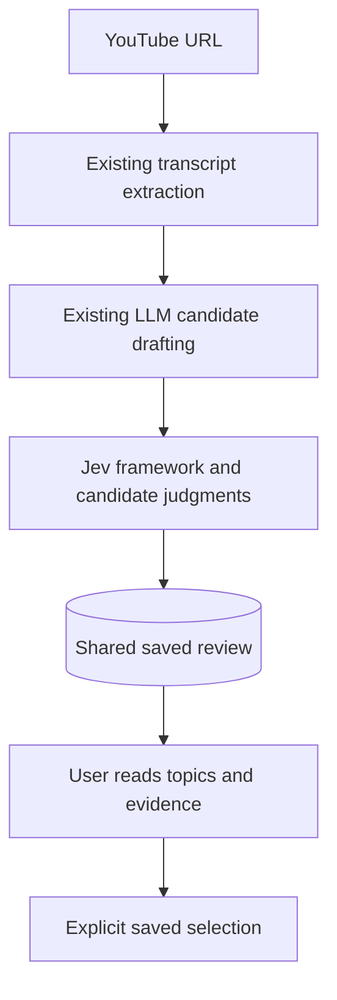
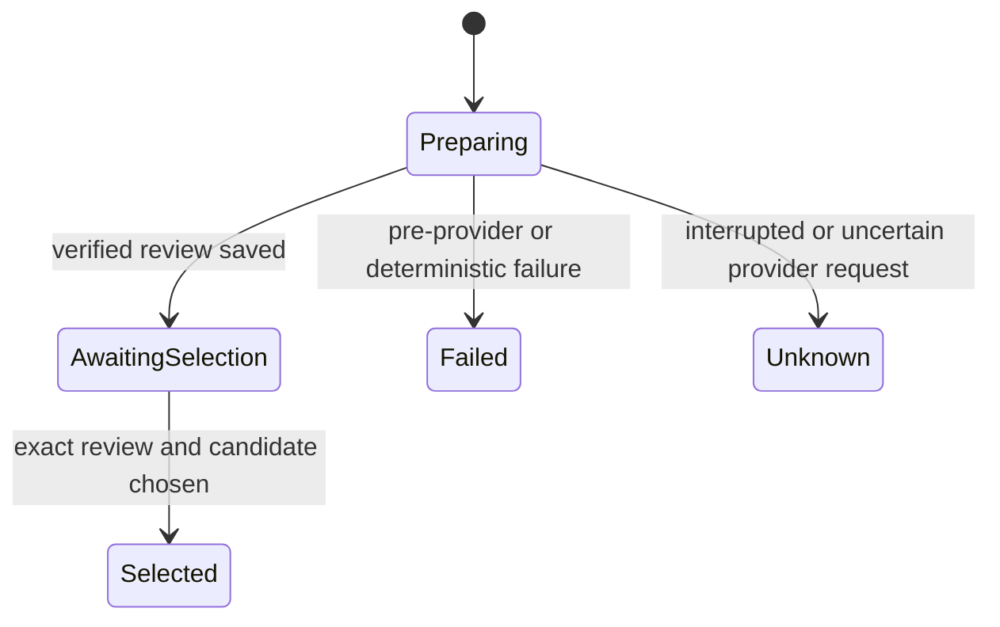

# Candidate review before video production

The user approved implementation and a real-video trial. Extend existing transcript extraction, structured selection, Jev judgment, and one-run processing. Preserve raw evidence and judgments before any rendering.

## Mermaid flowchart

## Lifecycle/state diagram

## Human approval and external-side-effect boundaries

Preparation calls the explicitly configured LLM and Jev. The approved trial uses the previously supplied YouTube source. Selection records the user's choice. No render, research, narration, or publication occurs.

## Failure and retry paths

Save progress before each paid request. Failed and uncertain attempts require a new explicitly requested preparation. Do not replay requests on startup. Completed reviews can be read without providers. Selection rejects stale fingerprints and unsupported candidates.

## Invariants

- No automatic topic selection.
- Original evidence, question definitions, raw answers, normalized judgments, and provenance remain available.
- Save reviews outside the checkout.
- Existing Classic creation behavior is preserved.
- The initial reuse slice retains the existing LLM clip constraints. Topic-specific drafting is a future extension, not claimed complete here.

## Changed/unchanged summary

Add preparation, reading, and selecting a review. Reuse current extraction/provider and Jev transport. Stop before video production.

## Implementation reconciliation and deviations

Implemented preparation, retrieval, and selection through the existing MCP server and a one-run command. Reused the existing LLM recipe, transcript utilities, Jev ranking, and transport. A separate review table is needed because current helper results represent rendered clip jobs, not evidence review and topic selection.

The bounded implementation does not claim the broader draft plan complete. It retains existing clip duration/count constraints. The framework questions are additional per-candidate Scores, not a replacement for the existing ranking weights. Research and topic-specific drafting remain future work.

Verified 400 pipeline tests before the final recovery addition, then 7 focused review tests and 29 affected MCP/Jev regression tests. Lint, type checks, and feature-document validation passed. A real trial extracted the transcript, drafted three candidates with chatgpt-oauth, and saved 42 Jev answers. An actual MCP client retrieved the saved review. The trial remains awaiting the user's choice.

The trial exposed missing-window evidence filtering and Noul responses without confidence fields. Both behaviors now have explicit handling. Incomplete/uncertain provider outcomes require inspection and a new explicitly requested preparation. No automatic retry, narration, render, or publishing occurred.
