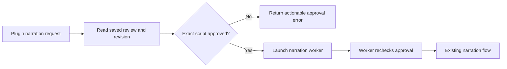
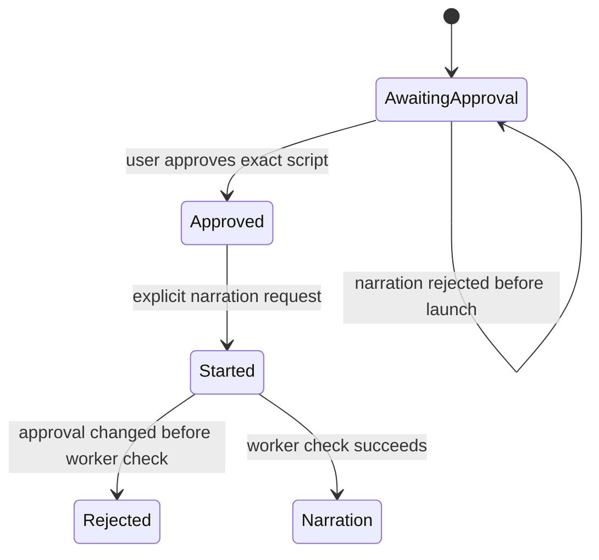

# Check narration approval before starting

## Mermaid flowchart

## Lifecycle/state diagram

## Human approval and external-side-effect boundaries

The user must approve the exact script before a narration request can start. The worker rechecks the saved approval before any paid request. A preflight rejection starts no worker and makes no paid call. This change does not grant approvals or publish media.

## Failure and retry paths

Missing or stale approval returns a fixed actionable error. A stale revision or pending operation still fails closed. Changes after the preflight are checked again by the worker; status started means a worker was launched, not that a provider succeeded.

## Invariants

Do not log or expose raw internal errors. Keep the existing compare-and-swap and worker approval checks. Rejection must not change the review or create a worker request. Existing valid narration requests retain their behavior.

## Changed/unchanged summary

Add a narration approval check to the launcher and expose only its fixed safe message through MCP. Leave all other stage gates and error handling unchanged.

## Implementation reconciliation and deviations

The launcher reads the saved review and rejects narration when the current script hash is missing or does not match its approval. It returns a fixed message through MCP before creating an operation request or launching a worker. Other errors remain generic. The worker still checks approval before narration, so a later concurrent edit cannot authorize a paid request. Focused tests cover missing and stale approval, no launch or request file, a valid launched request, and the actual MCP error. Twelve focused tests and lint passed. The running service was not changed and requires a code refresh for this behavior.
