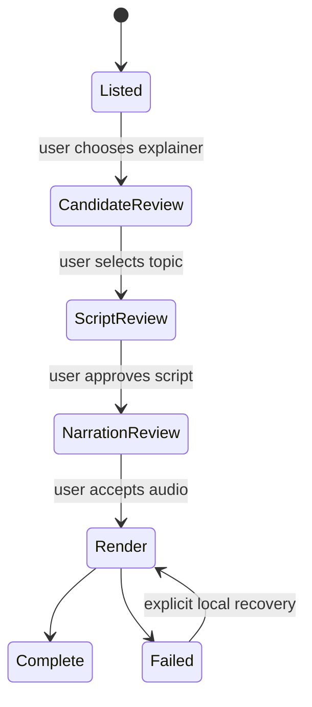

# Select Animated Explainer in the plugin

## Mermaid flowchart

```mermaid
flowchart LR
 A[User asks for templates] --> B[MCP template listing]
 B --> C[User selects Animated Explainer]
 C --> D[Existing candidate review]
 D --> E[User selects topic]
 E --> F[Research and script review]
 F --> G[User approves script and narration]
 G --> H[Scene plan and local render]
 H --> I[Local artifact and explicit delivery limitation]
```

## Lifecycle/state diagram

## Human approval and external-side-effect boundaries

Selection is explicit. Candidate preparation may call external LLM and Jev. Research is supplied by the caller. Exact script approval precedes paid ElevenLabs narration and exact audio acceptance precedes planning and rendering. No publishing, hosting, background service setup or automatic paid retry.

## Failure and retry paths

Existing candidate and explainer state handling remains authoritative. Failed or interrupted paid work remains unconfirmed; local render recovery is explicit. Missing local artwork, credentials, or inability to deliver the local file must be reported instead of claiming a playable result.

## Invariants

Classic remains a valid create_audiogram selection. The explainer is a distinct workflow and must not be routed into the Classic renderer. Listing alone has no side effects. Selection, script approval and audio acceptance are not inferred. Remote media is not published.

## Changed/unchanged summary

Expose the existing explainer as a discoverable design with explicit tool routing. Reuse candidate review and explainer stages; keep Classic and their state transitions unchanged.

## Implementation reconciliation and deviations

The default MCP listing includes Classic and Animated Explainer and identifies
the separate candidate-review flow. Classic's CLI template catalog still rejects
the explainer identity, preventing accidental routing to create_audiogram.
The UI displays the review requirement and does not claim a hosted preview.
MCP client discovery, listing and existing approval forwarding, catalog routing,
UI, server and HTTP tests pass; lint and TypeScript pass. The running connected
plugin was observed to expose only the older four tools. Reloading the local
service and refreshing the plugin connection remain necessary before a live
plugin trial. Rhubarb 1.14.0 is installed locally and was tested on ten seconds
of saved audio; a separate local environment file identifies it and the existing
presenter artwork. A temporary MCP server returned both designs and a saved
trial's accessible audio and video paths; the audio hash matched. The tool
instructs the caller to ask the user to listen locally before accepting audio.
These checks do not establish a new live paid narration or hosted media. Output
paths remain local and cannot be played in ChatGPT on a different machine.
