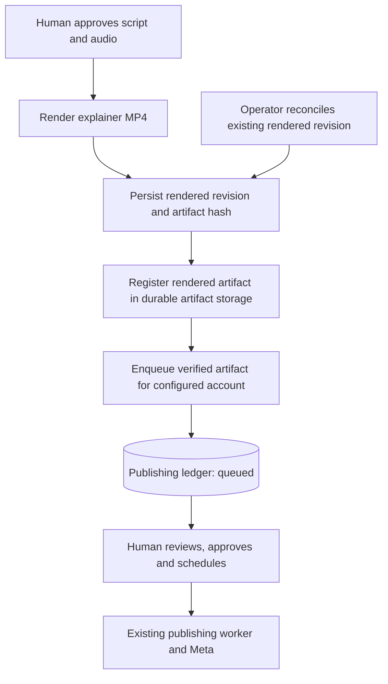
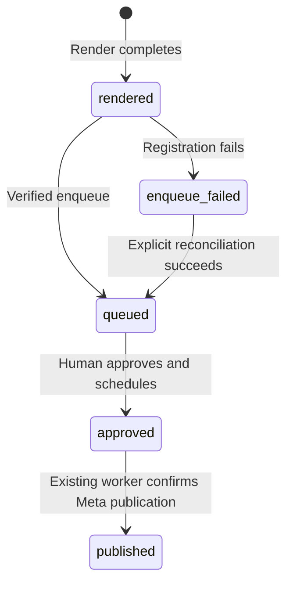

# Explainer publishing queue

## Changed and unchanged

Successful explainer renders should appear in the existing local approval queue.
Existing render revisions, human publishing approval, worker checks, and Meta
publication remain separate. Existing completed renders need an explicit,
idempotent local reconciliation path; rendering again must not be required.

## Mermaid flowchart

## Lifecycle/state diagram

## Human approval and external-side-effect boundaries

Queue insertion does not approve, schedule, upload, or publish a video. The
existing dashboard approval and publishing worker remain authoritative. Real
ledger mutation and Meta publication are not part of automated verification.

## Failure and retry paths

Rendering success must survive ledger failure; surface registration failure in
the render result and permit explicit reconciliation without re-rendering. A
crash before returning the result leaves no durable failure marker, so inspect
the saved render and explicitly reconcile it. Dedupe by the
existing durable artifact identity and hash. Handle a crash between rendering,
artifact registration and queue insertion without duplicate queue entries.
Do not overwrite an existing approval or silently change its caption or account.

## Invariants

Only a complete, current, verified render can be queued. Fingerprint the actual
MP4 and bind it to the exact explainer revision. Use the durable artifact store
so the existing preview and publisher can resolve it independently of a
worktree. Keep the explainer review and provenance in the candidate review store. Do not broaden artifact
path access or silently substitute credentials, accounts, or approvals.

## Implementation reconciliation and deviations

Reviewed against existing artifact and ledger behavior: render completion calls
the existing content-addressed artifact store and queue helper after the render
revision is persisted. `queue_render` reconciles the current revision without
re-rendering. The existing account resolver supplies the account; caption starts
empty. Queue failures are returned without invalidating a successful render.
Separate stores cannot share a transaction, so an interrupted registration
requires explicit reconciliation. Queue registration does not approve or publish.

Focused tests cover repeated registration, unchanged approval, stale revisions,
changed bytes and account mismatch. The review retains source provenance; the
publishing ledger records the artifact hash and explainer treatment, but does
not currently link directly back to the review ID.
