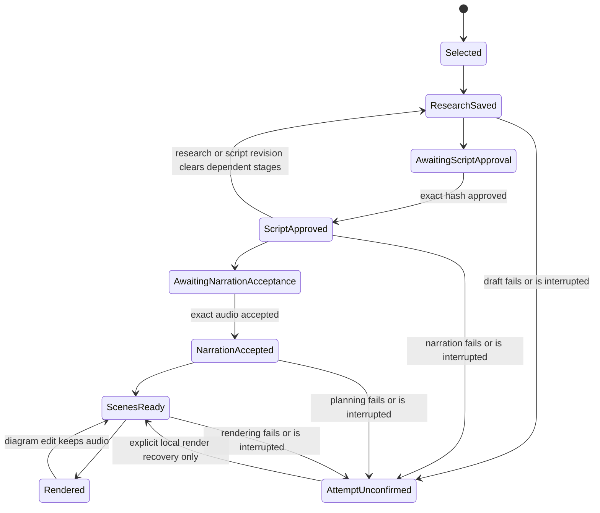

# Research, script review and reusable explanation scenes

The user authorized improved diagrams, reusable scene blocks and connection to the existing candidate pipeline. Reuse candidate review, configured LLM transport, ElevenLabs and Rhubarb. Extend the selected review record in the same database. Do not introduce a replacement source extractor, candidate judge or worker service.

## Mermaid flowchart

```mermaid
flowchart LR
 A[Existing candidate review and explicit selection] --> B[Saved research sources from the calling assistant]
 B --> C[Draft or import script with source references]
 C --> D[Human approval of exact script hash]
 D --> E[Generate or import saved narration]
 E --> F[Human acceptance of exact audio hash]
 F --> G[Checked comparison process and branch scene plan]
 G --> H[Remotion renderer and fixed presenter]
 H --> I[Durable local MP4 and manifest]
```

## Lifecycle/state diagram

## Human approval and external-side-effect boundaries

The calling assistant researches the topic with its web tools and submits source passages and URLs. This worker does not claim to perform autonomous web search. The configured LLM drafts the script and scene plan from this evidence. Exact script and narration approval gates precede downstream work. Reuse saved audio for the accepted trial; no new paid narration is necessary. Remote generation starts only on an explicit operation. No publishing. Existing static prototypes remain untouched.

## Failure and retry paths

Use atomic compare-and-swap updates on the existing candidate record. Save a unique attempt before paid work; uncertain attempts cannot auto-retry. Local render failures retain accepted script/audio. Persist immutable hashed JSON and audio under the shared data root. Missing source references fail validation. Missing local artwork fails the local render attempt. Missing narration tools fail before a paid request. Retain prior script revisions on edits.

## Invariants

Factual script segments reference saved source IDs; illustrative segments are explicitly labeled. Approval binds exact content hashes. New research or script invalidates dependent approvals and scene plans. Changed diagrams retain accepted script and audio. Blocks have strict versioned schemas and bounded labels/data; no executable model output. Script words must match audio alignment. Production cue data is passed as props, not overwritten in source files. Personal art remains local. Classic behavior remains unchanged.

## Changed/unchanged summary

Add three reusable explanatory blocks and an integrated one-command-per-step workflow, exposed through the existing MCP server. Keep YouTube extraction, candidate scoring, TTS request checkpoint and shared storage conventions.

## Implementation reconciliation and deviations

Implemented in `scripts/explainer/`, `src/Explainer/` and the existing MCP server. The candidate-review commit was reused; candidate drafting and Jev scoring were not rebuilt. The selected candidate stays in `candidate-reviews.sqlite`; `production` records revisions and approvals. Artifacts are saved under `<AUDIOGRAM_DATA_ROOT>/explainers/<reviewId>/`. Scene edits preserve accepted audio; script and research changes clear downstream approvals. Generation provenance is saved for generated scripts and scene plans.

Verification on 2026-11-06: focused contract, approval, tampering, concurrency, recovery and real local MCP-client tests passed; lint and TypeScript passed. An actual selected-candidate trial imported the previously approved script and Liam recording and rendered 963 frames at 720 x 1280, 24 fps. A separate live ChatGPT OAuth scene-planning call returned seven schema-valid scenes. The offline Classic fixture passed. The new paid-narration adapter is not live-verified by this trial; it reuses the existing ElevenLabs helper and Rhubarb.

Intentional limits: the calling assistant supplies researched passages; this worker does not browse. Source-reference checks verify links to saved passages, not whether a passage proves a claim. Human script review remains necessary. New LLM drafts require fresh approval. This trial does not claim a new script was approved automatically. Only interrupted local rendering has a built-in recovery command. Unconfirmed generation or paid narration requires manual inspection; there is no automatic replay or paid recovery command.

MCP long actions launch a process once and return an operation ID. Poll `get` with that ID for the saved outcome, including startup failures. Missing outcome files are unconfirmed, never treated as success. Artifacts are local paths: this slice does not add remote media serving, queue publishing, new `create_audiogram` template IDs, autonomous research, briefs or two-speaker formats. Personal artwork remains ignored and must be supplied locally. Re-rendering needs that artwork, though accepted audio and videos survive checkout removal.
