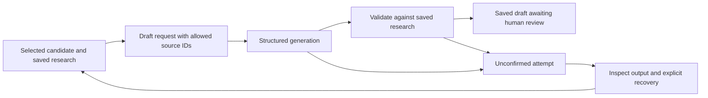

# Source IDs and recovery for explainer drafts

## Mermaid flowchart



## Lifecycle/state diagram

```mermaid
stateDiagram-v2
 [*] --> ResearchSaved
 ResearchSaved --> Drafting: explicit request
 Drafting --> AwaitingReview: validated draft
 Drafting --> Unconfirmed: error or interruption
 Unconfirmed --> ResearchSaved: explicit recovery with revision and token
 ```

## Human approval and external-side-effect boundaries

Only an explicit request starts or restarts model generation. Recovery does not call a provider. The user must review the exact script before narration; no changes to narration or publishing permissions.

## Failure and retry paths

Draft recovery checks the exact saved revision and token, only clears an unconfirmed script attempt, restores the previous state, retains prior evidence and history, and does not replay the provider. Running and other stage attempts remain blocked. Invalid references fail validation; they are never silently mapped to different sources.

## Invariants

Every factual script segment references saved source IDs. Factual support still requires human review. Research and selected candidate are retained. No approval is inferred; no paid request is automatically retried. Keep existing render recovery behavior.

## Changed/unchanged summary

Constrain the structured draft schema to known source IDs and expose a separate explicit draft-recovery action. Existing research, script approval and narration stages remain unchanged.

## Implementation reconciliation and deviations

The draft's structured output schema enumerates the saved source IDs. The existing validator still checks factual references and known IDs after generation; enumerating IDs does not prove source support. `recover_draft` accepts the current revision and pending token and does not start a model request. It restores the prior state and saves the failed attempt in history. It handles only attempts recorded as unconfirmed; a process that disappears while marked started still needs separate investigation. This does not alter render or narration recovery.

Focused tests cover the allowed-ID schema, stale-token rejection, explicit recovery, preserved research, history and approval gates. An actual ChatGPT OAuth request using the affected review's two sources returned a schema-valid draft. The exact failed review was explicitly recovered after its saved worker outcome showed the source-reference error. A subsequent explicit draft request completed and saved a new script at revision 6, awaiting user approval; no narration or publication was performed. The running plugin service was not restarted and needs updated code to expose the new recovery action.
