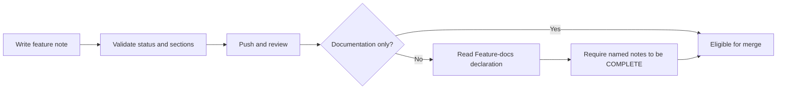
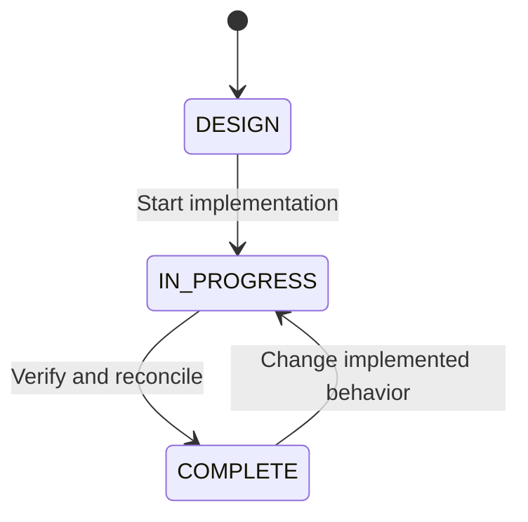

# Save designs before implementation

## Mermaid flowchart

## Lifecycle/state diagram

## Human approval and external-side-effect boundaries
Commit and push do not claim completion or authorize implementation.
Document validation runs locally and in CI for every stage.
PR readiness requires an open, non-draft PR without known merge conflicts.
Documentation-only PRs may merge with DESIGN notes.
PRs with other files must declare `Feature-docs: docs/features/name.md` in the body.
Use a comma-separated list for multiple features.
Each named note must be COMPLETE and reconciled.
For changes with no feature behavior, use `Feature-docs: none` and a nonempty
`Feature-docs-reason:` line. A reviewer must assess that claim.
The check cannot infer whether the declared notes cover all code changes.
Repository branch protection determines whether the readiness check blocks merge.
No script merges a PR or changes branch protection.

## Failure and retry paths
Missing sections, unknown statuses and inconsistent metadata fail validation.
DESIGN permits either design-reviewed boolean; IN_PROGRESS and COMPLETE require true.
Unfinished notes require implementation-reconciled false; COMPLETE requires true.
Missing or invalid PR declarations and unfinished named notes fail readiness.
Unrelated unfinished notes do not fail readiness.
Fix the note or PR body and rerun. PR body edits and draft-state changes rerun CI.
GitHub lookup failures fail the check; changed files are paginated.

## Invariants
- A successful push does not mean the feature is complete.
- No unfinished note claims reconciliation.
- Plans keep one path through their lifecycle.
- The readiness check reads notes from the checked-out PR revision.
- Only Markdown under docs, root README.md and root AGENTS.md count as documentation-only.
- Rename checks consider both old and new paths.

## Implementation reconciliation and deviations
Implemented and reconciled against the verifier, readiness helper, PR entry point,
workflow events and repository guidance. All 26 focused tests pass, including
lifecycle metadata, design-only PRs, declared feature completion, unrelated
unfinished notes, rename handling, maintenance reasons, GitHub CRLF bodies,
file pagination, draft/conflict rejection and failed/incomplete API responses.
Lint and TypeScript passed. Document validation passed while this note was
IN_PROGRESS, demonstrating that a push no longer requires a false completion claim.

The readiness helper has a reviewed maintenance exemption (`none` plus a reason).
It validates declarations; it cannot prove their completeness or the truth of
reconciliation. Reviewers retain those responsibilities. This is intentional.

Read-only GitHub inspection on 2026-10-05 found no required status checks for
main in branch protection or effective branch rules. CI therefore reports
readiness but is not currently an enforced merge block. No repository settings
were changed. Merge-group workflows retain the existing verify check; the
PR-specific readiness check runs on pull_request events.

Changed: validation will accept honest lifecycle stages and readiness will check declared features.
Unchanged: required diagram sections, code tests, reconciliation duty and human merge approval.
