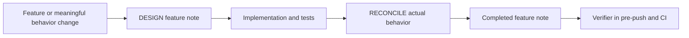
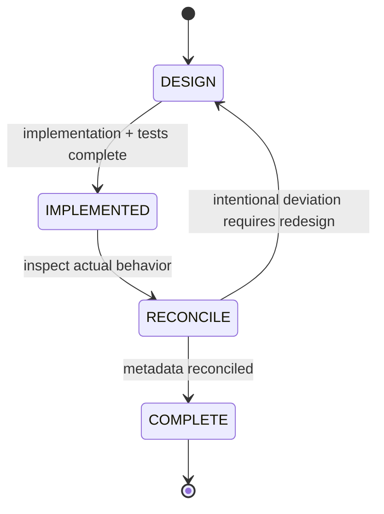

# Feature-flow diagrams lifecycle

## Mermaid flowchart

## Lifecycle/state diagram

## Human approval and external-side-effect boundaries

The repository guidance is the human review boundary: implementation should
not begin until the DESIGN note has been reviewed. The verifier only checks
document metadata and required sections; it does not approve external side
effects or semantically validate Mermaid.

## Failure and retry paths

If reconciliation finds an intentional deviation, update the design note and
repeat implementation review. If metadata is incomplete, the local pre-push
hook and CI fail with the missing field or section.

## Invariants

- Every feature note has machine-readable metadata for feature, status,
  design-reviewed, and implementation-reconciled.
- Completed notes contain both diagrams and the required boundary, failure,
  invariant, and reconciliation sections.
- Verification is deterministic and does not claim to parse Mermaid semantics.

## Implementation reconciliation and deviations

The implementation adds the repository guidance, two-phase skill, metadata
verifier, and local/CI gates. The actual flow matches the DESIGN diagram: the
feature note precedes implementation, reconciliation follows tests, and the
same deterministic verifier runs before push and in CI. No intentional
deviations remain.

Status: COMPLETE
