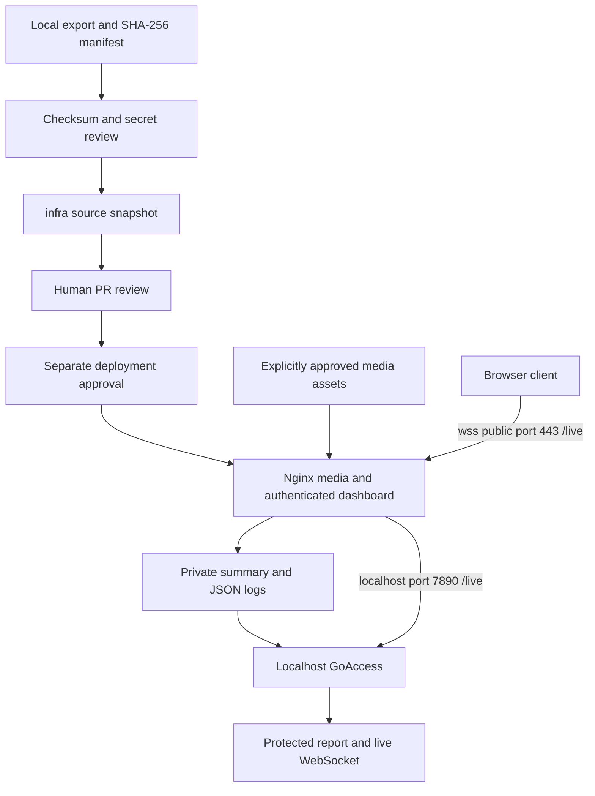
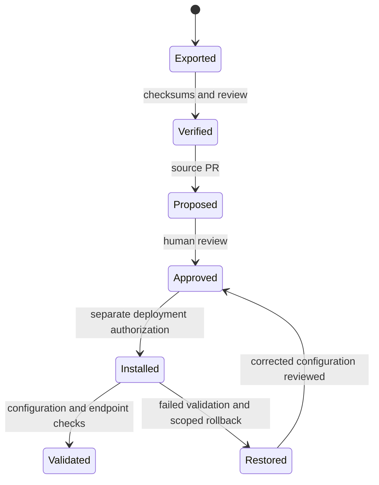

# Hetzner media infrastructure source snapshot

## Scope and design review

Import the checksum-verified 2026-10-25 export into a new `infra/` directory.
Design reviewed against the exported configurations and repository conventions.
This feature versions an existing deployment; it does not provision or update a
server. Application code, media approval and publishing remain unchanged.
The source integration is the completion boundary; historical deployment claims
in the export are supplied evidence, not fresh verification of the VPS.

### Follow-up design: explicit public WebSocket port

Set the service's browser-facing URL to `wss://logs.ferarana.work:443/live`.
The user reproduced GoAccess 1.8.1 falling back to its backend port when the
public port is omitted. The [GoAccess manual](https://goaccess.io/man) recommends
including proxy path and port. Design reviewed: keep `--addr=127.0.0.1`,
`--port=7890`, Nginx and firewall unchanged. Document generated-client URL
verification in addition to proxy checks. Deployment requires separate approval.

## Mermaid flowchart

## Lifecycle/state diagram

## Human approval and external-side-effect boundaries

This task authorizes a branch, push and PR only. No SSH, deployment, service
reload, certificate issuance, firewall changes, publication or merge occurs.
Future operators must separately approve configuration updates and assets.
The dashboard uses HTTPS basic authentication for both report and WebSocket;
GoAccess binds to localhost. Passwords and certificates are runtime inputs.

## Failure and retry paths

Reject mismatched export hashes and stop on destination collisions. Preserve
unrelated files. Future deployments validate Nginx before reload and restore
only affected backed-up files on failure. GoAccess restarts on failure; missing
reports return 503. Rotation reopens logs and restarts GoAccess, resetting its
in-memory statistics. See `infra/DEPLOYMENT.md` for operational procedures.

## Invariants

- Import only reviewed source; no secrets, assets, logs, generated reports or backups.
- Preserve unrelated files; record intentional post-export configuration changes.
- Media locations are explicit; other paths return 404 except ACME challenges.
- Summary and JSON access logs omit queries, cookies and authorization values;
  IP addresses and normalized paths remain, and existing error logs may contain
  request information. These are private operational data, not anonymous logs.
- The renewal hook validates configuration before reload.
- A merge alone does not deploy infrastructure or publish media.

## Implementation reconciliation and deviations

The service now explicitly advertises public port 443. A focused comparison
verified that this URL is the only service-file change, the listener remains
127.0.0.1:7890, and both Nginx files are unchanged. The flowchart and deployment
verification now distinguish the browser destination from the backend listener.
This intentionally changes the original export's service URL; all other service
settings are preserved. Lint, all 65 configured CI test files, feature-document
validation and whitespace checks passed. GoAccess is unavailable locally, so
its generated JavaScript and authenticated live updates were not reproduced
here; the 1.8.1 reproduction was supplied by the user. Production was not changed.
The documented post-deployment browser check remains an operational requirement.

### Original source import validation

At original import, all 13 files matched the verified export manifest byte for
byte. No existing files were overwritten. Manual inspection and a credential-pattern
scan found no secret values; runtime artifact ignore rules were checked.
The renewal hook passes `sh -n`. Repository lint and the pre-push CI test command
(with its configured publishing-server exclusion) pass. Feature-document
validation and diff whitespace checks pass.

The diagrams were reconciled against the source: explicit media routes,
authentication inherited by both dashboard routes, localhost GoAccess, two
private access logs, rotation/restart, and validation before renewal reload.
No configuration deviations were introduced by the original import. Completion
refers to source integration only. Nginx is unavailable locally; no
fresh `nginx -t`, live endpoint checks, certificate renewal, deployment or
renderer end-to-end test was performed. Exported deployment history remains
supplied evidence rather than independently reproduced results.
