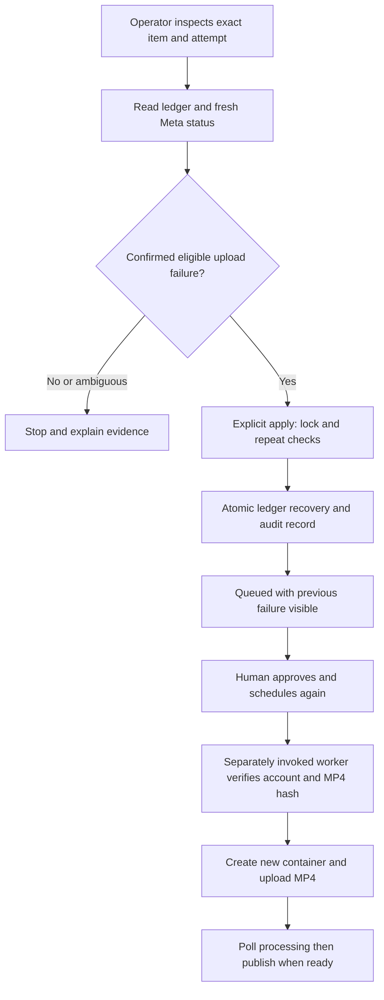

# Controlled Instagram publishing recovery

The user approved this design in chat on 2026-10-13. Implementation is in progress.

## Changed / unchanged

Add explicit recovery for confirmed video-upload failures and durable dashboard
failure history. Investigate uncertain container creation without assuming Meta
supports discovery of a container whose ID was never received. Keep the existing
approval button, separate one-shot worker, account checks, artifact integrity
checks, and conservative publication handling. Do not add a scheduler or a
dashboard recovery action in this slice.

## Mermaid flowchart

## Lifecycle/state diagram

```mermaid
stateDiagram-v2
  queued --> approved: Human approval
  approved --> uploading: Due item claimed
  uploading --> container_created: Container ID received
  uploading --> unknown: Creation outcome uncertain
  container_created --> processing: Upload accepted
  container_created --> failed: Confirmed upload failure
  failed --> queued: Explicit eligible recovery; approval cleared
  processing --> published: Ready then publish confirmed
  processing --> unknown: Publish outcome uncertain
```

The existing item may still be container_created with an upload_requested attempt.
Recovery must also handle this legacy representation when fresh evidence proves
the eligible failure; do not require running the publishing worker to classify it.

## Human approval and external-side-effect boundaries

Inspection reads existing data, validates the artifact, and issues Meta GETs only.
It must not run schema migrations or create an empty database. Apply takes the
existing worker lock, repeats checks, then changes local state only. Preserve
the failed attempt, old container, sanitized evidence, and recovery audit record.
Clear active container fields, approval snapshots, and scheduling atomically.
The item returns to queued, never directly to approved.

Fresh Approve + Schedule authorizes a later worker invocation to create a new
container, upload, wait for processing, and publish. No second approval is
required between processing and publication. No live recovery or publication
is authorized by passing implementation tests.

## Failure and retry paths

### Provider research (2026-10-13)

Context7's official Instagram Platform documentation describes status GETs
using a known container ID and resumable upload offsets using that container.
No documented idempotency key or reliable lookup without the creation-response
ID was found. This is a research limit, not proof that Meta has no such API.
Creation without an ID therefore stays unknown and cannot be recovered here.
Sources: [content publishing](https://developers.facebook.com/documentation/instagram-platform/content-publishing),
[resumable uploads](https://developers.facebook.com/documentation/instagram-platform/content-publishing/resumable-uploads),
[container reference](https://developers.facebook.com/documentation/instagram-platform/instagram-graph-api/reference/ig-container).
The direct official page fetch was unavailable; Context7 retrieved these official
sources. EXPIRED means unpublished after 24 hours; it is not upload-failure proof.
FINISHED means ready and PUBLISHED means published, so neither qualifies even if
contradictory upload details say error. Only upload error with processing not
started and ERROR or IN_PROGRESS qualifies, alongside local pre-publication proof.

- Investigate official Meta documentation for reconciliation or idempotency when
  container creation times out without an ID. Record sources and limitations.
  If no reliable documented mechanism is found, keep creation outcome unknown
  and block automatic replacement. Absence from a listing is not proof of failure.
- Scope initial recovery to confirmed upload-phase failure before publish intent.
  Pending, ready, published, processing-only failure, inaccessible containers,
  missing evidence, and contradictory status do not qualify.
- Require exact item, latest attempt, container, account, approved caption, and
  artifact hash. Recheck state after asynchronous reads and inside the transaction.
- Never blindly retry create, upload, or publish requests. Never recover an attempt
  that requested publication or has a recorded media ID.
- Roll back the complete local transition if audit or diagnostic storage fails.
- Reject duplicate apply operations and stale expected attempt/container values.

## Dashboard history

Show current state separately from previous attempt outcome. A requeued item can
show "Queued — awaiting approval" and "Previous attempt: Video upload failed".
Include attempt time, sanitized failure code, and recovery status. Preserve this
history after reapproval and subsequent attempts. Distinguish upload failure,
creation outcome unknown, still processing, and publication outcome unknown.
Do not infer failure from elapsed time. Never expose tokens, upload URLs, or raw
provider messages. Recovery remains an operator command in this slice.

## Invariants

- An explicit recovery action targets one item and its latest identified attempt.
- Recovery never publishes, uploads, creates containers, or preserves approval.
- Old attempts and diagnostic evidence remain available after recovery.
- Published and ambiguous publication outcomes cannot enter upload recovery.
- No automatic retry loop or manual SQL repair is part of the supported flow.
- A crash cannot commit half a recovery transition.
- Read-only inspection remains usable without initializing write-capable stores.
- Dashboard history is bounded and sanitized; current state is not overwritten.

## Implementation reconciliation and deviations

Pending implementation and reconciliation. The Meta no-ID reconciliation
capability is an investigation requirement, not an established provider feature.
Reconcile actual behavior and run npm run verify:feature-docs before COMPLETE.
