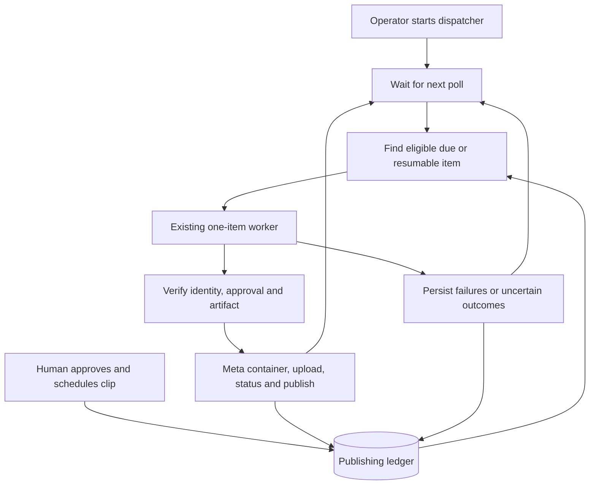
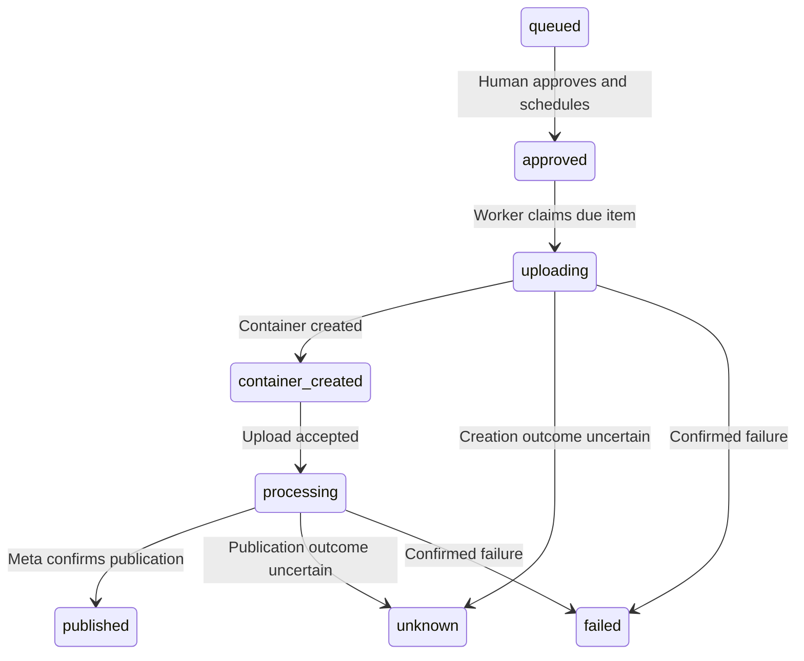

# Instagram publishing dispatcher

## Changed and unchanged

Add a separately started, opt-in process that regularly finds due approved
items for the configured account and calls the existing one-item worker. Keep
the dashboard responsive and preserve its existing approval behavior. Do not
install or start a service automatically. A running dispatcher means an approved
and due item may be published without another manual command.

## Mermaid flowchart

## Lifecycle/state diagram

## Human approval and external-side-effect boundaries

Explicit startup enables automation; a single-item approval authorizes the
existing worker to publish that item after its scheduled time. The dispatcher
must never approve items or modify captions. Account, snapshot, due-time,
artifact hash, lock, and Meta identity checks remain in the existing worker.
Do not run a live dispatcher as verification. Fixtures and fake Meta clients
exercise scheduling and worker invocation without real posts.

## Failure and retry paths

The dispatcher uses the existing worker lock, processes one item at a time,
and never overlaps invocations. Known pre-publication in-flight attempts may
be resumed using the worker's existing checkpoint logic. Ambiguous creation or
publication follows the worker's unknown state, never a blind retry. Pending
Meta processing is polled at a bounded interval; failed and unknown items are
not automatically retried. Provider failures must not cause a busy loop or
starve other eligible items. On restart, inspect durable state, not memory.
Stop cleanly on shutdown, and surface sanitized errors without credentials.

## Invariants

- No queued, rejected, failed, unknown, or already published item is selected.
- Only the configured account's approved, due items or safely resumable active
  attempts are considered; eligibility is rechecked by the worker.
- Explicit approval and matching caption and artifact snapshots remain required.
- A stale worker lock is never automatically stolen.
- No ambiguous external write is replayed; no history is discarded.
- Dispatcher startup and polling never implicitly grant approval.
- Keep waiting bounded and prevent repeated pending items from starving others.

## Implementation reconciliation and deviations

The dispatcher polls immediately and waits 60 seconds after each pass. Each
eligible item is invoked at most once per pass, in queue order; pending items
do not prevent later items in that pass from running. SIGINT and SIGTERM stop
after the current worker returns; a worker may take several minutes to finish
its own status polling. The existing worker takes its database lock separately
for each item. Start explicitly with `npm run publishing:dispatch -- --live`
after providing the existing Instagram credentials and storage configuration.
The process is not installed, started, or restarted automatically. A long queue
or slow provider can delay later items; no exact execution-time guarantee is made.
Errors are sanitized and a failed pass is retried only after the interval.
Fixture tests exercise due-time/account filtering, shutdown, and an approved
item through the real worker with a fake provider, including duplicate prevention.
