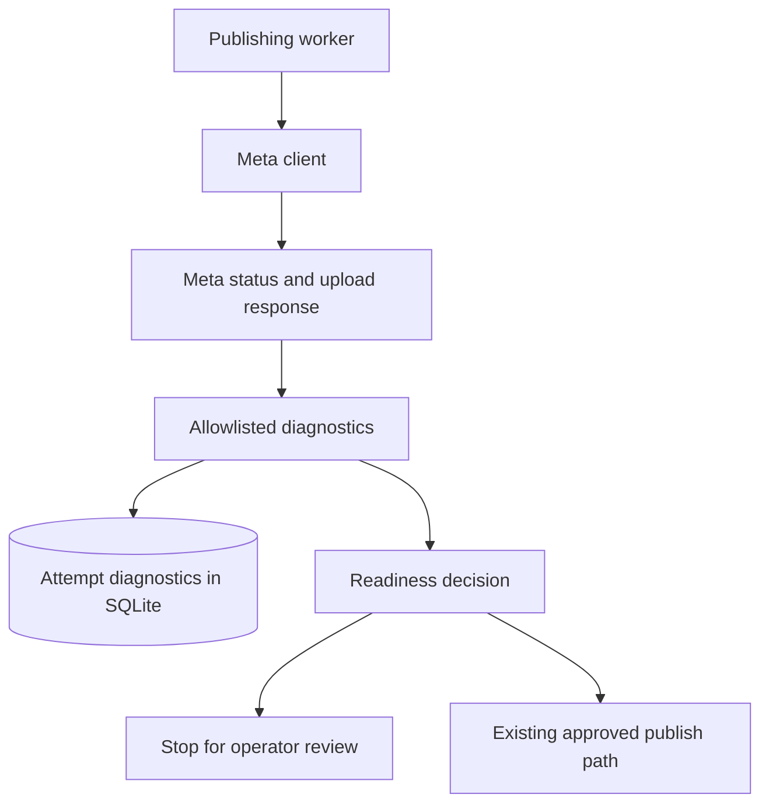
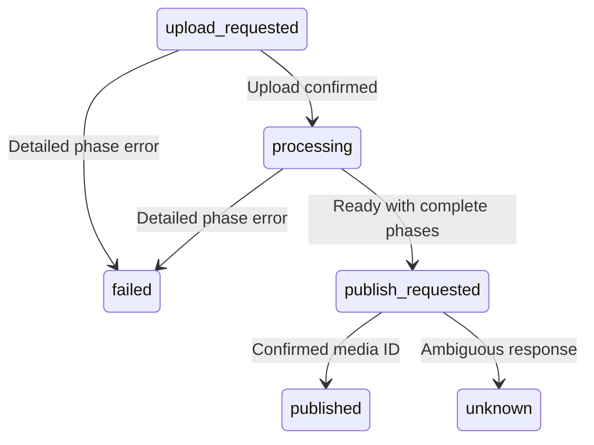

# Instagram upload diagnostics

The user approved this bounded design on 2026-10-10. Read detailed container
status and retain sanitized diagnostics. Recovery of existing items is separate.

## Changed and unchanged

Change the Meta client, worker and execution store. Add an append-only diagnostic
table. Keep approvals, credentials, artifact verification and write-retry rules.
Do not change the live ledger during implementation or tests.

## Mermaid flowchart

## Lifecycle/state diagram

Missing or incomplete details defer publication without a state reset. An upload
exception retains upload_requested. A detailed error or conflicting readiness
stops with failed and safeToRetry false. PUBLISHED and publish_requested recovery
retain the existing conservative unknown handling.

## Human approval and external-side-effect boundaries

No automatic retry, new container or approval reset follows a diagnostic error.
An operator must decide recovery separately. Only existing approved execution may
publish after readiness checks. This change does not authorize live execution.

## Failure and retry paths

Read status, status_code and video_status. Keep only enum phases, numeric byte
counts, numeric provider codes, operation, local error category, HTTP status and
the locally generated timestamp. Never persist raw status text, messages, tokens,
headers or URLs. Distinguish recognized timeout exceptions from network failures.
Persist diagnostic observations without erasing prior errors. Refuse publication
if diagnostic persistence fails. Retain bounded GET retries and no POST retries.

## Invariants

- An overall IN_PROGRESS value does not override a detailed phase error.
- An error never grants retry permission.
- Unknown publication outcomes never trigger another publication.
- Missing data is not evidence of a completed upload.
- Stored diagnostics contain only explicitly allowed fields and values.
- Diagnostic records belong to the current attempt and survive restart.

## Verification

Test the observed zero-byte error, conflicting readiness, missing details,
successful complete phases, timeout classification, secret removal, restart
persistence and refusal to retry. Use temporary SQLite databases and fake Meta
responses. Run the publishing suite, repository script suite and document gate.

Official reference: [Meta resumable uploads](https://developers.facebook.com/documentation/instagram-platform/content-publishing/resumable-uploads).

## Implementation reconciliation and deviations

Reconciled against the client, worker, execution store and regression tests.
The execution store adds an append-only publishing_diagnostics table on open.
The reader returns the latest 100 records, oldest first. No retention cleanup
or dashboard endpoint is added. Known timeout exceptions remain distinct even
when they occur during response-body reads.

The execution store atomically saves detailed phase errors and marks both the
attempt and item failed with safeToRetry false. A crash cannot leave a durable
phase error without its operator-review boundary. Numeric provider codes retain
their sign; byte counts remain nonnegative.

The worker saves allowlisted observations before readiness decisions. Upload
and processing errors override IN_PROGRESS or FINISHED, but not PUBLISHED,
which retains the existing unknown-publication safeguard. Missing completion
details return pending. Diagnostic write failures stop execution before publish.

Existing positive ERROR/EXPIRED and rejected-upload classifications retain their
previous retry policy. New detailed-phase errors never grant retry permission.
The live ledger and pending container were not changed during this work.
Provider free-text status is requested but discarded deliberately. Tests cover
the observed response, redaction, persistence after reopen and write failures.
