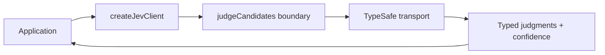
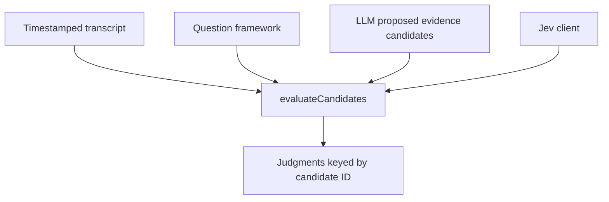
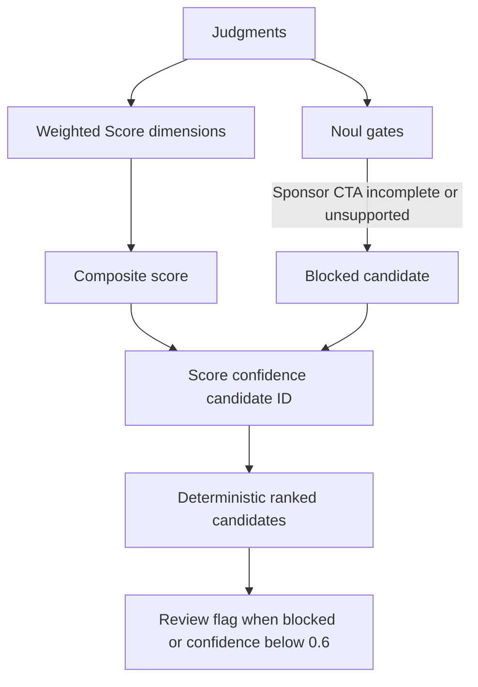
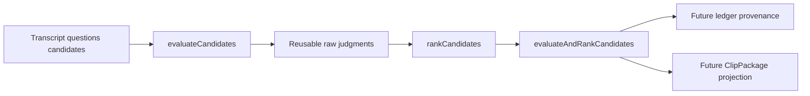
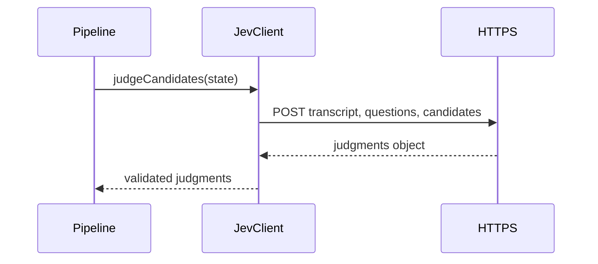
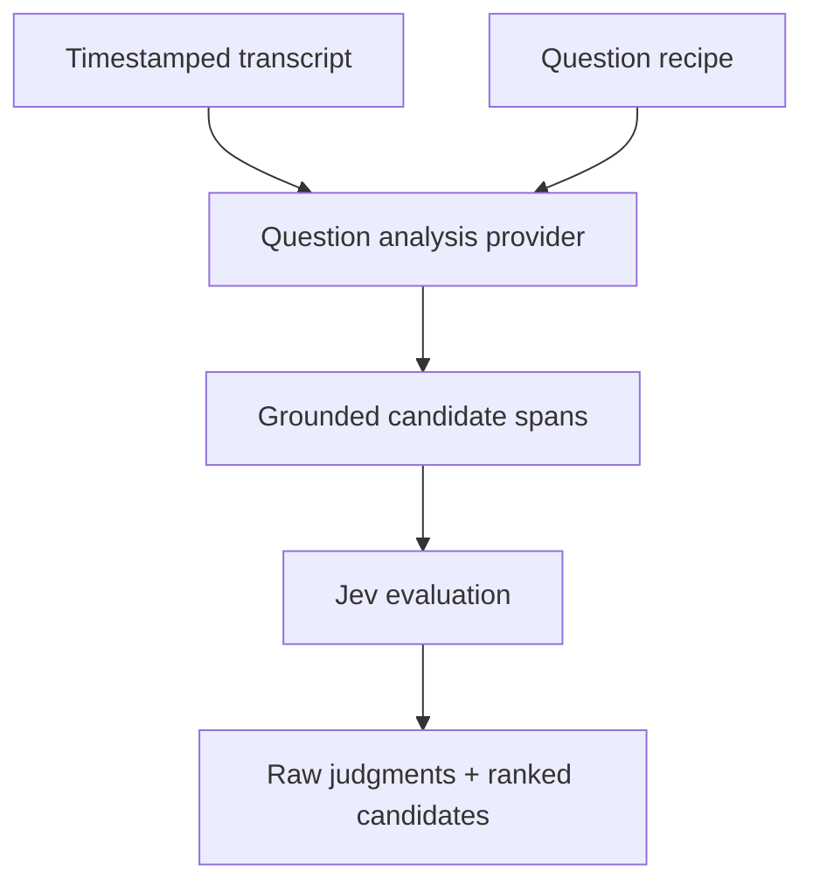
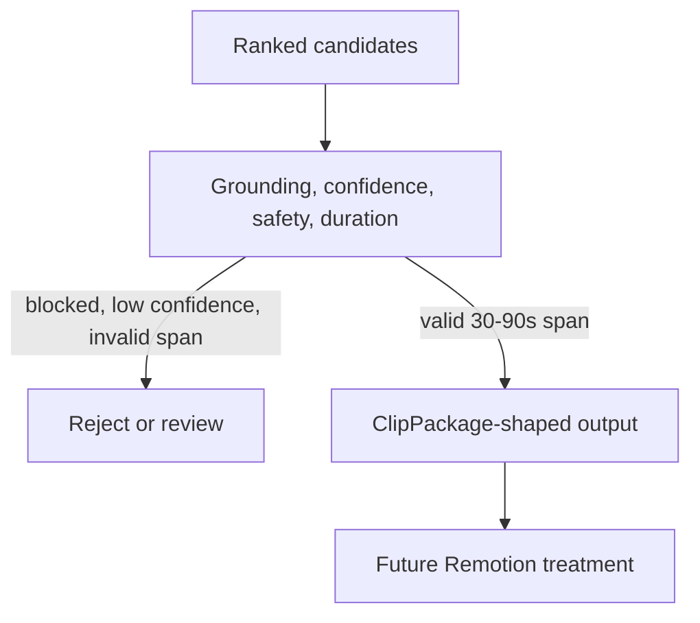
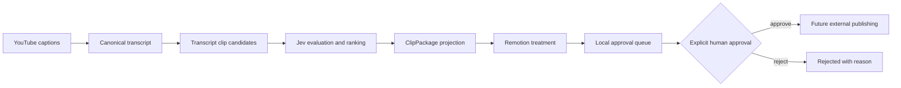
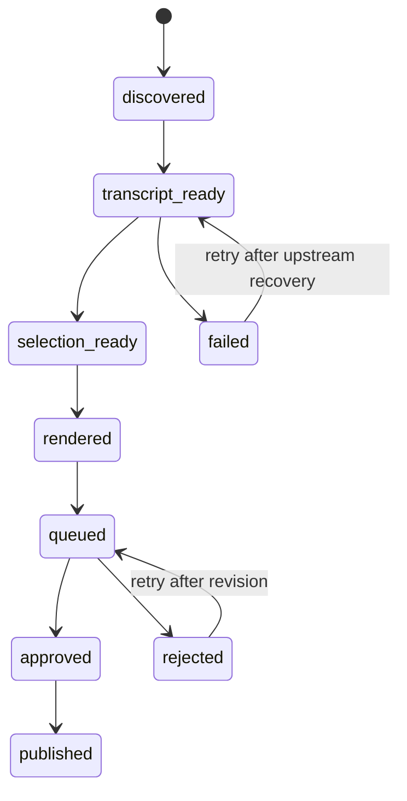

# Jev lifecycle feature flows

## 1. Client boundary

The client boundary keeps credentials and provider transport out of ranking code.

## 2. Candidate evaluation

Jev receives transcript state, questions, and candidate spans; this layer does not send audio or video.

## 3. Deterministic ranking and safety gates

Default weights: relevance 0.45, insight 0.35, self-containedness 0.20. Blocked candidates receive score 0.

## 4. Composed lifecycle

The composed operation returns raw judgments and ranked candidates so policy or display changes can reuse judgments without rerunning Jev.

## 5. Injectable HTTP transport

The HTTP adapter requires an HTTPS endpoint and explicit API key, uses an abort timeout, sends JSON only, and validates that the response contains a judgments object. Tests inject `fetchImpl`; production code supplies the real transport without coupling ranking logic to HTTP.

## 6. Question-analysis adapter

`runQuestionAnalysis()` owns the handoff from structured candidate generation to Jev. It returns provider provenance together with the reusable judgments and ranked output.

## 7. ClipPackage projection

Projection preserves `analysisQuestionId`, timestamps, score, confidence, review state, title, and summary. Duplicate candidate IDs are suppressed and invalid or unsafe candidates never reach treatment.

## Mermaid flowchart

The production pipeline currently implements the path through local queue insertion. External publishing remains behind the approval boundary.

## Lifecycle/state diagram

## Human approval and external-side-effect boundaries

Jev may rank and filter candidate clips, but it cannot publish externally. Remotion rendering produces local artifacts; the publishing ledger receives them as `queued`. A human must explicitly approve each item in the local UI before any future Instagram side effect is permitted.

## Failure and retry paths

- Missing or rate-limited YouTube captions fail only the affected video and preserve the error for a later retry.
- Jev transport, schema, or semantic failures fail the affected selection job without treating an unjudged candidate as approved.
- Invalid duration, grounding, duplicate, sponsor, or unsupported candidates are rejected or marked for review before rendering.
- Rendering failures do not enqueue an artifact.

## Invariants

- Every rendered package is grounded in timestamped transcript cues.
- Jev questions and judgments are keyed deterministically by candidate ID.
- No external publishing call occurs before explicit approval.
- Package and treatment provenance remain linked to the source video and package version.

## Implementation reconciliation and deviations

The production wiring now runs transcript acquisition, existing transcript candidate generation, Jev evaluation/ranking, ClipPackage projection, treatment rendering, and optional local approval-queue insertion in `scripts/youtube-pipeline.mjs`. Jev is opt-in through `TYPESAFE_JEV_ENDPOINT` and `TYPESAFE_JEV_API_KEY`. The current implementation evaluates transcript-derived candidates rather than replacing candidate generation with a separate question-analysis provider. 9:16 rendering and structured pipeline logs are deferred to follow-up work.
