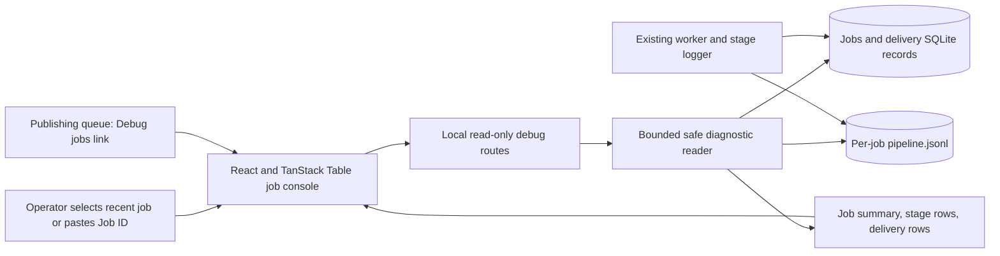
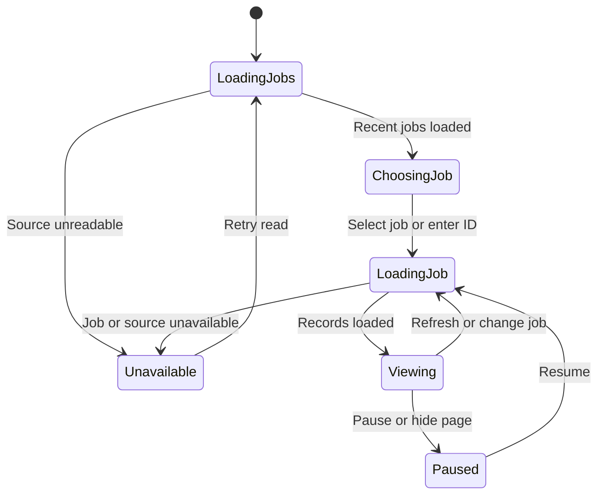

# Local job debugging console

## Purpose and agreed scope

An operator can choose any recent Audiogram job, or paste a Job ID from
ChatGPT, and inspect its progress without searching files or querying SQLite.
Use TanStack Table v9 and a separate local debugging page. Remove the System
logs panel above the publishing queue after the new page works.

Keep the structured pipeline logger, JSONL files, and SQLite records. The
removed component is the publishing page's log viewer, not log capture.
The console must not start, retry, cancel, approve, or publish work.

## Implemented first version

The user approved this design on 2026-11-06 before implementation.

- A dedicated `/debug/jobs` page on the existing local publishing HTTP server.
  This is a separate page; it does not require another persistent server.
- A recent-jobs list with title, Job ID, created time, and processing status.
  Show 50 jobs per page, newest first, with pagination for older retained jobs.
  Read this list from the jobs database, not from a global last-500-events window.
- An exact Job ID search. Keep the selected ID in the URL for reloads and links.
  Selecting a job must not change when a newer job arrives.
- A summary for the selected job: processing result, verified artifact count,
  failed clips, capture health, and notification health as separate facts.
- A TanStack Table event view with time, stage, clip, treatment, status, duration,
  and safe error code. Filter by stage, clip, status, time, and text. Expand a row
  to read permitted structured details. Use stable event identities.
- A delivery view with event name/sequence, delivery state, attempt count, last
  retained error code, and acknowledgement time. Do not expose callback URLs,
  credentials, or encrypted secret fields.
- Refresh the selected job every two seconds, with a pause control and a visible
  last-refresh time. Label this auto-refresh, not streaming. Avoid overlapping
  requests. Cancel obsolete requests when the selection changes; stale responses
  must never replace the current job. Pause while the page is hidden and refresh
  immediately when it becomes visible again.
- Preserve filters, expanded rows, and scroll position during refresh. A separate
  Follow control scrolls to new records only when the operator enables it.
- Keep refreshing delivery state after processing reaches a terminal state:
  pending callbacks can outlive the worker.
- A small Debug jobs link replaces the old System logs panel on the publishing
  page. Remove its activity initialization, panel-only CSS, and unused view code.
  Retain the existing `/api/logs` endpoint initially for compatibility.

## Data and interfaces

Use the existing React and esbuild stack with the current TanStack Table v9
API, checked against https://tanstack.com/table/latest/docs/overview and the
installed type definitions. The package is pinned to 9.3.1.

A read-only repository adapter supplies bounded responses to local GET routes:

- `GET /api/debug/jobs?cursor=...&limit=50` lists retained jobs.
- `GET /api/debug/jobs/:jobId` supplies the safe job summary.
- `GET /api/debug/jobs/:jobId/events?cursor=...` supplies structured stage events.
- `GET /api/debug/jobs/:jobId/deliveries?cursor=...` supplies safe delivery records.

Configure the jobs database and diagnostics root explicitly so a console can
inspect jobs created by a different worktree. Show the selected source label in
the UI. Never create an empty database when the configured source is absent.
Do not use `createJobStore` for inspection: its initialization performs writes
and migrations. Open existing databases read-only.

Read per-job JSONL through the existing safe diagnostic parsing boundary.
Enforce byte and row limits, validate Job IDs and cursors, and prevent arbitrary
file access. Pagination must not silently omit older retained stage records.
Filters must state whether they apply to loaded rows or all retained records;
the first version applies table filters to loaded rows and shows the loaded count.

The console reports recorded stage activity, not worker liveness. An old last
event does not prove the worker stalled. It must not invent heartbeats, percentage
completion, time estimates, or a current stage from an incomplete history.

## Mermaid flowchart

## Lifecycle/state diagram

## Human approval and external-side-effect boundaries

The console only reads local diagnostic data. Bind its hosting service to
loopback for this use and apply Host/Origin checks to debug routes. Do not make
these routes available through the MCP tunnel or enable permissive CORS.
Use response allowlists, no-store caching, and text rendering for event content.
Never put raw stdout/stderr, arbitrary ledger error strings, or secrets into the
browser. A later operator-diagnostic detail endpoint needs its own redaction
contract before exposing richer renderer errors.

The publishing page retains its existing approval controls. This console adds
no write controls. Starting a visible local server is an operator action; this
change must not restart the active MCP server or tunnel.

## Failure and retry paths

Missing database, unknown job, expired logs, malformed JSONL, and read failures
must have distinct states. A partial final JSONL line during a write can be
retried on the next refresh. Retention and truncation must be visible.
Keep the last successful view on transient errors and mark it stale with its
refresh time. Retrying a read never creates or retries a processing job.

The current delivery table retains an attempt count and current result, not a
full attempt history. Successful acknowledgement clears the earlier error.
The UI must label historical attempt details unavailable rather than reconstruct
them. Full attempt-history retention is separate backend work.

## Invariants

- A selected Job ID scopes every summary, stage row, and delivery row.
- Recent-job selection is not limited to whichever jobs appear in recent logs.
- Viewing data causes no job transitions, migrations, retries, or publication.
- Processing success and notification success are separate.
- Callback acknowledgement is not proof that ChatGPT displayed a message.
- Missing diagnostic detail is explicit, never synthesized.
- The old panel is removed only when the replacement is usable.
- Raw event content cannot become executable markup or instructions.

## Changed/unchanged summary

Changed: a separate job-centric console replaces the publishing page's large
System logs panel, with recent-job browsing and delivery visibility.
Unchanged: pipeline execution, log capture, retained job data, callback dispatch,
MCP tools, publishing approvals, and the existing logs API.
Font-loading fixes, new renderer stream capture, delivery-attempt persistence,
and cloud hosting are separate work.

## Verification and acceptance

Use temporary databases and log fixtures to check pagination, exact job lookup,
source configuration, limits, missing data, redaction, and read-only behavior.
Check UI filtering, live refresh, pause/follow behavior, stale-request handling,
and separate rendering of processing and delivery state. Exercise two concurrent
jobs to prove their rows never mix. Check that the publishing queue still loads
and its former activity loop no longer runs.

Inspect the rendered page with a populated job, an empty history, and a failed
read. Test both desktop and narrow layouts. Run appropriate existing publishing
tests, frontend checks, and `npm run verify:feature-docs`. Do not create a real
video job or publish anything to validate the console.

## Implementation reconciliation and deviations

Reconciled on 2026-11-06 with the reader, routes, React components, controller,
tests, and rendered browser page. The diagrams match the implemented boundaries.

- `scripts/job-debug-store.mjs` opens an existing SQLite database read-only for
  each operation. It does not call the job-store initializer. Per-job JSONL is
  normalized by the existing pipeline logger and checked against both job/run IDs.
- Job pages contain at most 50 records. Event/delivery API pages contain at most
  500 records (the UI requests 100). JSONL reads are bounded to 1 MiB per request;
  individual parsed lines are limited to 64 KiB. Stored result summaries read at
  most 262,144 characters and expose a warning when this limit is reached.
- Job and delivery pagination use keyset cursors. Event cursors include file
  identity and byte offset. File replacement or truncation resets the cursor;
  the client retries rather than combining rows from different file generations.
- `scripts/job-debug-http.mjs` serves fixed local assets and guarded read-only
  routes. `scripts/publishing-server.mjs` hosts them. Configuration accepts a
  separate jobs database, diagnostics root, and visible source label.
- The React page uses TanStack Table v9 filtering/sorting. Its refresh controller
  aborts obsolete work and ignores late results. Processing and delivery are
  distinct views. Terminal jobs continue to refresh for pending callbacks.
- Refresh rereads the selected number of pages as a complete snapshot rather
  than merging incremental requests. Stable row IDs preserve expansion and
  selection. This intentionally simple approach avoids stale edited delivery rows;
  its cost grows with the number of pages the operator loads.
- The large publishing activity panel, its module, tests, initialization and
  panel-only CSS are removed. A Debug jobs link replaces it. `/api/logs` remains.
- Startup instructions and current test-source examples are in
  `docs/job-debug-console.md`. No active MCP service or tunnel was restarted.

Verification: the full CI runner passed 81/81 test files. After final review,
21 focused reader/controller/HTTP/publishing tests passed, lint/type checks and
the local asset build passed, and the browser fixture passed job selection,
filtering, sorting, expansion retention, pause/resume, appended rows, deliveries,
job isolation, stale errors, narrow layout, and publishing navigation. Test
servers and Chrome profiles were temporary and were closed. Read-only inspection
of recent real job `92fd058e-e006-4f69-bce7-c267983fdec8` returned 30 stage records,
25 delivery records and two verified artifacts. No real processing was started.

Limits: this feature does not retain erased delivery-attempt errors, expose raw
renderer output, prove ChatGPT displayed a message, or add worker heartbeats.
Missing logs cannot distinguish expiration from a file that was never created.
