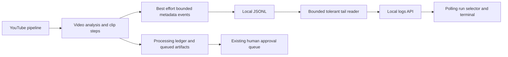
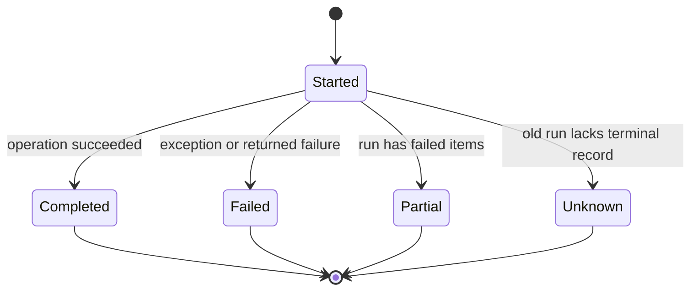

# Live pipeline logs

Design reviewed against the requested OpenShorts reference and the existing run-history design. This slice implements durable detailed events and a live run-filtered terminal. The existing pipeline-run-history proposal remains preserved for full historical APIs and artifact previews.

## Mermaid flowchart

## Lifecycle/state diagram

## Human approval and external-side-effect boundaries

The panel only reads logs. Pipeline work retains existing network and local queue behavior. Logging and inspection never approve or publish clips. No production job is started for verification.

## Failure and retry paths

File writes and optional progress callbacks are best effort. Read at most an 8 MiB suffix, skip malformed records, filter allowlisted fields and cap results to 1,000. Report actual stage failures and retain preceding progress. Poll every two seconds after the previous request settles, abort stalled requests, display a stale/unavailable status while preserving the last successful snapshot, and resume after temporary errors. A terminated process can leave incomplete records; the panel does not infer successful completion or trigger retries.

## Invariants

- Persist metadata only; no raw subprocess output, transcript, generated content, credentials or arbitrary error text.
- Log transcript fetch, moment selection, Jev ranking, asset acquisition, rendering and queueing with run/video/clip context.
- One run ID per invocation; preserve legacy records and original timestamps.
- UI uses text nodes, local times, structured severity, wrapped messages, details, collapse and follow controls.
- Run filtering covers only the bounded recent window, explicitly labeled as such.
- Polls never overlap; historical incomplete runs are shown as unknown/stale.

## Changed and unchanged summary

Changed: logger resilience, detailed stage events, automatic refresh and readable run-specific terminal. Unchanged: JSONL persistence, existing queue operations, approval boundary and pipeline selection/render algorithms. No new frontend framework or dependencies.

## Implementation reconciliation and deviations

### PR #20 integration

PR #20 is the merged baseline. Retain its fail-open writes, truthful terminal outcomes, bounded tail and malformed-record tolerance. PR #21 extends these with clip/count metadata, validation on reads and writes, asynchronous diagnostic rejection handling, short-read handling and interrupted-append recovery. It deliberately omits legacy free-form `errorMessage` fields in favor of safe error codes; friendly UI descriptions are derived from stage/status. Its per-video `video-analysis` failures replace the duplicate outer `transcript-sync` failure rows. The overall run can finish `partial` while failed steps retain `failed` status. PR #20 regression scenarios are retained in `pipeline-logger-regression.test.mjs`, with the free-form-message expectation updated to match the stricter privacy contract.

Implemented and reconciled with `pipeline-logger.mjs`, both pipeline cores, the CLI orchestration, logs API and `public/publishing/activity.mjs`. The panel requests up to 500 events, polls two seconds after completion, aborts requests after ten seconds, pauses background-tab polling and retains the last successful snapshot on errors. Runs without a terminal event become unknown after ten minutes without progress; this is not a process-liveness check.

Verification: 29 focused logger/core/browser-helper tests and seven isolated HTTP server tests pass. Browser inspection with synthetic logs confirms readable stage rows, failure styling and expandable metadata. No production pipeline was executed and no production ledger or log was modified. The older `pipeline-run-history.md` remains an unfinished separate proposal and prevents the repository-wide feature-doc gate from passing; this note satisfies the completed-note requirements.

Intentional scope limits: existing logs cannot gain details retroactively. Full searchable history, artifact preview associations, log rotation and subprocess percentage capture remain outside this slice. Startup configuration validation before the run wrapper is not logged. The live server must be restarted to load backend changes; new pipeline invocations produce the richer events.
