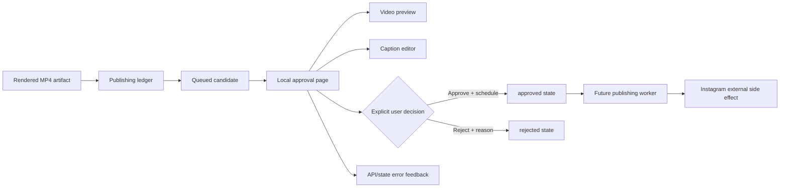
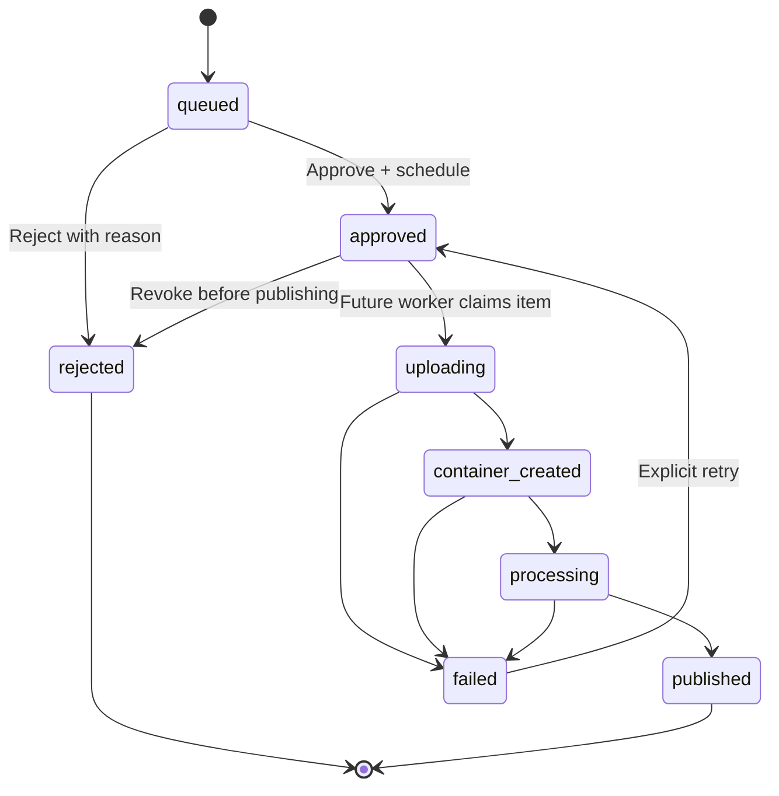

# Local approval queue UI

## Purpose

Provide a small local web page where the operator can inspect rendered MP4
artifacts, edit captions, and explicitly approve or reject each publishing
candidate before any future Instagram publishing worker can act.

The first version is intentionally local and dependency-free: it uses the
existing Node HTTP publishing server and browser-native HTML, CSS, JavaScript,
and video controls. It does not add Instagram credentials, automatic
publishing, authentication, or a new frontend framework.

## Mermaid flowchart

## Lifecycle/state diagram

## Scope and user workflow

The page loads queue items from `GET /api/items`. Each candidate displays its
title, status, artifact metadata, caption, timestamps, and an HTML video
preview sourced from `GET /api/items/:id/preview`.

The operator may:

- edit and save a caption while the item is `queued` or `approved`;
- approve a queued item with an explicit ISO timestamp for publication;
- reject a queued or approved item with a required reason;
- refresh the queue and see updated state or server errors.

The first UI does not expose retry, publishing-worker controls, unknown-outcome
verification, account management, or bulk approval. Those remain backend
capabilities or later features until their interaction design is reviewed.

## Human approval and external-side-effect boundaries

Artifact rendering and queue insertion are automated. Reviewing the video and
caption is human work. The approval action is the explicit boundary that
permits a future worker to consider the candidate for Instagram publishing.

The UI itself never calls Instagram. Approval changes the local ledger to
`approved`; a separate future worker will claim due approved items and perform
external publishing. Rejection has no external side effect.

## Failure and retry paths

- Missing or malformed queue data produces an inline load error without
  implying that an item was approved.
- Missing, unsafe, or unreadable MP4 previews show a preview error while the
  queue item remains governed by the ledger state.
- Caption, approval, and rejection API failures remain visible and do not
  optimistically finalize the UI state.
- Server-side invalid transitions are shown as state errors and require a
  refresh before another action.
- Future publishing failures remain in the existing `failed` state and may be
  explicitly retried through the backend; retry UI is out of scope for this
  slice.

## Invariants

- A queued artifact is never treated as approved merely because it is visible
  in the UI.
- The approved artifact hash must remain bound to the artifact that the user
  reviewed.
- Approval requires a valid schedule timestamp and is persisted atomically by
  the ledger.
- Rejection requires a non-empty reason.
- Preview paths remain project-relative MP4 paths validated by the server.
- The browser does not receive or persist Instagram credentials.
- The UI reflects server state after mutations rather than inventing a local
  terminal state.

## Proposed files and tests

Implementation is expected to add or update:

- `public/publishing/index.html`
- `public/publishing/app.js`
- `public/publishing/styles.css`
- focused publishing-server/UI contract tests as appropriate

The existing ledger and server tests remain the source of truth for transition
rules. The UI slice adds tests for queue rendering data, preview URLs, caption
updates, approval scheduling, rejection reasons, and visible API errors.

## Changed / unchanged summary

Changed: a local browser interface for reviewing and deciding publishing
candidates.

Unchanged: artifact generation, ledger transition rules, Instagram credentials,
Instagram publishing execution, scheduling worker behavior, and the Remotion
rendering UI.

## Implementation reconciliation and deviations

Not yet implemented. This section will be updated after implementation and
tests compare the actual behavior with this design.
