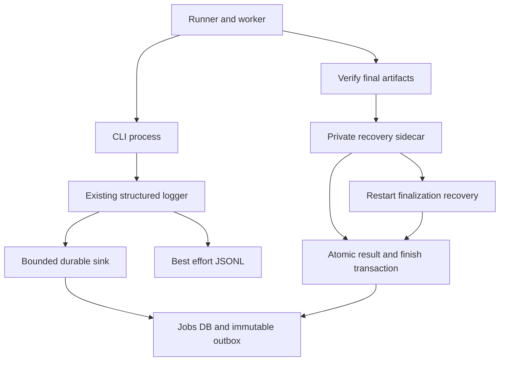
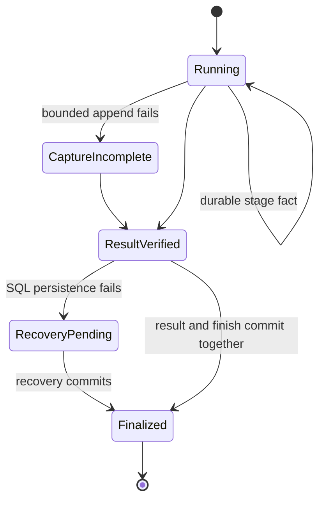

# Durable MCP stage capture and atomic finish records

## Purpose and scope

PR 3 implements Tasks 3–5 of the approved live-stage-events plan. Persist safe
facts from the existing logger, cross the CLI process boundary with validated
identity, and recover final-result persistence without rerendering.
Changed: optional durable stage capture and atomic finalization.
Unchanged: selection, Jev, rendering, retry approval, and publishing.
Review comes from the approved parent design; this slice remains unfinished.

## Mermaid flowchart

## Lifecycle/state diagram

## Human approval and external-side-effect boundaries

Work uses a dedicated worktree and synthetic temporary databases. No running
server, tunnel, real job store, credential, paid provider, or remote plugin is
changed. Callbacks are not sent in this slice. Feature-off legacy tools retain
their behavior; Events activation remains gated until the later delivery slice.

## Failure and retry paths

Progress retries reuse source identity; finalization retries reuse the verified
result. No storage failure authorizes rerendering. Capture health is independent
of diagnostic-file truncation. Finalization recovery runs before stale-worker
classification. Do not invent failures for unfinished stages.

## Invariants

- One shared jobs SQLite database; each process opens its own connection.
- Immutable facts, unique source IDs and job-local sequence numbers.
- Final job result and its single finish event commit in one transaction.
- Duplicate identical writes reuse events; conflicting writes reject.
- Notification failure never overwrites a verified successful result.
- No secrets or raw logs in outbox payloads or CLI event configuration.
- Legacy owner migration requires explicit private-owner mode.
- No Events capability or background dispatcher starts in this slice.

## Implementation reconciliation and deviations

Pending Tasks 3–5 and their verification. The feature is not complete.
