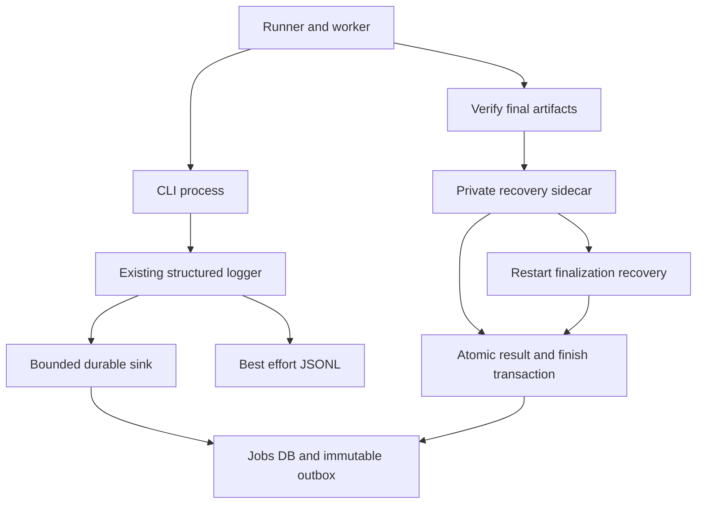
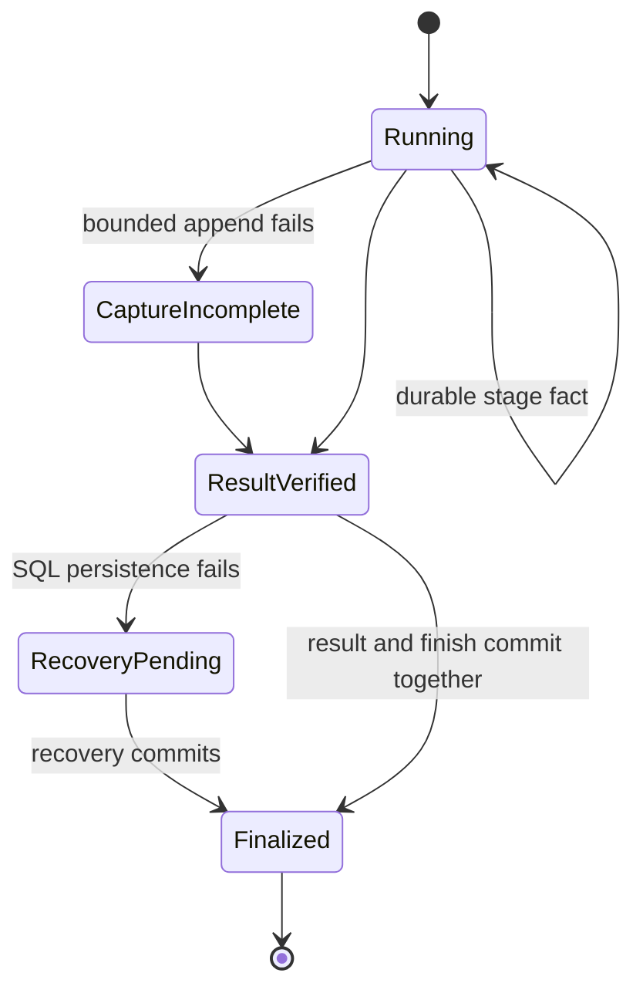

# Durable MCP stage capture and atomic finish records

## Purpose and scope

PR 3 implements Tasks 3–5 of the approved live-stage-events plan. Persist safe
facts from the existing logger, cross the CLI process boundary with validated
identity, and recover final-result persistence without rerendering.
Changed: optional durable stage capture and atomic finalization.
Unchanged: selection, Jev, rendering, retry approval, and publishing.
Review comes from the approved parent design. This slice does not implement
subscriptions or remote delivery.

## Mermaid flowchart

## Lifecycle/state diagram

## Human approval and external-side-effect boundaries

Work uses a dedicated worktree and synthetic temporary databases. No running
server, tunnel, real job store, credential, paid provider, or remote plugin is
changed. Callbacks are not sent in this slice. Feature-off legacy tools retain
their behavior; Events activation remains gated until the later delivery slice.

## Failure and retry paths

Progress retries reuse source identity; finalization retries reuse the verified
result. No storage failure authorizes rerendering. Capture health is independent
of diagnostic-file truncation. Finalization recovery runs before stale-worker
classification. Do not invent failures for unfinished stages.

## Invariants

- One shared jobs SQLite database; each process opens its own connection.
- Immutable facts, unique source IDs and job-local sequence numbers.
- Final job result and its single finish event commit in one transaction.
- Duplicate identical writes reuse events; conflicting writes reject.
- Notification failure never overwrites a verified successful result.
- No secrets or raw logs in outbox payloads or CLI event configuration.
- Legacy owner migration requires explicit private-owner mode.
- No Events capability or background dispatcher starts in this slice.

## Implementation reconciliation and deviations

Tasks 3–5 are reconciled against their implementations and tests. The shared
jobs connection owns schema migration, immutable event storage, source-ID
deduplication, sequence allocation, and atomic finish persistence. Independent
CLI connections use a 100 ms busy timeout; the sink makes at most three writes
with 50/100 ms waits. JSONL remains a separate, best-effort diagnostic mirror.

Managed CLI capture validates job/run identity and opens the configured store.
The logger assigns source IDs and per-invocation stage IDs; explicit selection
recovery retains the instance and records the known attempt. Parallel stages
do not share mutable context. Signing keys are stripped from child environments.
Capture reports follow flush/close and remain separate from file truncation.

Workers separate processing validation from persistence. Normalized successful
results include private artifact hashes. Finalization writes an exclusive,
fsynced temporary record and atomically publishes the fixed recovery filename
without replacing a competitor's result. It attempts SQL immediately and after
1/2/4/8/16 seconds. If both SQL and the sidecar fail, a safe health alert states
that recovery is not assured; no render is automatically repeated.

Status lookup recovers pending results before declaring a worker stale, and
revalidates media before committing. Missing, changed, oversized, malformed,
or wrong-job records cannot become a successful finish. Pending recovery files
pin their diagnostic directories against retention cleanup. Deleted/modified
media after finalization returns a separate ARTIFACT_UNAVAILABLE tool error;
the historical job and single finish event remain unchanged.

Intentional implementation choices:

- Atomic no-replace hard-link publication replaces the plan's overwriting
  rename, because competing finalizers must not replace a verified result.
  Filesystems without this support lose sidecar recovery, not render success.
- Event timestamps come from the store's injected clock, not a second sink clock.
- New worker outcomes use atomic finish persistence before Events advertisement.
  Direct feature-off legacy store writes retain compatibility unless a finish
  already exists; they cannot overwrite a finalized result.
- Artifact I/O occurs before the synchronous SQL boundary. Safe reference
  schemas alone are not proof of valid bytes.
- Global service-start recovery is wired in the later service-lifecycle slice.
  This slice exposes the recovery function and wires job-scoped stale lookup.

Evidence includes real temporary SQLite connections, rollback triggers,
source-write deduplication, a real CLI child process, a process exit after a
committed progress fact, competing finalizers, success during stale lookup,
pending-result recovery without another CLI call, artifact mutation/deletion,
retention pinning, and exact envelope-size validation. Full CI/plugin, lint,
feature-document, and diff gates are required before PR handoff.

No live video, production database, running server, tunnel, or remote plugin
was changed. No callback was sent. The overall live-stage-events feature
remains IN_PROGRESS; unsolicited ChatGPT presentation is not yet verified.
