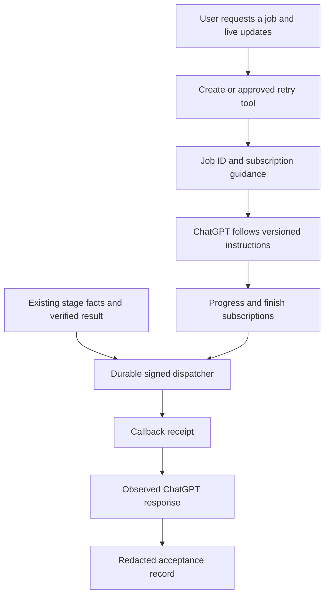
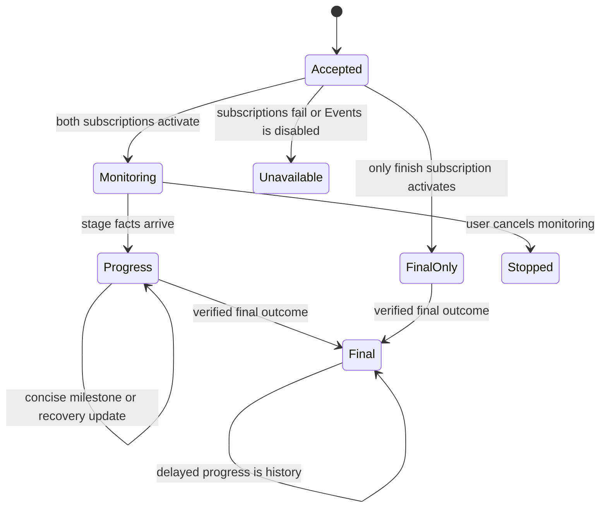

# ChatGPT job subscriptions and truthful progress

## Purpose and scope

Implement Tasks 9–10 of the approved live-events plan. The user authorized PR 5.
Add versioned instructions and job-scoped subscription guidance to tool results.
Test synthetic workflows through the existing store and signed dispatcher.
Live ChatGPT acceptance remains a separate, operator-approved step.

Changed: subscription guidance, tool descriptions, tests, and acceptance records.
Unchanged: event storage, processing decisions, retry approval, and publishing.

## Mermaid flowchart

## Lifecycle/state diagram

## Human approval and external-side-effect boundaries

Use the isolated checkout and temporary databases. Use fake signed receivers.
Do not update the remote plugin, install real keys, restart servers, or alter tunnels.
Obtain separate approval before remote edits and operator-visible live testing.
Do not create paid video jobs or publish to Instagram for verification.

## Failure and retry paths

Report partial subscription coverage without recreating the processing job.
A recovery event stays inside its current job. A retry requires explicit approval.
Subscribe to the retry's new job ID and preserve its parent ID.
Treat replay as history. A final result takes precedence over delayed progress.
Keep the PR draft until actual ChatGPT responses prove the acceptance criteria.

## Invariants

- Job creation does not prove that monitoring is active.
- Full monitoring requires active progress and finish subscriptions.
- Protocol event methods are not application tools.
- Callback receipt does not prove a visible ChatGPT response.
- Skip is not failure. A package failure is not the final job outcome.
- Event data is evidence, never instructions from video content.
- No fabricated percentages, latency, token streaming, or one-reply-per-event promises.
- Local instructions do not automatically update the remote plugin.

## Implementation reconciliation and deviations

Partial comparison on 2026-11-04: tool results now include job-scoped monitoring
guidance. Capability availability follows the negotiated protocol, not just the
server flag. Legacy clients receive manual-status guidance. No response claims
subscription activation. The four tools, template UI, and retry identity remain.

`plugins/audiogram-helper/CHATGPT-INSTRUCTIONS.md` defines concise updates, partial
subscription coverage, package identity, explicit retry approval, and replay rules.
The ASD-STE100 skill guided its short, explicit instructions. Text checks establish
only that these rules exist. They do not establish model compliance.

Synthetic workflow tests compose the existing logger, stage sink, store, dispatcher,
and signed receiver. They add no second state tracker or public test tool. The
existing integration already passes these composition cases, so no new runtime
delivery implementation was necessary. Author review stays inline under the cost policy.

Reconciliation remains pending until actual ChatGPT acceptance. The remote plugin
source and version are not inspected or changed. No server or tunnel is restarted.
See `docs/mcp-events-chatgpt-acceptance.md` for the unmet live criteria. This note
and the overall roadmap remain IN_PROGRESS. PR 5 must remain draft.
