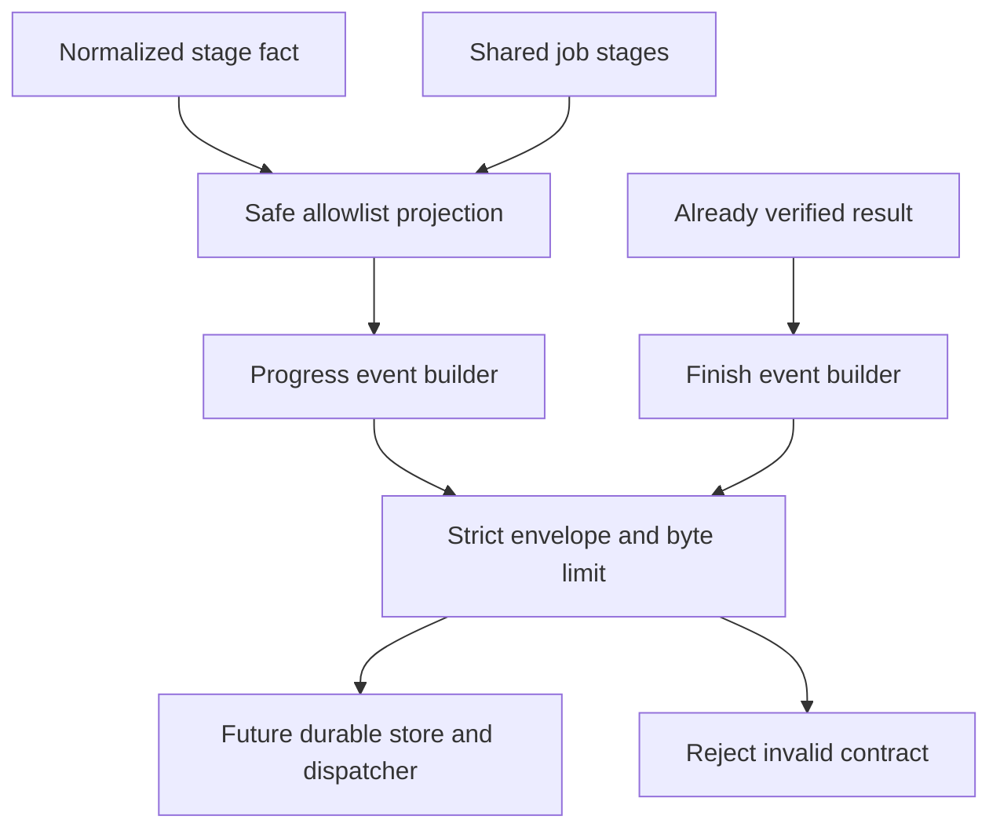
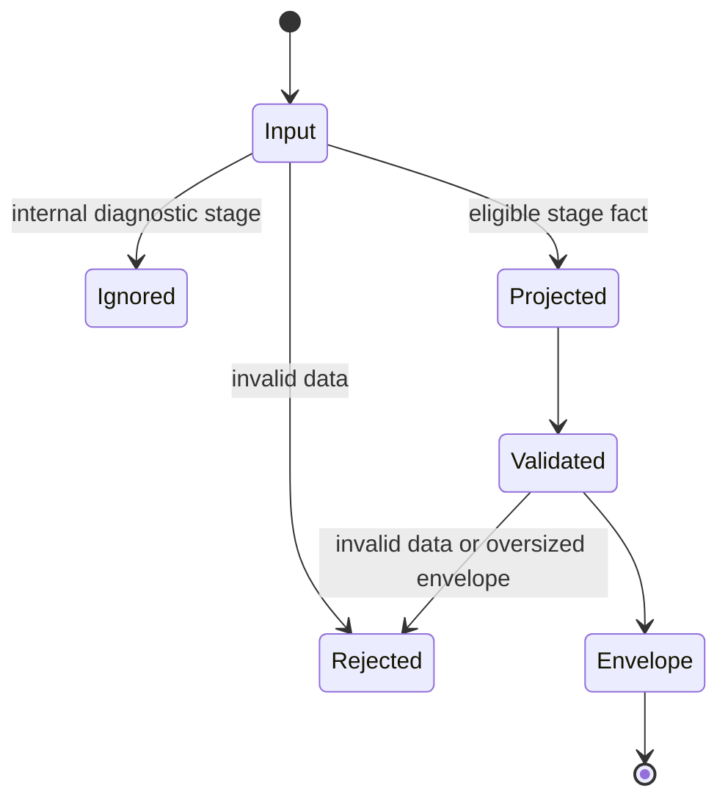

# MCP safe progress and finish event contract

## Purpose and scope

PR 2 implements the shared vocabulary in the approved live-stage-events design.
Changed: pure event projection, strict schemas, and a shared stage list.
Unchanged: tool behavior, pipeline execution, job persistence, and transport.
The approved parent design supplies review for this implementation slice.

## Mermaid flowchart

## Lifecycle/state diagram

These are validation steps, not a second job state machine. A completed stage
does not establish a terminal job result.

## Human approval and external-side-effect boundaries

The user approved implementation. Builders perform no I/O, provider request,
job creation, callback delivery, or service startup. Final-result callers must
validate artifact bytes before supplying references; a pure schema checks only
the safe reference format, not the filesystem. Remote plugin changes and live
callback tests require separate approval.

## Failure and retry paths

Invalid stages, statuses, identities, unknown wire fields, and oversized bodies
reject. Internal diagnostic stages queue, videos-pending, and video-analysis
produce no public event. Retrying means recovery within the same stage instance;
it does not authorize a new job. Explicit skipped Jev remains a skipped fact.
Safe messages and error codes never copy exception or video text.

## Invariants

- Exactly two names: progress and finished; stages use the existing ten values.
- Caller supplies IDs, timestamp, sequence, and known attempt; no invented count.
- Run ID equals job ID for this one-worker-per-attempt system.
- Package and treatment identities distinguish parallel work.
- Partial requires verified artifact references and failures.
- Final events require a terminal result, not a stage completion.
- No raw logs, secrets, model output, transcripts, or absolute paths in payloads.
- Envelope validation checks exact serialized UTF-8 bytes against 64 KiB.
- Storage and callback delivery remain unimplemented in this slice.

## Implementation reconciliation and deviations

Reconciled against the pure builders and their ten focused tests. Logger facts
map to the five approved kinds. Wire schemas reject unknown fields and use
fixed messages and stage-specific error-code allowlists. Package failures are
preserved, not replaced by a single generic error. The shared ten-stage list
replaces the two existing literals without changing accepted tool values.

Final results must already have passed artifact verification; this module
checks reference syntax only. Tests cover all four final statuses, invalid
identity and stage data, raw-content exclusion, package/treatment separation,
recovery instance continuity, and exact 65,536-byte acceptance versus
65,537-byte rejection. No pipeline stage can create a finish event by itself.

Verification: 68/68 CI-safe files, 62/62 plugin tests, repository lint, targeted
ESLint, feature-document gate, and diff checks pass. The sandbox initially
blocked temporary loopback listeners with EPERM; the authorized test run passes.
Node's existing experimental SQLite warning remains unchanged.

Intentional boundary: queue, videos-pending, and video-analysis are internal
diagnostics, not new public stages. Unknown stages still reject. Artifact byte
verification remains with the result validator. No database, logger sink,
subscription, callback delivery, remote plugin, or running service is changed.
The overall live-stage-events feature remains IN_PROGRESS.
