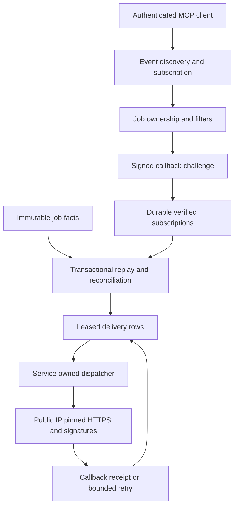
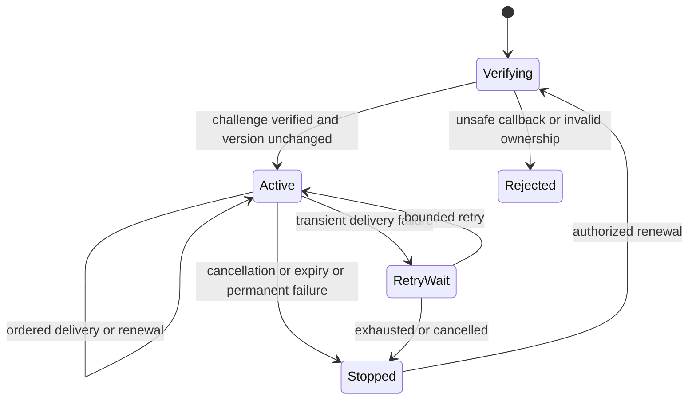

# Verified MCP subscriptions and durable signed delivery

## Purpose and scope

PR 4 implements Tasks 6–8 of the approved live-stage-events design: job-owned
subscriptions, retained replay, signed HTTPS callbacks, and a durable leased
dispatcher owned by the explicitly started MCP service. The parent design is
approved. This slice is not proof of unsolicited ChatGPT presentation.

Changed: delivery infrastructure and optional Events protocol methods.
Unchanged: processing outcomes, rendering recipes, retry approval, publishing.

## Mermaid flowchart

## Lifecycle/state diagram

Subscription, delivery, processing, and ChatGPT display remain separate states.

## Human approval and external-side-effect boundaries

The user authorized PR 4 implementation. Development uses an isolated checkout,
temporary synthetic databases and fake receivers. No live callback, paid video,
remote plugin update, existing tunnel, production database, or server restart is
authorized here. Dependencies are local to this worktree and lockfile. Runtime
Events requires explicit enablement, trusted ownership mode, and an operator
protection key. Never install or print a real protection key.

## Failure and retry paths

Callback verification occurs outside SQL, before activation. A version check
prevents slow verification from undoing cancellation or renewal. Delivery uses
bounded retries, stable event IDs, fresh signing timestamps, and claim tokens.
Finish delivery is independent of blocked progress delivery. Restart resumes
durable work. No delivery failure starts a new job or changes render success.

## Invariants

- One job store and existing stage-event source; no second workflow engine.
- Verify ownership on tools, subscriptions, and every outbound delivery.
- Encrypt signing secrets; authenticate opaque owner/job/event-scoped cursors.
- Resolve and pin only public destination IPs at every connection; no redirects.
- No SQL transaction spans DNS, HTTP, or artifact verification.
- One in-flight delivery per subscription, bounded cross-subscription concurrency.
- Cancellation, expiry, renewal, rotation, and lease takeover are versioned.
- Replay never skips pending deliveries and reports retained-history gaps.
- Do not purge running-job facts or facts pinned by subscriptions/retries.
- Start no detached dispatcher; expose safe health and close service resources.
- HTTP receipt is not proof that ChatGPT displayed a response.

## Implementation reconciliation and deviations

Reconciled against the implementation and isolated tests on 2026-10-26.
`server.mjs` owns the store and dispatcher. Request-scoped MCP instances register
the three Events methods for modern and legacy HTTP when configuration is ready.
`local-runner.mjs` receives trusted identity for create, status, and retry. Shared
mode rejects ownerless legacy jobs; private-tunnel migration uses `local-owner`.
Startup recovers pending final results before a status lookup can classify a
stopped worker. Shutdown aborts verification and delivery, waits for all concurrent
sends even when one database operation fails, then closes the store.

Subscription SQL is isolated in `mcp-subscription-store.mjs`; lease and delivery
SQL is isolated in `mcp-delivery-store.mjs`. Both use the existing connection and
transaction boundary, not a new database or queue service. Safe status summaries
contain at most 50 subscription IDs, event names, and states. An internal lookup
can select a subscription ID. Callback URLs, secrets, and raw event bodies stay
out of these summaries. Notification health failures do not replace job results.

Verification: 76/76 offline CI test files and 139 plugin tests passed. Repository
lint/TypeScript and direct ESLint checks for callback modules passed. Tests cover
wire discovery and subscription, ownership, migration, persisted replay, startup
recovery, cancellation, expiry, competing renewal, rotation, retries, retention,
destination pinning, signatures, bounded concurrency, and shutdown. Author review
was inline under the repository cost policy; no independent agent review is claimed.

Compatibility reconciliation on 2026-11-04: removed the modern-only registration
and monitoring-guidance gates. Modern `server/discover` and legacy `initialize`
now advertise the same configured Events capability. Legacy protocol versions
2025-03-26 and 2025-11-25 pass real HTTP tests for catalog lookup, callback
verification, progress and finish delivery, status, and cancellation. Shared-owner
denial and Events-off behavior remain enforced. The handlers, store, and dispatcher
are reused without schema, authentication, or secret-policy changes. Latest local
verification: 81/81 CI files, 150 plugin tests, lint/TypeScript, and direct ESLint.
This proves protocol compatibility against isolated fixtures, not the actual
ChatGPT client's chosen protocol or event presentation. No live restart occurred.

Events remains opt-in. No real key was installed, callback contacted, video
processed, remote plugin changed, tunnel changed, or running server restarted.
Live ChatGPT subscription and presentation remain PR 5 acceptance work. The
overall `mcp-job-events.md` roadmap remains IN_PROGRESS.
This PR also carries the reviewed PR 53 commits: that stacked PR merged into
the former PR 52 branch, not main. Its feature note remains reconciled separately.

Protocol source: [official MCP Events documentation](https://developers.openai.com/plugins/build/mcp-events),
checked 2026-10-26. Installed SDK types supply the custom-method registration seam.
