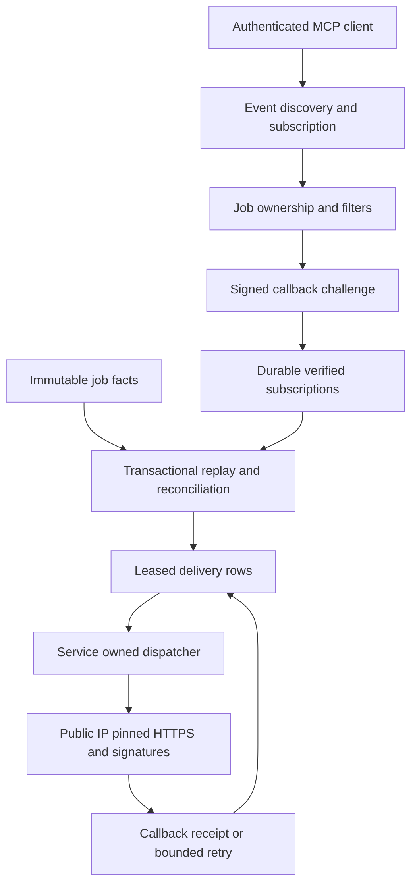
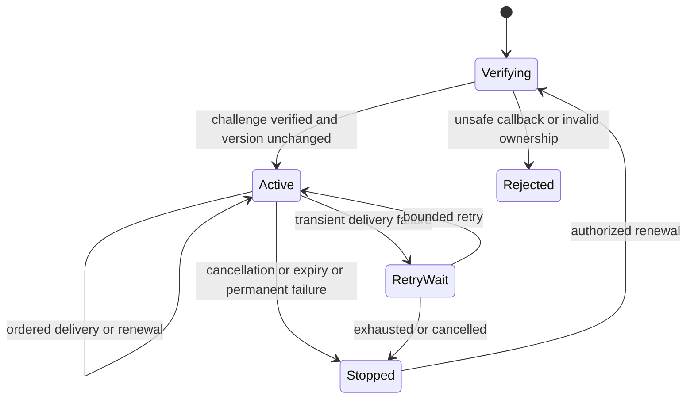

# Verified MCP subscriptions and durable signed delivery

## Purpose and scope

PR 4 implements Tasks 6–8 of the approved live-stage-events design: job-owned
subscriptions, retained replay, signed HTTPS callbacks, and a durable leased
dispatcher owned by the explicitly started MCP service. The parent design is
approved. This slice is not proof of unsolicited ChatGPT presentation.

Changed: delivery infrastructure and optional Events protocol methods.
Unchanged: processing outcomes, rendering recipes, retry approval, publishing.

## Mermaid flowchart

## Lifecycle/state diagram

Subscription, delivery, processing, and ChatGPT display remain separate states.

## Human approval and external-side-effect boundaries

The user authorized PR 4 implementation. Development uses an isolated checkout,
temporary synthetic databases and fake receivers. No live callback, paid video,
remote plugin update, existing tunnel, production database, or server restart is
authorized here. Dependencies are local to this worktree and lockfile. Runtime
Events requires explicit enablement, trusted ownership mode, and an operator
protection key. Never install or print a real protection key.

## Failure and retry paths

Callback verification occurs outside SQL, before activation. A version check
prevents slow verification from undoing cancellation or renewal. Delivery uses
bounded retries, stable event IDs, fresh signing timestamps, and claim tokens.
Finish delivery is independent of blocked progress delivery. Restart resumes
durable work. No delivery failure starts a new job or changes render success.

## Invariants

- One job store and existing stage-event source; no second workflow engine.
- Verify ownership on tools, subscriptions, and every outbound delivery.
- Encrypt signing secrets; authenticate opaque owner/job/event-scoped cursors.
- Resolve and pin only public destination IPs at every connection; no redirects.
- No SQL transaction spans DNS, HTTP, or artifact verification.
- One in-flight delivery per subscription, bounded cross-subscription concurrency.
- Cancellation, expiry, renewal, rotation, and lease takeover are versioned.
- Replay never skips pending deliveries and reports retained-history gaps.
- Do not purge running-job facts or facts pinned by subscriptions/retries.
- Start no detached dispatcher; expose safe health and close service resources.
- HTTP receipt is not proof that ChatGPT displayed a response.

## Implementation reconciliation and deviations

Pending implementation and verification. The overall feature remains IN_PROGRESS.
This PR also carries the reviewed PR 53 commits: that stacked PR merged into
the former PR 52 branch, not main. Its feature note remains reconciled separately.

Protocol source: [official MCP Events documentation](https://developers.openai.com/plugins/build/mcp-events),
checked 2026-10-26. Installed SDK types supply the custom-method registration seam.
