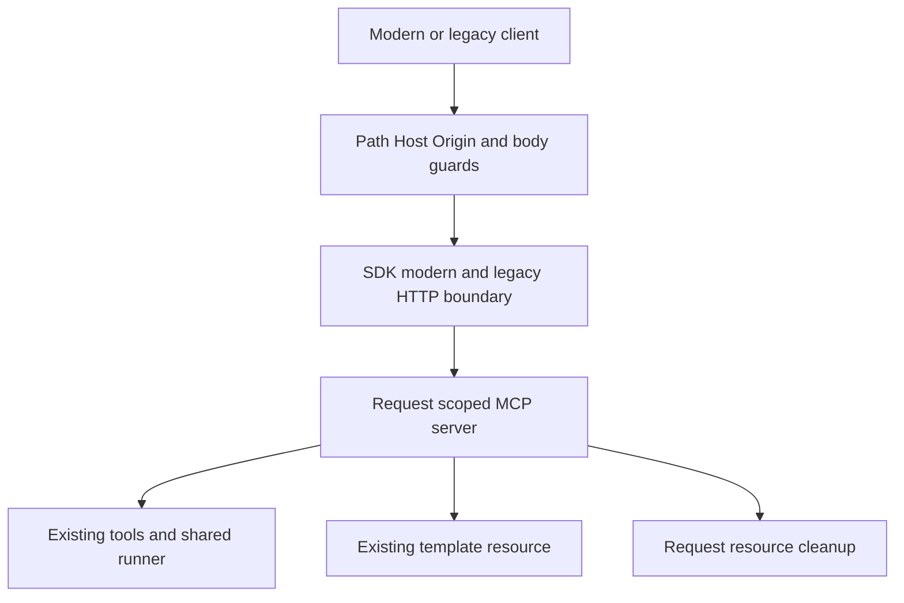
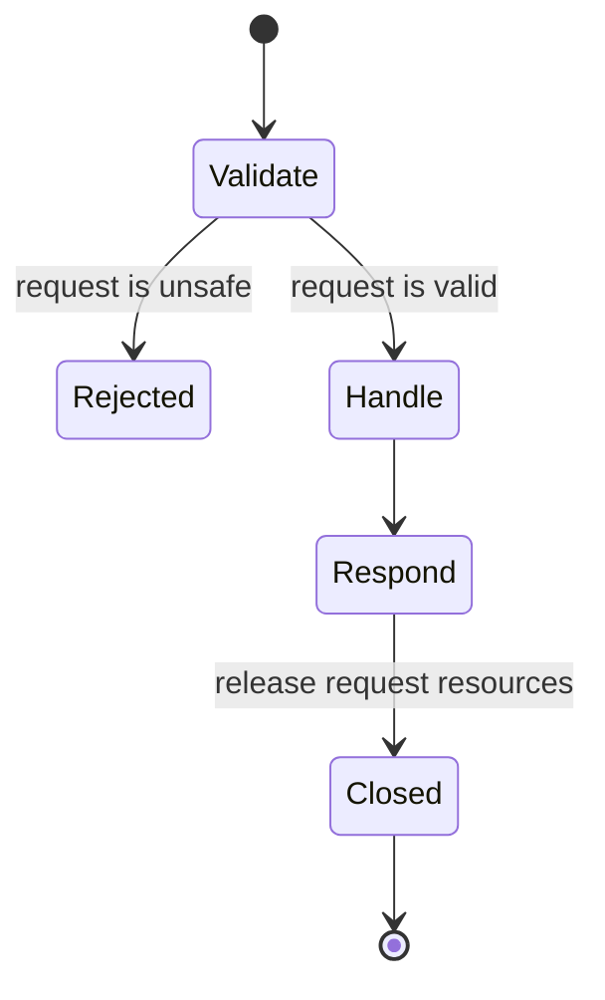

# MCP modern HTTP protocol boundary

## Purpose and scope

PR 1 of the approved live-stage-events plan. Serve protocol 2026-07-28 through
the released SDK entry and preserve stateless legacy clients, four existing
tools, and the template preview resource. Do not advertise or implement Events
subscriptions or callback delivery in this slice.

## Mermaid flowchart

## Lifecycle/state diagram

## Human approval and external-side-effect boundaries

The user approved execution of the live-stage-events plan. This slice changes
only the isolated implementation checkout and dependency lockfile. Tests use
temporary stores and ephemeral local HTTP ports. No real job is started,
production plugin updated, callback contacted, or running service restarted.
The user separately approved and operated a visible server on port 7332 and
a separate test tunnel/plugin for read-only template listing.

## Failure and retry paths

Unsafe Host/Origin, malformed JSON, unsupported paths, and oversized bodies
retain their rejection boundaries. Unknown Events methods return method-not-found.
A failed request does not close the shared runner/store. Existing retry tools
retain explicit user-approval requirements.

## Invariants

- SDK package/version decisions are verified against published manifests.
- Modern discovery does not imply Events support.
- Existing tool names, status schemas, and template UI remain usable.
- No provider, processing recipe, database migration, or worker behavior changes.
- Shared service resources outlive individual requests.

## Package evidence

Registry checked 2026-10-25: server 2.4.0, client 2.4.0, Node bridge 2.1.2;
the Node bridge requires server ^2.4.0. Existing ext-apps 1.7.5 requires SDK
^1.29.0. Keep the v1 dependency for that compatibility surface until tests
prove a supported replacement. Published versions alone do not prove the
protocol integration; HTTP/UI tests are the acceptance gate.

## Implementation reconciliation and deviations

Local reconciliation: `mcp-http.mjs` uses the released SDK modern/legacy entry
and Node adapter. The HTTP server retains its Host/Origin/path/JSON/body guards.
The optional trusted-principal resolver denies null/failed authentication and
keeps concurrent contexts separate. No caller-provided identity field grants
access. SDK request cleanup closes per-request transports, not shared stores.

Tests exercised modern discovery, a pinned modern client, legacy clients,
all four tools, template listing and resource reads, unauthorized discovery,
oversized bodies, paths, existing Host/Origin guards, concurrent principal
isolation, and actual low-level close notifications. All 67 CI-safe test files
and all 52 plugin tests pass; targeted ESLint and repository lint pass.

Live compatibility evidence on 2026-10-25: the user reported that the separate
ChatGPT test plugin returned Classic V1 / Default and its public preview link,
with no job created or retried. This verifies a real tool round-trip through
the test connection, not the exact protocol era used by ChatGPT. Modern-era
negotiation is independently proven by the pinned modern SDK client test and
the local read-only check against the visible port-7332 server.

The protocol slice is reconciled. No existing runtime/tunnel was replaced.
Events capability remains absent and the overall live-stage-events feature
remains IN_PROGRESS. Subscription/callback acceptance is still future work.

Sources: [SDK modern migration](https://ts.sdk.modelcontextprotocol.io/v2/migration/support-2026-07-28)
and [legacy HTTP support](https://ts.sdk.modelcontextprotocol.io/v2/serving/legacy-clients).
Package evidence came from published manifests and installed SDK interfaces.
