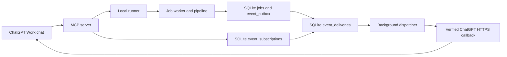
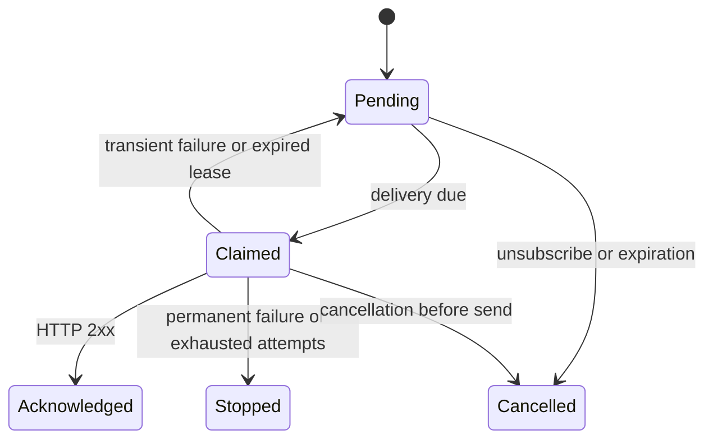

# MCP job completion events

## Purpose and scope

After requesting completion updates, a user receives the final outcome of a
clip-generation attempt in a subscribed ChatGPT Work chat. Deliver one logical
`audiogram.job.finished` event per attempt. Its status is `complete`, `partial`,
`failed`, or `no_clips`. Retries have new job IDs and preserve their parent link.
The event and delivery mechanisms described here are proposed, not implemented.

Changed: protocol support, terminal-event contract, atomic result/outbox writes,
subscription management, and signed delivery. Unchanged: clip selection, Jev,
rendering, explicit retry approval, and separate Instagram publishing approval.
Stage progress and Instagram events are outside this first release.

## Mermaid flowchart

## Lifecycle/state diagram

Acknowledged means webhook receipt, not completion of a ChatGPT response.
Subscription state is separate: verifying, active, expired, or cancelled.

## Human approval and external-side-effect boundaries

- Creating a job does not automatically create a subscription.
- Plugin instructions guide subscription when the user requests updates.
- Never claim monitoring before the subscription is confirmed active.
- ChatGPT supplies callback URL and signing secret. Our service verifies,
  stores, and uses them; outbound webhooks are the new external side effect.
- Local development is explicitly one private tunnel owner. Shared deployment
  requires authenticated ownership checks; job IDs alone do not grant access.
- Delivery retries do not authorize clip retries or Instagram publishing.

## Failure and retry paths

Save result and event in one SQLite transaction. A unique attempt/event-name
constraint prevents duplicate logical events. Delivery is at least once;
duplicate receipt is possible after an acknowledgment is lost.
Persist delivery attempts, leases, and retry deadlines. Stop on permanent
failures or exhaustion. Read final status manually if delivery cannot complete.
Reconcile a terminal event with a late subscription so a fast job is not missed.
Cancellation stops future delivery but cannot recall a request already sent.

## Invariants

- Existing create/status/retry tools remain available.
- Event names and payload validation have one shared owner module.
- Payloads contain only allowlisted safe status fields and verified references.
- No raw logs, provider payloads, transcripts, credentials, or local diagnostic paths.
- Event data is an outcome, never instructions for the receiving model.
- Job results, event facts, subscriptions, and delivery states stay distinct.
- The worker and MCP service communicate through the persistent database.
- Callback verification and delivery block non-public addresses and redirects.
- No events capability is advertised until its required methods work.
- Terminal result writes from every failure path use the same atomic boundary.

## Implementation reconciliation and deviations

Pending implementation and reconciliation. See
`../superpowers/plans/2026-10-15-mcp-job-events.md` for the five-PR sequence.
Each implementation PR creates a separate slice note and declares only that
completed slice. This roadmap stays DESIGN until the complete workflow is
verified. No completion metadata is claimed for planned behavior.

## Sources and protocol vocabulary

Official integration: https://developers.openai.com/plugins/build/mcp-events

The Events extension defines `events/list`, `events/subscribe`, and
`events/unsubscribe`. These are JSON-RPC method names, not tool names or HTTP
verbs. HTTP carries requests to `/mcp`; `tools/call` executes application tools.
Discovery timing is client-controlled, not a required call after each job.
We define the event name, job filter, and data schema through `events/list`.
