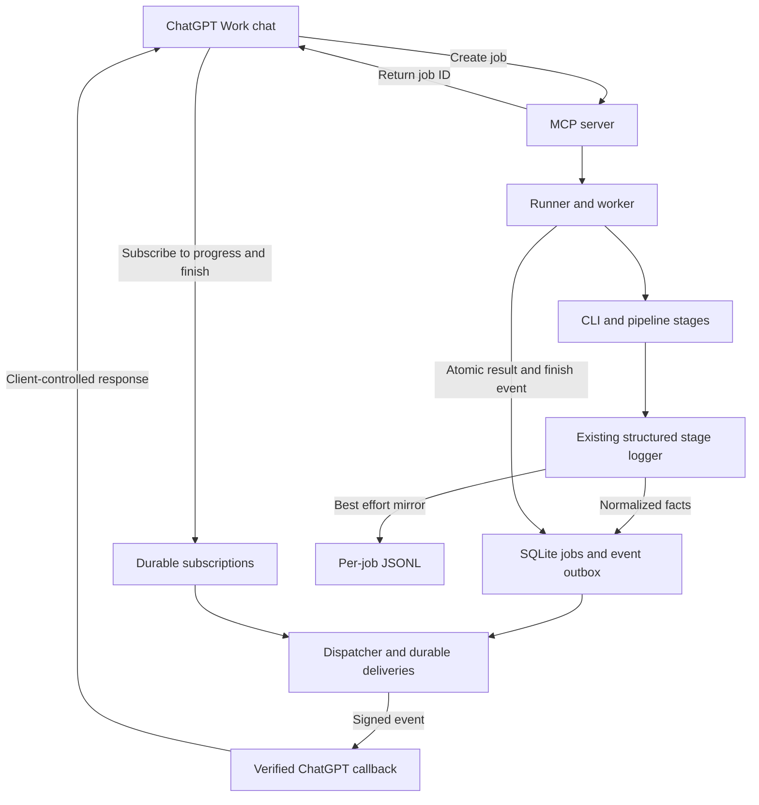
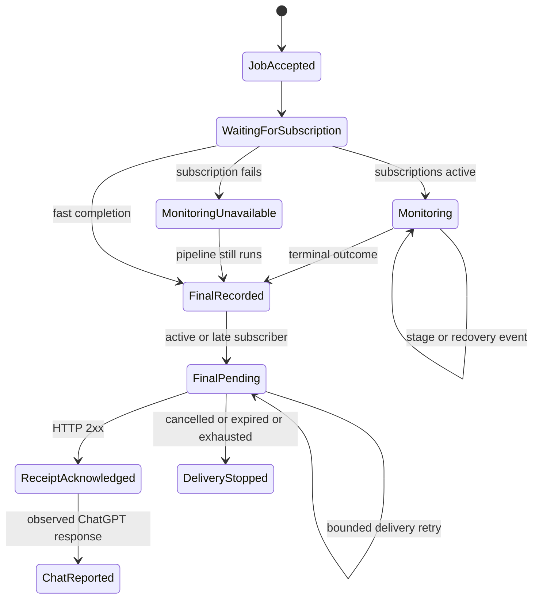

# MCP live job progress and completion events

## Review summary

A user starts an Audiogram job in ChatGPT. ChatGPT subscribes to that job.
The existing stage logger records progress facts. A durable dispatcher sends
those facts to the callback supplied by ChatGPT. The subscribed chat reports
meaningful progress and the final result without another user prompt.

This is an approved design, not implemented behavior. The user requested this
extension and approved it on 2026-10-25, then requested an implementation plan.
The user authorized implementation on 2026-10-25. Slice notes record progress;
the complete subscription-to-chat experience is not yet implemented or verified.

## Purpose and scope

Include stage starts, completions, failures, bounded recovery, and the final
outcome. Cover transcript, selection, Jev, assets, render, and artifact
verification. Include real intake, metadata, setup, and worker failures.
Identify each clip/package and treatment when a stage runs more than once.

Reuse the structured stage logger. Do not add another workflow engine or a
second state machine that decides what the pipeline should do.

Changed: the completion-only design now includes live progress, durable
capture, replay, ordering, and presentation rules. Unchanged: selection rules,
Jev decisions, verified-artifact requirements, explicit retry-job approval,
and separate Instagram publishing approval.

Out of scope: token streaming, fabricated percentages or ETAs, raw-log
delivery, Instagram events, and a separate progress dashboard. We do not
promise that a webhook edits a message in place or creates one reply per event.
Actual ChatGPT behavior must be demonstrated, not assumed.

## Approved design choices

The user approved these design recommendations on 2026-10-25:

- Use `audiogram.job.progress` for transitions and keep `audiogram.job.finished`.
- Record and deliver all eligible transitions; request concise chat summaries.
- Replay retained history to late subscribers, including fast final outcomes.
- Keep notification health separate from processing success.
- Bound stage-storage retries; notification failures must not fail a render.
- Require real unsolicited ChatGPT progress and final responses before shipping.

## Existing source and process boundary

`scripts/pipeline-logger.mjs` already normalizes events and provides
`runLoggedStage`. Callers emit `started`, `completed`, `failed`, `retrying`,
and explicit `skipped` facts through the existing `onEvent` path. Per-job
diagnostics write bounded JSONL files.

Today this path is best effort: `emitPipelineEvent` catches sink errors.
Tailing the bounded files cannot guarantee event delivery. The proposed
logger gains a durable sink before its best-effort JSONL mirror. Both receive
the same normalized fact. Stage callers do not emit a second business event.
JSONL appends do not prove a database commit. Delivery never depends on tailing.

The worker and CLI are separate processes. A function callback cannot cross
that boundary. The runner passes validated job/run identity and the event-store
location through the CLI/environment contract. Each process creates its own
logger sink and opens the same durable database.

Assign a stage-instance ID when each stage invocation begins; reuse it for
that invocation's later facts. Assign a source-emission ID before a durable
append so write retries reuse the ID. One transaction deduplicates that ID
and allocates the next committed job-local sequence. Timestamps do not order
events. Worker lifecycle facts use the same allocator.

Await a bounded durable append before the logger returns. Callback HTTP
requests never block pipeline execution. Keep stdout/stderr and JSONL for
support; do not forward raw records to ChatGPT.

## Mermaid flowchart



## Lifecycle/state diagram



Job, subscription, delivery, and chat-response states are separate. Each
delivery has pending, claimed, acknowledged, retry-wait, stopped, or cancelled
state. An expiring claim lease permits recovery after a service restart.
Receipt acknowledgment does not prove a user-visible response.

## Job creation and subscription

1. `create_audiogram` accepts the request and returns its job ID immediately.
2. Plugin guidance tells ChatGPT to subscribe automatically to that exact job
   unless the user explicitly declines monitoring. The tool result points to that next step, but does
   not claim monitoring is already active.
3. `events/list` describes both names, their required `job_id` filter, and data
   schemas. Discovery timing remains client-controlled.
4. ChatGPT calls `events/subscribe` for each name and supplies its callback URL
   and signing secret. Our runner does not invent a chat callback URL.
5. Our server checks ownership, validates filters, verifies callbacks, and
   stores active subscriptions. It sends no job data before verification.
6. ChatGPT claims full monitoring only when both subscriptions are active. If
   only final-result monitoring works, it must say so. Failure to subscribe
   does not cancel, recreate, or retry the processing job.

The job does not wait for subscription. Previously recorded events remain
replayable. An approved retry creates a new job ID with its parent link and
requires subscriptions to the new ID.

## Shared event contract

One shared module owns names, kind enumeration, stage vocabulary, validation,
and safe message templates. Periods in names are conventions, not paths.

| Event name | Meaning | Data discriminator |
| --- | --- | --- |
| `audiogram.job.progress` | A recorded transition | `stage_started`, `stage_completed`, `stage_failed`, `stage_recovery`, or `stage_skipped` |
| `audiogram.job.finished` | The final outcome | `status`: `complete`, `partial`, `failed`, or `no_clips` |

Map logger `retrying` to `stage_recovery`: an existing bounded recovery inside
the current job, not permission to start another job. A later stage completion
records recovery success; do not manufacture a duplicate completion. Emit
`stage_skipped` only for an explicit pipeline decision. Never invent a skipped
Jev failure. A failed clip stage does not by itself mean the whole job failed.

Progress data includes schema version, job/run IDs, optional parent job ID,
job-local sequence, kind, stage, stage-instance ID, known stage attempt, and
a safe fixed message. Optional fields include package/treatment identity,
duration, counts, and an allowlisted error code. Unknown attempt counts stay
absent. Internal selection recovery stays within its original stage instance.

Illustrative application data, not the full protocol envelope:

```json
{
  "schema_version": 1,
  "job_id": "JobID-A",
  "run_id": "RunID-A",
  "sequence": 12,
  "kind": "stage_recovery",
  "stage": "selection",
  "stage_instance_id": "StageID-A",
  "stage_attempt": 2,
  "code": "SELECTION_INVALID_CUE",
  "message": "The first selection was invalid. Trying selection once more."
}
```

Finish data includes job identity, sequence, final status, every safe
stage/package failure, verified artifact references, and progress-history
completeness. Use `partial` only if a verified artifact exists. Render
completion alone cannot establish job completion before artifact verification.
The existing status tool remains the authoritative result lookup.

## Durable storage, replay, and ordering

| Store | Responsibility |
| --- | --- |
| `jobs` | Processing attempt and verified final result |
| `event_outbox` | Immutable progress/finish facts, source IDs, sequences, safe payloads, and occurrence times |
| `event_subscriptions` | Owner, event name, job filter, callback, protected secret/version, verification, expiry, cancellation |
| `event_deliveries` | Event/subscription pairing, lease, attempts, retry deadline, and receipt outcome |

The outbox is a durable journal with pending delivery work, not a second job
tracker. Do not destructively pop facts. Deduplicate source IDs and delivery
pairs. Many progress facts may share one job/event name; the earlier unique
job/event-name rule applies only to the single logical finish event.

Use a transactional watermark for subscription activation and catch-up so an
event cannot fall between replay and live delivery. A new subscription starts
with retained history. A validated cursor resumes after its acknowledged
position, is scoped to owner/job/event stream, and never skips pending events.
Each subscriber has independent delivery positions and failures.

Send in sequence within each subscription. Retries and separate progress and
finish streams can still cause duplicates or late arrivals. Include the job
sequence in messages. Once a final result is known, older progress is history,
not a currently running stage. A failed progress delivery must not block the
independent finish stream.

Proposed retention: 30 days after finalization, extended while an active
subscription or unexpired delivery retry needs the facts. Do not purge running
jobs' history. Report truncated replay explicitly; never claim full recovery
after a retention gap. Include the current verified status when available.

## Capture and finalization failures

Bound progress-storage retries. If appends fail, latch degraded capture and
propagate that flag across the CLI result boundary as notification-health
metadata. The worker must not infer full history from swallowed logger errors.
After recovery, report incomplete history without inventing missing facts.
A process death before reporting coverage leaves it unknown, not complete.

This health metadata does not turn successful artifacts into a failed or
partial processing result. JSONL truncation and durable-sink failure are
different conditions and must remain distinguishable.

Flush progress appends before finalization. Save the verified final result
and its single finish event in one SQLite transaction. If it cannot commit,
retain the verified worker result for bounded finalization recovery. Do not
rerun rendering or expose a terminal result without its finish event. Reject
late progress appends after finalization. If a worker stops with unfinished
stages, record the actual worker failure, not guessed failures for each stage.

## Durable dispatcher and callback lifecycle

The dispatcher belongs to the operator-started long-running MCP service. It
is not a detached process started by a worker. Its lifecycle and logs must be
visible to the operator. It claims due delivery rows, not arbitrary log lines.

Use signed HTTPS callbacks, verification, protected secrets, ownership checks,
and destination validation. Reject non-public addresses and redirects. Each
delivery has a timeout and bounded backoff; retries preserve its event ID.
Before sending, recheck access, expiry, cancellation, and signing-key version.
Record receipt, transient/permanent errors, exhaustion, and expired leases.
Service restarts resume pending work.

Wrap each fact in the protocol event envelope, with its stable `eventId`,
`name`, `timestamp`, application `data`, and replay `cursor`. Send one event
per request. Use Standard Webhooks HMAC signing; refresh the signing timestamp
and signature on each attempt. Callback verification uses a signed, fresh,
single-use challenge before activation. Keep the signing secret out of event
data and logs. Never substitute an unsigned ad hoc callback format.

Renewal updates the same logical subscription. Secret rotation must not create
duplicates. Expiry pauses sends until authorized renewal. Cancellation stops
future sends but cannot recall an in-flight request. Neither stops processing.
These are our application events sent to ChatGPT, not OpenAI API response
webhooks sent to our backend.

## User-facing progress

Desired messages include:

- "Job accepted. Live updates are active."
- "Transcript ready. Selecting clips."
- "The first selection was invalid. Trying selection once more."
- "Jev ranking finished. Preparing media."
- "One clip finished rendering; the remaining clips are still processing."
- "The job finished. Three clips passed verification."
- "Selection failed after recovery. No clips were produced. Retry this job?"

Plugin guidance requests concise milestone, recovery, failure, and final
updates. Include job identity; distinguish package failure from job failure.
Ignore stale progress after the final outcome. Describe catch-up as history,
not a reason to announce an already completed stage as running.

Retain and deliver all eligible facts. Do not drop them to control chat volume.
ChatGPT may batch events or choose how to respond; instructions express desired
presentation, not a guaranteed animation, latency, or reply count. Do not send
empty heartbeat callbacks or token-sized events merely to simulate motion.
Callback acceptance alone is not evidence of the requested user experience.

## Human approval and external-side-effect boundaries

- Starting a job and subscribing are separate operations. A returned job ID
  triggers automatic subscription guidance unless the user declines monitoring.
  Job creation alone proves no active monitoring. Host permission requirements still apply.
- Notifications authorize no new retry job or Instagram publishing action.
- Local development has one private tunnel owner. Shared use requires
  authenticated ownership checks; possession of a job ID is not authorization.
- Never send transcripts, raw logs, provider output, credentials, callback
  query strings, or local diagnostic paths as event data or operator summaries.
- Event messages are fixed safe facts, not instructions taken from videos.
- This document edit authorizes no deployment, installation, live subscription,
  paid call, background process, or product implementation.

## Failure and retry paths

Processing failure, progress-capture degradation, subscription failure,
callback-delivery failure, and absent ChatGPT presentation are different faults.
A notification failure must never restart processing. An inaccessible callback
does not erase events; they remain recoverable within retention/retry policy.

If subscription cannot activate, ChatGPT reports that automatic updates are
unavailable and leaves the job running. Manual status lookup remains possible,
but polling is not this feature's success criterion. Later delivery failure
must be inspectable through safe operator diagnostics and additive status-health
metadata. Do not promise to report a callback outage through that broken callback.

## Invariants

- One existing stage-event source; no second workflow tracker.
- Durable commit precedes a claim that a progress fact was recorded.
- Stable source IDs deduplicate capture; stable event IDs deduplicate delivery work.
- Stage-instance identity distinguishes repeated and parallel package work.
- One logical finish event per attempt; callback delivery is at least once.
- Ordered records do not imply ordered display or one ChatGPT reply per event.
- The final verified result outranks late progress and includes all safe failures.
- Skipping is not failure; recovery is not a new retry job.
- Job results, facts, subscriptions, deliveries, and notification health stay distinct.
- Unknown coverage never becomes a claim of complete progress history.
- Existing create/status/retry tools remain usable; health fields are additive.
- Advertise events only after the required discovery/subscription/delivery path works.

## Acceptance and review gates

The event and presentation choices were approved for planning. Before shipping,
prove:

- A real supported ChatGPT chat subscribes to the returned job and reports
  progress before completion, then the verified final outcome without a prompt.
- Real success and failure runs show truthful updates; explicit skipped Jev
  and successful bounded selection recovery are not reported as job failure.
- Fast completion before subscription still delivers the outcome through replay.
- Repeated/parallel clip stages, duplicates, and delayed callbacks do not make
  a finished job appear to be running again.
- Crashes around capture, finalization, sending, and acknowledgment recover
  without rerendering or duplicating a logical finish.
- Durable-store outages and JSONL truncation expose honest coverage; successful
  artifacts remain successful even if notification history is incomplete.
- Two dispatchers and subscribers isolate ownership, leases, cursors, failures,
  renewal, cancellation, and secret rotation.
- Unsafe addresses, unauthorized job access, and raw content are blocked.
- Multi-clip runs do not flood the chat. Measure actual delay, batching, and
  stale-event behavior instead of inventing a latency promise.

## Implementation reconciliation and deviations

Pending implementation and reconciliation. Design approval does not claim
working events or authorize product implementation, deployment, or publication.

Use `../superpowers/plans/2026-10-25-mcp-live-stage-events.md` for the approved
scope's implementation plan. The completion-only plan dated 2026-10-15 is
superseded and retained for history. The revised plan retains five dependent
PRs and expands their responsibilities to cover progress capture and replay.

Design checks: the feature-document metadata gate passes. The stage source and
separate-process boundary were checked against the current logger, CLI, worker,
and diagnostics modules. These are document checks, not implementation or live
ChatGPT acceptance results. The existing best-effort logger does not already
provide the durable-capture guarantees proposed here.

## Sources and protocol vocabulary

[Official MCP Events documentation](https://developers.openai.com/plugins/build/mcp-events),
checked 2026-10-25, describes webhook subscriptions, callback verification,
refresh, and cancellation. It identifies supported Work chat environments and
supports modern protocol `2026-07-28` and legacy Streamable HTTP initialization.
Both paths must expose the same enabled Events methods. Confirm the target chat in acceptance
testing. Our event names and persistence choices are application design,
not a claim of already implemented SDK support.

`events/list`, `events/subscribe`, and `events/unsubscribe` are JSON-RPC
methods, not tool names or HTTP verbs. `tools/call` invokes application tools.
Progress here uses discrete callbacks, not token streaming. Client batching
and asynchronous processing require separate evidence of receipt and visible
response.
