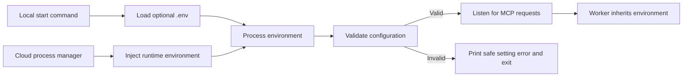
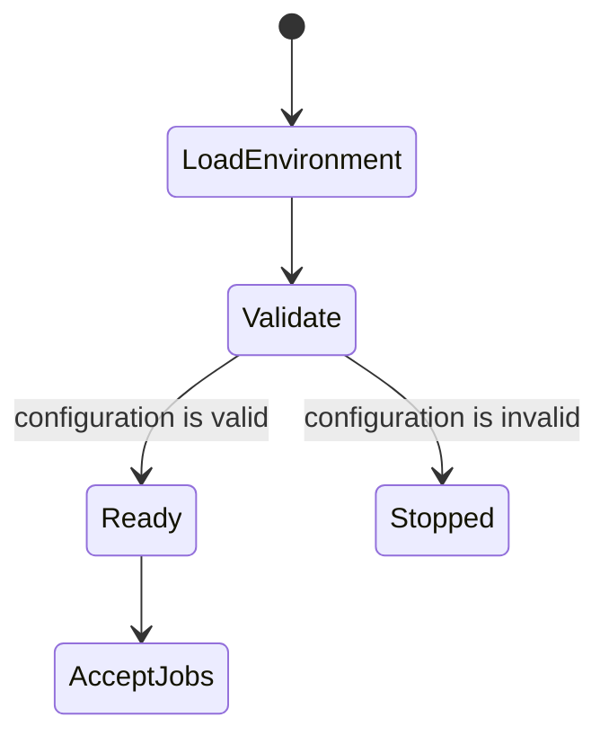

# MCP runtime configuration

## Purpose and scope

Load an optional local `.env` file when the MCP server starts. Validate the
runtime configuration before the server accepts jobs. In a cloud host, the
platform supplies the same values through its environment or secret manager.
This change does not deploy cloud resources or design multi-user OAuth.

## Mermaid flowchart

## Lifecycle/state diagram

## Human approval and external-side-effect boundaries

- Local startup may read the ignored `.env` file. It must not print its values.
- Cloud hosting must provide settings and secrets through the host environment.
- This change does not upload credentials, create cloud resources, or deploy.
- This change does not move local ChatGPT OAuth credentials to a shared host.

## Failure and retry paths

- Missing or invalid required settings stop startup before the MCP port opens.
- The error names the setting that needs attention, but never its value.
- A corrected environment permits a normal restart. Job retry behavior does not change.

## Invariants

- The local command loads `.env` only when the file exists.
- The server uses platform-injected variables when no local `.env` file exists.
- The worker inherits the validated server environment.
- Configuration validation does not make network calls or create provider clients.
- No credential values appear in startup logs, tests, or documentation.
- Cloud Run deployment and per-user OAuth remain separate future work.

## Implementation reconciliation and deviations

Review fixes leave optional Jev settings disabled in the example and use the
default external OAuth credential path. Startup rejects relative, unnormalized,
or repository-contained OAuth paths and invalid Jev values before listening.
The README requires Node 22.13.0 or newer. Tests start with the actual example
configuration and check invalid Jev and OAuth settings. These checks do not
read credentials or contact providers. Credential file access checks still run
when the worker opens the credentials.

The `audiogram:mcp` command loads `.env` when the file exists. The MCP entry
point validates the selector/provider configuration and the Jev endpoint/key
pair before it starts the HTTP listener. It reports safe setting errors without
printing values. The worker continues to inherit the server environment.

The plugin README now documents local setup and the cloud environment boundary.
The integration test verifies missing settings stop startup, local `.env`
settings start the server, platform-injected settings start the server without
`.env`, and an incomplete Jev pair stops startup. No cloud deployment or
multi-user OAuth behavior was added. No other deviations remain.
