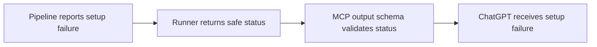
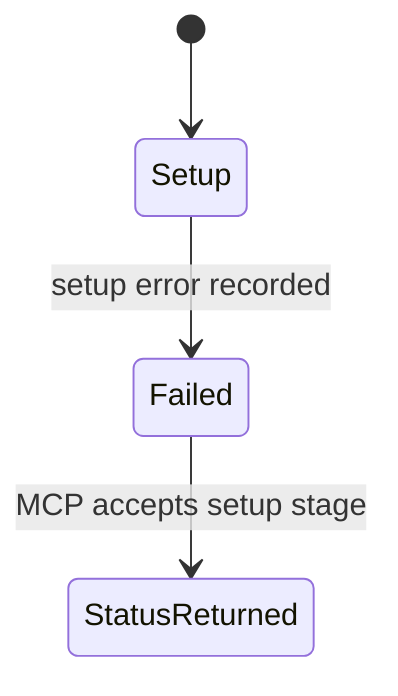

# MCP setup failure stage contract

## Purpose and scope

Allow the MCP status tool to return a safe `setup` stage failure from the
single-URL pipeline. Keep the change limited to the status output schema and
its contract test.

## Mermaid flowchart

## Lifecycle/state diagram

## Human approval and external-side-effect boundaries

- The user approved the focused schema and contract-test change.
- This change does not run the video pipeline, retry a job, or restart a server.
- MCP continues to return safe failure summaries only.

## Failure and retry paths

- If setup fails, the MCP status schema accepts the `setup` failure stage.
- If schema validation fails, the contract test must fail.
- Retry behavior does not change.

## Invariants

- The `setup` stage name matches the pipeline result contract.
- The status schema does not expose raw process output or private paths.
- Existing failure stages and status behavior remain unchanged.

## Implementation reconciliation and deviations

`server.mjs` now allows the `setup` stage in the MCP output schema. The MCP
contract test sends a failed job with a `setup` failure and confirms that the
client receives the structured failure. The focused contract test and the full
Audiogram plugin test suite pass. No intentional deviations remain.
