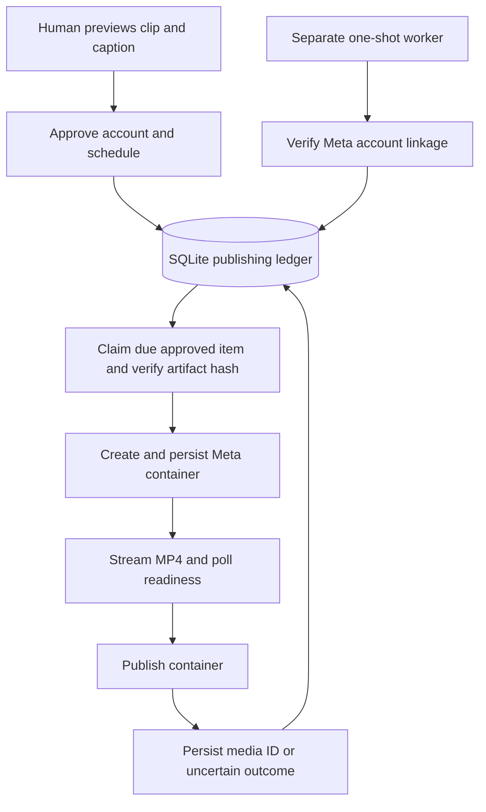
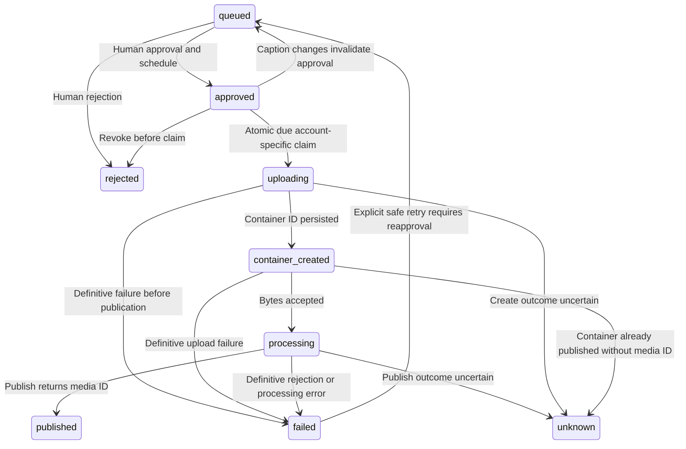

# Native Instagram publishing worker

## Scope and review status

The seven-point first slice, written design and implementation plan were approved
in conversation, with live Meta testing explicitly authorized. It supersedes the R2 transport portion of the September
20 publishing design, not the existing human approval boundary.

Code work stays in `codex/native-instagram-publishing`; preserve the original
checkout's code, credentials and uncommitted files. For live validation the user
explicitly replaced the isolated-data plan: use the existing App Support publishing
database, existing artifact root, and pass the original checkout's `.env` path to
Node without displaying, copying or modifying its contents. Deterministic tests
continue to use temporary databases and fixtures.

## Architecture

A separate Node worker runs one due item per invocation. No background service
is installed or started automatically. A future scheduler can invoke this
command; this slice preserves the existing approval and scheduling UI.

The Meta adapter uses Facebook Login and the Page access token. Before claiming
an item, verify the configured Page links to the configured Instagram ID and
that the Instagram username matches the required `INSTAGRAM_USERNAME` setting. Claim only records
for that account with explicit approval and a due UTC timestamp. Never map
legacy `local-approval` records to the real account automatically.

After claiming, validate the repository-relative MP4 and compare its actual
hash with the approved artifact hash. Create a REELS resumable container,
persist its ID, stream the file to Meta's upload URI, poll readiness, then
publish the existing container and persist the returned media ID. Validate
the upload URI against the expected HTTPS Meta host before sending credentials.
Use asynchronous streaming and bounded network timeouts; never buffer the
whole video or hold a SQLite transaction during a network request.

## Mermaid flowchart

## Lifecycle/state diagram

## Human approval and external-side-effect boundaries

Approval applies to the artifact, destination account, caption and schedule.
A changed caption returns an approved item to queued and clears approval;
claiming freezes mutable publication fields. Use conditional transactional
updates to prevent caption editing from racing a worker claim.

Live testing is authorized, including real posts to `theballooninquiries`.
Each test still uses one specifically approved clip/caption and one-shot worker
invocation. Do not bypass the queue, bulk publish, delete test posts, or activate
an unattended loop. Identify the candidate and caption before asking for its
queue approval; broad development authorization does not approve unknown media.

## Failure and retry paths

- Retry transient read requests with bounded backoff; preserve rate-limit hints.
- Do not blindly retry container creation, upload, or publication after an
  ambiguous network response. A timeout is not evidence that a write failed.
- Persist a publish-attempt marker before calling media_publish. A crash after
  that marker requires reconciliation, not another automatic publish request.
- Resume an existing known container by querying Meta. Never create a replacement
  automatically after a publish attempt. PUBLISHED without a recovered media ID
  remains operator-visible and must not trigger another publication.
- A stored pre-publication phase permits safe status inspection. Expired or
  rejected containers become explicit failures; pending processing can be resumed
  on a later invocation without holding an HTTP approval request open.
- Serialize worker ownership across an invocation and recovery using a durable
  lease/claim mechanism; a second worker must not recover an actively owned item.
  Lease expiry alone cannot authorize repeating an ambiguous external write.
- Failed records are retryable only when publication is known not to have
  happened; unknown records cannot use the generic failed-item retry action.
- Authentication failures stop before uploads; no credential values or raw
  provider response bodies go into logs or diagnostics.

## Invariants

- Rendering and enqueueing never authorize publication.
- Due-time, account, approval, and artifact-integrity checks precede uploads.
- Only a confirmed media ID transitions to published.
- Approved captions cannot silently change underneath the worker.
- Existing published items are never selected again.
- Container creation occurs near publication, not days ahead of schedule.
- Token validity does not prove a Reel meets Meta's media requirements.
- Main's code, credentials, artifacts and untracked work remain untouched; the
  explicitly authorized existing publishing database records the real outcome.

## Validation

Use real read-only Meta responses for identity and linkage, then real container
creation, upload, status polling and one approved public Reel. Record sanitized
IDs, timestamps and outcomes; verify the resulting media and rerun the worker
to demonstrate that it does not select the published item again.

Also retain isolated deterministic tests for duplicate claims, changed captions,
wrong accounts, tampered artifacts, timeouts and crash recovery. These exercise
dangerous paths without intentionally duplicating live posts. Mock-only success
does not count as completion of the live API validation requested by the user.

## Changed and unchanged

Changed: native Meta transport, separate worker, account-aware claiming,
caption reapproval, durable execution/recovery metadata and live validation.

Unchanged: rendering pipeline, per-item human approval, local-first dashboard,
one Instagram account, UTC schedules and preservation of local artifacts.
Deferred: broader scheduling UX redesign, multiple accounts, token onboarding
UI, automatic service installation and other social networks.

## Implementation reconciliation and deviations

The worker and recovery command require `INSTAGRAM_USERNAME` without `@`.
Missing or invalid values stop before Meta calls; the account check compares
the configured username with Meta's response and rejects mismatches. Existing
deployments must set this variable before their next worker invocation. This
changes the expected username's configuration only; account-ID linkage and
human approval checks remain unchanged. Publishing tests cover configuration,
command propagation, and mismatched usernames.

Implemented in `publishing-ledger.mjs`, `publishing-execution.mjs`,
`instagram-client.mjs`, `publishing-worker.mjs` and `publishing-run.mjs`.
Deterministic tests cover approval invalidation, additive migration, account/item
claims, safe retries, transactional terminal writes, interrupted ownership,
streaming contracts, artifact tampering and crashes around external writes.

The ledger and attempts are updated in one execution-owned SQLite transaction.
An exclusive directory lock uses a PID/UUID owner file with mtime heartbeat; there
is no time-based takeover. Polling/hashing are worker responsibilities, not client
transport responsibilities. Hashing uses explicit reads and the same descriptor
as streaming, with metadata/hash checks before and after upload.

Conservative deviation: every unsuccessful publication response stays unknown,
even a provider rejection, rather than classifying some publication errors as
safe to retry. This may require more operator intervention but avoids duplicates.
The CLI is opt-in with explicit absolute DB/root, item and `--live`; account-check
mode performs only reads and never opens a ledger.

Live validation succeeded on 2026-10-04 UTC (October 3 local time): the user
approved the selected hash and caption through the updated dashboard, the native
worker published media `18473362021119016`, and Meta returned the exact caption
and username. The Reel was visually inspected and browser playback confirmed.
A second invocation returned the same media ID with one persisted attempt and
one claim. See `docs/research/native-instagram-live-validation.md` for evidence.

User-authorized data deviation: the test used the existing database and artifact,
not an isolated live-test copy. The selected legacy placeholder account was
explicitly changed to the real account and returned to queued before fresh UI
approval. Port 8787 was restarted with feature-branch code and the original
artifact root; original checkout source files were not edited. The token was
loaded by Node from the user-approved env-file path, never displayed or copied.

The one-shot slice is complete, not automatic scheduling: clicking Approve +
schedule records authorization but does not start a worker or create a timer.
An automatic dispatcher remains a separate design/implementation task.

## API references

- https://developers.facebook.com/documentation/instagram-platform/content-publishing
- https://developers.facebook.com/documentation/instagram-platform/content-publishing/resumable-uploads
- https://developers.facebook.com/documentation/instagram-platform/instagram-api-with-facebook-login/business-login-for-instagram
- https://developers.facebook.com/documentation/instagram-platform/app-review
