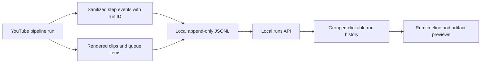
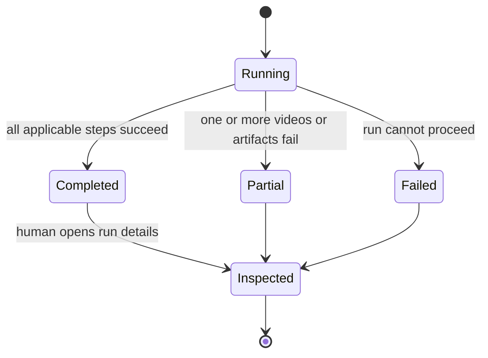

# Pipeline run history and details

## Mermaid flowchart

## Lifecycle/state diagram

## Human approval and external-side-effect boundaries

Run history is local observability. Opening a run or previewing its artifacts
does not change queue state. Each Reel remains in the existing approval queue
until a person explicitly approves and schedules it. This feature makes no
Instagram publishing calls.

## Failure and retry paths

- Record a failed step with a safe diagnostic and retain earlier successful
  steps and artifact links for partial runs.
- A later pipeline invocation creates a distinct run ID; it must not rewrite
  the previous run's history.
- If log data is missing or malformed, show a useful empty or unavailable state
  without hiding the queue UI.
- If an artifact is no longer available, keep the step visible and report that
  its preview cannot be loaded.

## Invariants

- Every event and artifact association belongs to one stable run ID.
- The history groups events by run ID and orders runs newest first; each detail
  view orders steps by occurrence.
- Events contain bounded metadata only. Transcript text, captions, OAuth data,
  and API keys never enter the activity log or run API response.
- Artifact previews use the existing local preview and approval mechanisms.
- Run inspection never implies approval or publication.

## Changed and unchanged summary

Changed: turn the current flat event list into a run history with clickable
details, a pipeline timeline, safe failure diagnostics, and links/previews for
artifacts produced by that run.

Unchanged: local JSONL persistence, the publishing queue, human approval and
scheduling requirements, and the absence of automatic Instagram publishing.

## Implementation reconciliation and deviations

DESIGN only. Implementation and tests have not started. Reconcile this section
after implementation by comparing the actual event schema, run API, timeline,
and artifact links with this design.
