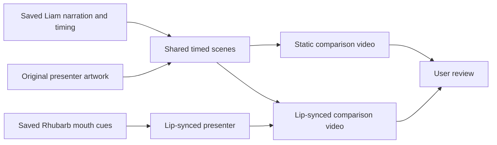
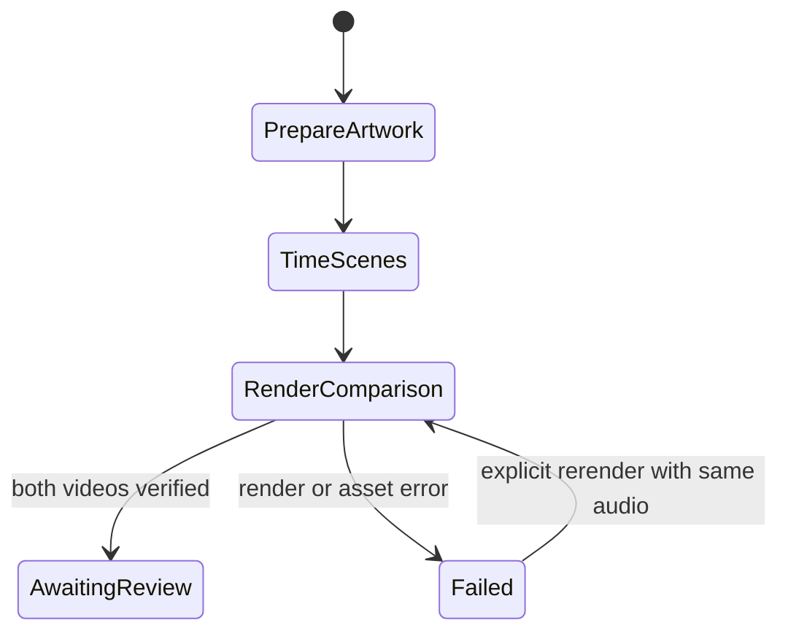

# Original presenter comparison with Liam

The user rejected the screenshot crop and first mouth artwork. Compare a new original presenter in static and lip-synced versions. Both use the previously approved full Liam recording and the same explanations and diagrams.

## Mermaid flowchart

## Lifecycle/state diagram

## Human approval and external-side-effect boundaries

The user requested both renders and an alternative character. Generate an original local preview asset. Reuse the already-paid Liam recording. Do not generate additional ElevenLabs audio or publish videos. The previous presenter references remain untouched.

## Failure and retry paths

Invalid alignment, missing narration or artwork, or a failed render stops the affected output. Validate sentence timing and cue ordering. Rerender locally using the same stored audio; do not repeat paid speech requests.

## Invariants

Both videos use identical audio, durations, scenes, captions, and presenter artwork. Only the mouth animation changes. The screenshot is not used. No production template registration or publishing. Preserve prior sample assets and Classic behavior.

## Changed/unchanged summary

Add experimental comparisons with a new character. Keep the existing samples, production catalog, and presenter close-up intact.

## Implementation reconciliation and deviations

Rendered both requested 720 by 1280 H.264/AAC videos with the original generated presenter. Each has 963 video frames at 24 fps and a 40.17-second container duration. Decoded audio hashes match. The same component, diagrams, scene timing, and captions are used in both; only Rhubarb-driven mouth artwork changes.

All 102 approved spoken words match the saved Liam alignment. Focused tests cover alignment mismatches, cue boundaries, and duplicate provider requests. Lint, type checks, and feature-document validation passed. The offline Classic fixture passed under evidence/liamcompare-1793853467. Representative frames and enlarged open/rest mouths were inspected. Perceptual review of the new character and mouth remains with the user.

The new original character image, generated speech, and rendered videos remain local. Their shared preview copies survive worktree removal. No additional ElevenLabs request or narration credit was used. No production template or pipeline behavior changed.
