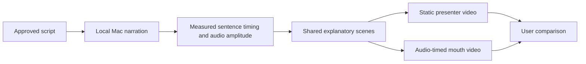
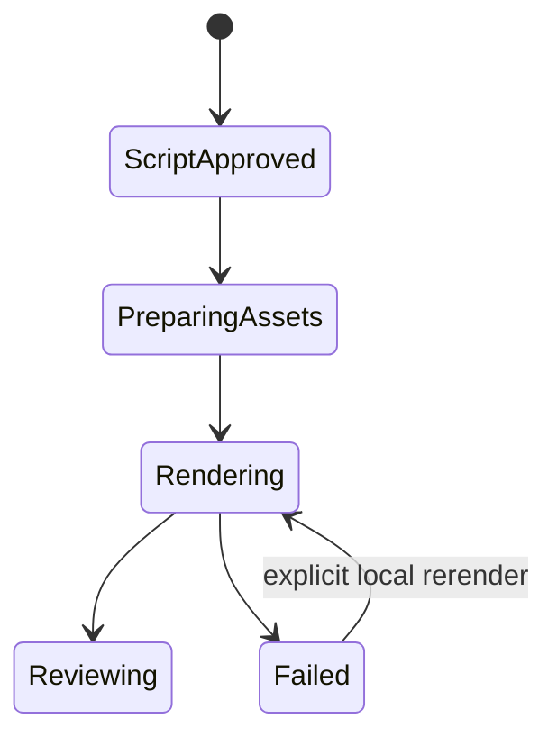

# Presenter comparison

The user approved the command-intent script and producing voice and visuals. Create two local experimental compositions with identical narration, diagrams, captions, and timing. Only the presenter treatment changes. This is not a production template or a new pipeline.

## Mermaid flowchart

## Lifecycle/state diagram

## Human approval and external-side-effect boundaries

Use the approved script, local Samantha voice, and supplied screenshot as a reference presenter. No paid voice provider, upload, account change, or publishing. The screenshot remains a local input, not a topic source. Mouth movement follows audio amplitude, not phoneme recognition. Do not claim accurate lip sync.

## Failure and retry paths

Missing input assets or failed narration prevent rendering. Preserve successful assets for a local rerender. Record measured audio duration and inspect representative rendered frames.

## Invariants

The two samples share audio, scenes, and captions. Frame-based animation only. No modification to Classic defaults or production template catalog. Keep the supplied screenshot unchanged and crop through composition layout.

## Changed/unchanged summary

Add experimental compositions. Existing production behavior remains unchanged. Narration and screenshot assets are local and are not added to Git.

## Implementation reconciliation and deviations

Both 720 by 1280 H.264/AAC samples rendered at 24 fps, about 34.09 seconds each. Representative scene frames and the adjusted mouth placement were visually inspected. Decoded audio hashes match across both videos. The Mac Samantha voice reads the approved script. Sentence-level captions follow measured speech duration.

Lint, type checks, and feature-document validation passed. The required offline Classic fixture journey passed with evidence under skills/verify-just-a-clipper-engine/evidence/1793070478. Generated inputs remain local. Finished previews and check results were copied to shared application previews storage so source-checkout removal does not remove them.

Intentional limitation: the second video is a rough audio-amplitude mouth comparison, not phoneme-accurate lip synchronization. This experimental comparison is complete within that scope. Accurate lip sync and production template integration remain unimplemented.
