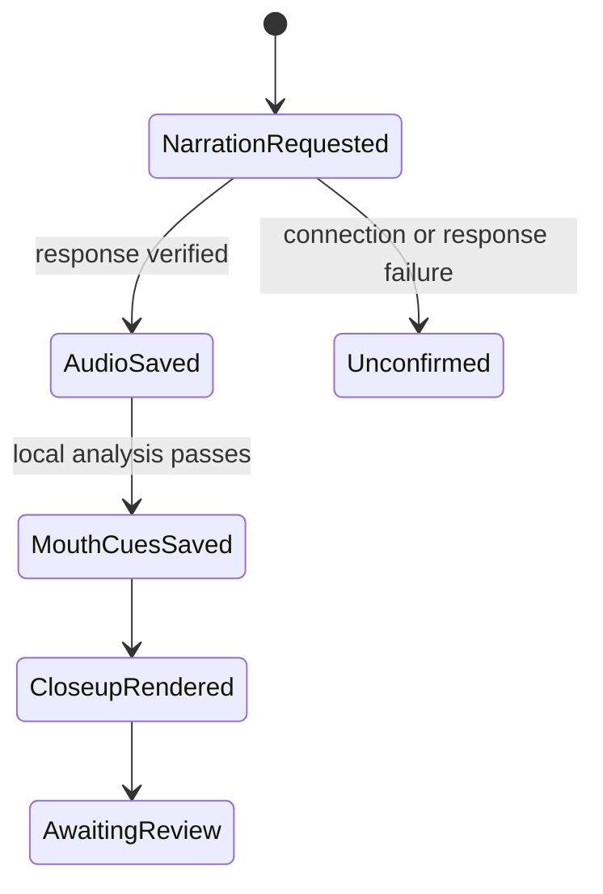

# Liam narration and sound-based mouth animation

The user approved Liam after a short audition, then authorized full narration and a ten-second close-up. Reuse the approved script and existing presenter reference. Stop before full-video production for user review.

## Mermaid flowchart

## Lifecycle/state diagram

## Human approval and external-side-effect boundaries

One authorized ElevenLabs generation uses the main checkout environment without printing secrets. Save output outside the checkout. Download Rhubarb from its official GitHub release and run it locally. No full-video rendering, publishing, or account changes. SVG mouth artwork belongs to the preview component. The supplied screenshot remains unchanged.

## Failure and retry paths

Save request intent before dispatch. An existing request checkpoint prevents accidental regeneration. Save a successful provider response before further processing. Unconfirmed outcomes require inspection, not automatic retry. Local Rhubarb and render retries reuse the accepted audio.

## Invariants

Mouth shapes follow Rhubarb cues, not loudness. Silence uses the resting mouth. Audio, alignment, and mouth cues belong to the same saved recording. Do not claim word timestamps are mouth cues. Low-resolution reference artwork remains a prototype limitation.

## Changed/unchanged summary

Add narration preparation, cue validation, mouth artwork, and an experimental close-up. Existing Samantha comparisons and Classic behavior stay available. Do not register a production template.

## Implementation reconciliation and deviations

Generated the approved 599-character script once with Liam and eleven_multilingual_v2, using the accepted audition settings. ElevenLabs reported 599 charged characters. The 40.124-second narration, character alignment, response, and provenance are saved in shared preview storage. No secret is included in generated manifests.

Official Rhubarb 1.14.0 produced 226 sound-based cues across all nine supported mouth shapes. The preparation command checks the accepted audio hash, runs locally, validates cue ordering and bounds, and prepares caption timing. Four focused tests cover duplicate-request prevention, malformed alignment, cue boundaries/silence, and invalid cues. Lint, type checks, and feature-document validation passed.

Rendered and inspected a 720 by 1280 H.264/AAC close-up: 240 video frames at 24 fps, ten seconds of video. Representative frames show distinct shapes and resting lips. The user still needs to assess perceptual synchronization and appearance. The source screenshot remains low resolution, and the vector mouth overlay is prototype artwork. This is sound-based 2D animation, not a photorealistic talking-head model.

The offline Classic fixture journey passed with evidence under skills/verify-just-a-clipper-engine/evidence/1793850495c. Verification first encountered a stalled managed-browser startup, then the wrapper's whitespace handling and Chrome symlink framework lookup. A temporary shell launcher for the installed Chrome resolved the environment checks without changing application or verification code. Earlier failed evidence remains available.

The finished close-up is preserved beside the accepted narration outside the worktree. Full-video production remains deferred until user review. The original Samantha comparison compositions and production catalog remain unchanged.
