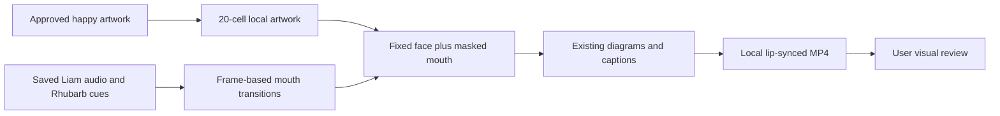
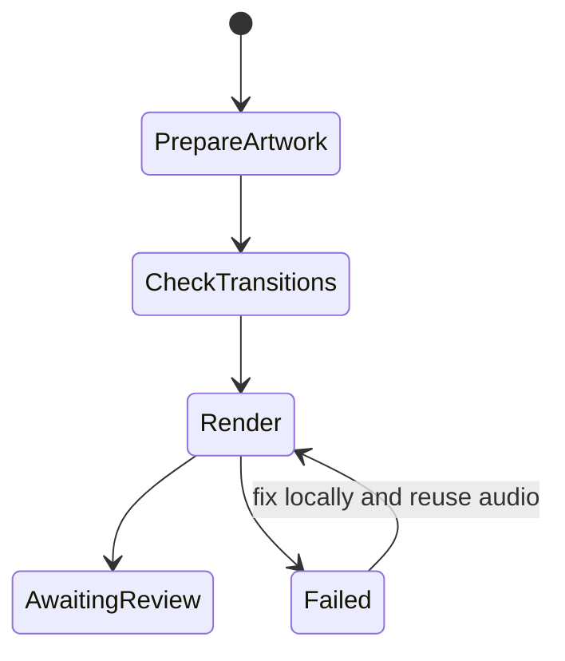

# Twenty mouth drawings for the approved presenter

The user approved expanding the happy presenter to twenty mouth drawings with intermediate openings. Keep the face stable and use saved Liam narration and Rhubarb cues. This is a local preview, not a production template.

## Mermaid flowchart

## Lifecycle/state diagram

## Human approval and external-side-effect boundaries

The user approved the happy likeness and this implementation. Generate illustration artwork with the built-in image tool. Keep likeness assets and videos local and ignored by Git. No new speech request, upload, publishing, or static-video render. Code and instructions remain in the presenter worktree for reproducibility.

## Failure and retry paths

Reject invalid cue timings. Fail on missing artwork/audio. If a render fails, retain prior outputs and rerender using the same audio. Check cell alignment visually; generated art can need further refinement.

## Invariants

The saved narration, timing, diagrams and captions remain unchanged. The face comes from one approved cell; other cells are visible only inside a soft mouth mask. Short consonant closures remain visible, silence returns to rest, and transitions are deterministic at the composition frame rate. Blinking has its own small eye mask. Twenty drawings are a visual palette, not twenty newly recognized phonemes.

## Changed/unchanged summary

Add an experimental composition with a fixed happy face, twenty mouth drawings and intermediate mouth states. Retain all existing compositions and the production catalog.

## Implementation reconciliation and deviations

Implemented `LikenessPresenter`, `mouth-transitions.mjs` and the `LiamLikeness20` composition. The approved happy face and blink artwork remain fixed; only a feathered mouth region reveals the generated 5 by 4 atlas. Long cues use brief entry/exit drawings; cues under five frames and closed-lip consonants retain their target shape. This is discrete animation with intermediate poses, not optical-flow morphing.

The sample uses 19 of the 20 available cells. Cell 15 is reserved for longer F/V cues; this recording has only brief ones. No audio regeneration was performed. The 40.170667-second output contains 963 H.264 frames at 24 fps and 720 by 1280. Its decoded audio SHA256 is `91872768fbeddf29f806eb08a4a6d86a673542f65a06056a3436059f5c5734f2`, identical to the preceding preview.

Eleven focused tests, ESLint, TypeScript and feature-document validation passed. The offline Classic render passed under `evidence/presenter20-20261106`. Sampled rendered frames including a blink and open/closed mouths were inspected. A ten-second enlarged preview is provided for user review; subjective smoothness and phonetic artwork accuracy are not certified by these checks.

Generated personal assets remain ignored under `public/generated/presenter-likeness`. A second local copy and the rendered outputs are stored in the main checkout under `out/presenter-likeness-20`. The twenty-pose presenter code is committed as `59dfff4`. No static version or production catalog change was made.
