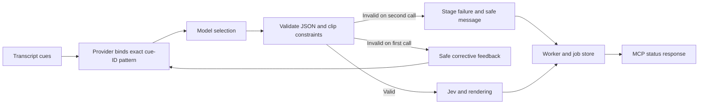
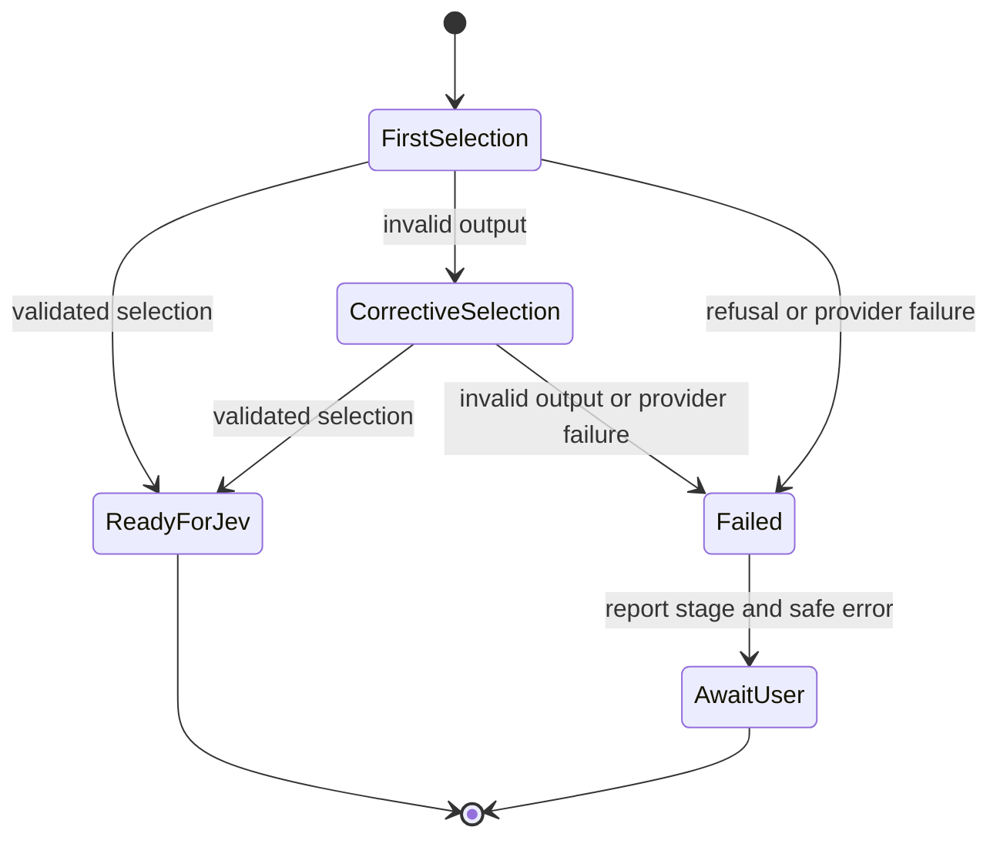

# Grounded transcript selection with bounded recovery

The user approved reporting `SELECTION_INVALID_CUE` instead of a generic
selection failure when a model references a cue absent from the transcript.
The message is: "Clip selection referenced a cue that is not in the transcript."

The user also approved constraining generated references to actual transcript
cues and handling invalid model output. The provider will bind all cue fields
to one shared exact-ID schema pattern derived from the input transcript.
This avoids the provider's 1000-enum-value limit for longer transcripts.
After invalid JSON, invalid output shape, or a clip-validation failure, the
pipeline may make one corrective selection call within the same job attempt.
It must validate the second result too. Network, authentication, response-envelope
errors and refusals do not trigger this recovery. The recipe records the policy
and changes version identity. No prior result is overwritten or automatically retried.

## Mermaid flowchart

## Lifecycle/state diagram

## Human approval and external-side-effect boundaries

This change can make at most two selection calls for one transcript within a
job. The extra call occurs only after local clip validation rejects model
output. Invalid JSON and wrong output shapes also qualify. It does not create
a retry job, edit saved runs, or publish artifacts. Two calls can use two
provider timeout windows and incur two generation charges.
A processing retry still requires explicit user approval.

## Failure and retry paths

The selector assigns `SELECTION_INVALID_CUE` at the membership check. The
analysis layer preserves this one approved code only during selection. Other
errors retain existing stage-specific codes. The pipeline supplies the safe
message. Existing worker validation and MCP output carry the failure code.
Recovery logs a safe event with an attempt count and stable error category.
It never logs transcript text or raw model output. Final invalid references
retain `SELECTION_INVALID_CUE`. Valid output alone can proceed to Jev.

All five cue-reference fields use one shared schema definition. Its pattern
contains only the transcript's actual IDs. Local membership validation remains
mandatory, even with constrained generation. Recovery uses the original cues
and fixed feedback. It does not send the rejected model output back to the model.

The recipe records schema version 2, the cue-binding policy, and the two-call
limit. Existing ledgers reject a changed recipe under an existing package
version. Before deployment, set `AUDIOGRAM_PACKAGE_VERSION` to a new, unused
value, such as `transcript-grounded-v2`, and restart the MCP service. Do not
edit old recipe rows or erase the database. This change does not update the
running service, its environment, or previous jobs.

## Invariants

- Missing transcript cues remain rejected before Jev and rendering.
- Public status includes no transcript text or arbitrary error message.
- Other selection failures remain `SELECTION_FAILED`.
- Unknown error codes do not become public failure codes automatically.
- Existing stored job results remain unchanged.
- At most two selection calls occur within one job attempt.
- Provider failures and refusals do not trigger corrective calls.
- No heatmap fallback or automatic retry job is introduced.

## Implementation reconciliation and deviations

The membership check now assigns `SELECTION_INVALID_CUE`. The analysis layer
preserves that code only for the selection stage. The CLI result supplies the
safe message. Result validation and the MCP status schema preserve the code.

Reconciled the schema builder, both provider transports, structured response
parser, pipeline recovery loop, failure mapping, and tests. Tests cover 1,624
actual IDs, sparse IDs, all five reference fields, duplicate and malformed
IDs, invalid JSON, invalid output shape, invalid cue membership, invalid
evidence order, recovery success, exhausted recovery, and non-retryable errors.
Transport tests confirm that both providers send the bound schema. Pipeline
tests confirm at most two calls, unchanged source cues in feedback, no raw
rejected ID in public results or recovery events, and no rendering after failure.
The CLI result validator and HTTP MCP status response preserve the safe code.
The pipeline suite passes 407 tests. The plugin suite passes 29 tests.

Intentional extension: invalid JSON and output shape now receive the same
bounded recovery as invalid clip references. Refusals remain non-retryable.
No live provider call or production job retry was made.

Changed: generation constraints, bounded selection recovery, recipe identity,
recovery events, and safe failure classification. Unchanged: transcript
acquisition, Jev ranking, rendering, artifact verification, publishing approval,
retry-job approval, and saved outcomes for prior runs.
