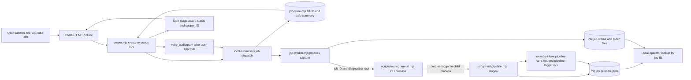

# Single-run worker observability

## Purpose and scope

Give each single-URL worker job a locally inspectable, isolated diagnostic
record keyed by its job UUID. Preserve worker and CLI stdout/stderr; record
stage lifecycle events for intake/metadata, transcript, selection, Jev, assets,
render, and artifact verification; and return a safe exact-stage failure
summary through the MCP status tool. Retries are explicit, each create a new
job ID, and retain a link to the failed attempt.

Design detail and unresolved choices are recorded in
[`docs/superpowers/specs/2026-10-04-single-run-worker-observability-design.md`](../superpowers/specs/2026-10-04-single-run-worker-observability-design.md).
The implementation now records isolated, bounded diagnostics for each job and
returns safe stage failures through MCP.

## Mermaid flowchart

## Lifecycle/state diagram

```mermaid
stateDiagram-v2
  [*] --> queued
  queued --> running: worker starts with job UUID
  running --> complete: CLI contract and artifact verification succeed
  running --> no_clips: selection returns no clips
  running --> failed: stage or process fails; retain safe failure and streams
  running --> partial: failures remain and at least one artifact is verified
  failed --> retry_requested: user explicitly asks to retry
  partial --> retry_requested: user explicitly asks to retry
  retry_requested --> queued: create new UUID linked to prior job
  failed --> inspected: operator looks up UUID locally
  complete --> inspected: operator looks up UUID locally
  no_clips --> inspected: operator looks up UUID locally
  complete --> [*]
  no_clips --> [*]
  inspected --> [*]
```

## Human approval and external-side-effect boundaries

- Submitting the URL authorizes the requested local processing only.
- A failed job does not authorize a retry. ChatGPT must ask and receive an
  explicit user choice before invoking the retry operation.
- Retry creates a new job UUID and isolated log set; the prior job remains
  immutable as the previous attempt's record.
- Raw stdout/stderr and detailed local event files are not returned through
  MCP. MCP returns only bounded, sanitized stage and error summaries.
- During Secure MCP Tunnel testing, logs remain on the local machine; there is
  no remote support upload, publishing, or cloud storage.
- Any future cloud lookup or support portal requires a separate authenticated
  design and approval boundary.

## Failure and retry paths

- Each stage emits start and terminal outcome events under the current job ID.
- A stage failure records a stable stage and error code, preserves process
  streams, and stops representing downstream work as successful.
- Concurrent runs write to separate per-job records; their event streams are
  never interleaved in one JSONL file.
- Logger/file-write failure is best-effort and cannot mask the pipeline error;
  status marks diagnostics incomplete when that can be determined.
- Failed jobs are not automatically retried. An explicit retry creates a new
  UUID with `retryOfJobId` pointing to the prior failed or partial job, using
  the dedicated `retry_audiogram` MCP tool.
- Partial clip/package outcomes retain per-item safe failure summaries in
  `failures[]`; status is `partial` only when at least one verified artifact
  exists, otherwise it is `failed`.
- Jev is always a distinct stage in the trace; record its actual outcome and
  never synthesize a skipped event as a failure.
- Local lookup returns safe structured events only. Raw process output stays
  in separate bounded local files and is not printed by the lookup.

## Invariants

- A job UUID identifies exactly one execution attempt and its diagnostic files.
- The worker passes `--job-id` and `AUDIOGRAM_DIAGNOSTICS_ROOT` to the CLI
  process. The CLI validates the ID, creates the JSONL logger, and passes its
  callback into the single-URL pipeline. No in-memory callback crosses process
  boundaries.
- Event `runId` equals the owning `jobId`; no unrelated run writes into that
  job's event file.
- Required stage order is truthful to actual execution; Jev is its own
  distinct stage and its recorded outcome reflects what actually happened.
- Known failures are never flattened into the current generic multi-stage
  message.
- No transcript/caption contents, credentials, provider payloads, or raw local
  paths are exposed in MCP results.
- Local diagnostic files are permission-restricted and bounded by configurable
  per-file size caps and a documented retention window.
- Existing transcript-LLM selection, provider setup, rendering behavior, local
  artifact boundary, and no-publish invariant remain unchanged.

## Changed and unchanged

Changed: add per-job structured events and process-stream retention, exact
stage-aware job failures, local lookup by support ID, and explicit linked retry.

Unchanged: clip-selection/render semantics, local artifacts, MCP tunnel
boundary, and no external publishing or upload.

## Implementation reconciliation and deviations

The implementation matches the approved process boundary: `local-runner.mjs`
passes `--job-id` and `AUDIOGRAM_DIAGNOSTICS_ROOT` to `job-worker.mjs`, which
passes them to `audiogram-url.mjs`; the CLI process creates the logger and
passes its callback to `runSingleUrlPipeline`. Worker and CLI streams use
separate owner-only files. Both worker and CLI stream files and structured
events have a configurable size cap. The default retention is 30 days, and the next job
creation removes expired UUID directories.

Pipeline stage callbacks record intake, metadata, transcript, selection, Jev,
assets, render, and artifact verification. When no Jev endpoint is configured,
the trace records `jev: skipped`; it does not record a failure. Results retain
per-stage/package safe failures. The worker validates every artifact before it
returns `partial` or `complete` to MCP. Local lookup returns only allowlisted
events. MCP status does not return raw process streams or exception text.

One related safety fix was added after the full suite exposed a test using the
real app credential path despite supplying a test environment. Credential path
resolution now uses the supplied environment. This keeps tests and injected
runtime configuration isolated from process-global credentials.

The focused acceptance suite, plugin suite, serial full script suite, and
feature-document gate pass. No cloud logging, uploads, publishing, or
automatic retry was added.
