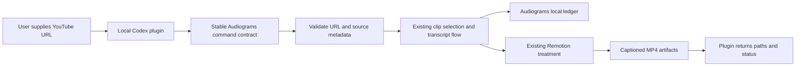
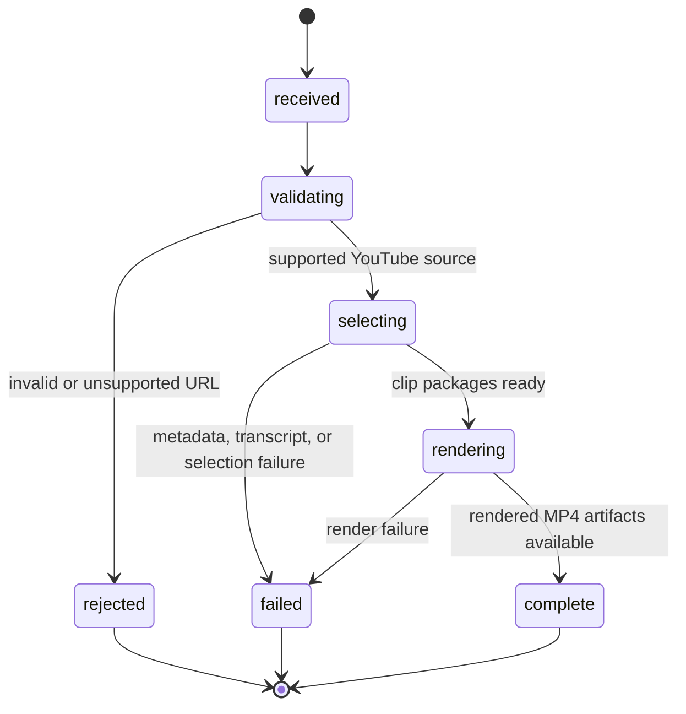

# Single URL Audiogram plugin bridge

## Purpose and scope

Provide a local Codex plugin entry point that accepts one publicly accessible YouTube video URL and returns finished, locally rendered captioned MP4 clips through the Audiograms project.

V1 reuses Audiograms' existing clip selection, package, and Remotion treatment behavior. The existing Most Replayed heatmap selection remains the default; transcript-based selection remains governed by the project's existing explicit configuration. The plugin reports the output artifact paths and processing status. It does not publish clips to a third party.

The current production command starts from the user's private `Audiogram Inbox` playlist. V1 therefore needs a direct-URL intake path that feeds one source into the same pipeline core without requiring playlist membership. The plugin should call a stable project command contract rather than depend on internal module names. This is the adaptation boundary if Audiograms' internals evolve.

V1 supports YouTube URLs only. Arbitrary media URLs, uploaded video files, manually supplied transcripts, and local speech-to-text are outside this design.

## Mermaid flowchart

## Lifecycle/state diagram

## Human approval and external-side-effect boundaries

- The plugin may initiate local metadata/transcript acquisition, clip selection, and Remotion rendering after receiving the URL.
- Rendered MP4s and ledger updates remain local to Audiograms.
- The plugin does not upload, publish, or share clips. Any future publishing integration is a separate feature and must retain an explicit human approval step.
- URL validation must limit inputs to supported YouTube URL forms before invoking project processing.

## Failure and retry paths

- Invalid or unsupported URLs fail before media processing and return a specific validation result.
- Inaccessible media, unavailable captions, and source-tool failures return a failed job result without claiming output exists.
- Selection failures and empty candidate results return an actionable status and do not enqueue nonexistent artifacts.
- Rendering failures remain visible through the existing pipeline diagnostics; retry uses the existing ledger and idempotency behavior where applicable.
- The plugin reports success only when the project command confirms non-empty MP4 outputs and returns their project-relative paths.

## Invariants

- One plugin request identifies one YouTube source URL.
- Selection and treatment defaults are owned by Audiograms and are not duplicated in plugin-side business logic.
- The plugin integration depends on a documented command contract, not private internal module paths.
- Every reported output is a locally rendered MP4 artifact produced by the Audiograms Remotion treatment.
- No external publish or upload occurs as part of the flow.

## Changed and unchanged

Changed: add a direct URL intake path and a local plugin bridge that invokes it and reports rendered outputs.

Unchanged: existing playlist ingestion, selection defaults, clip package format, Remotion treatment, local artifact storage, and publishing approval queue behavior.

## Implementation reconciliation and deviations

Not implemented yet. Reconcile this section against the resulting command, plugin tools, persistence behavior, and tests before marking the feature complete.
