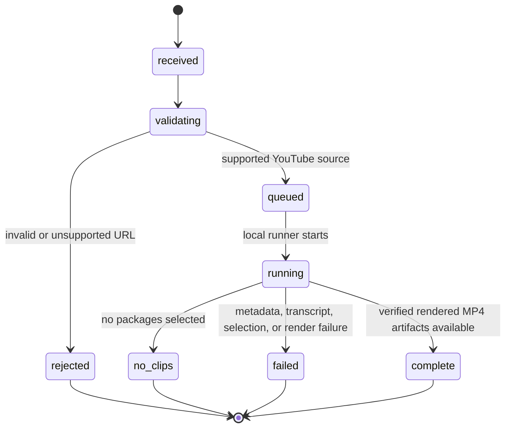

# Single URL Audiogram plugin bridge

## Purpose and scope

Provide a local ChatGPT Developer Mode plugin entry point that accepts one publicly accessible YouTube video URL and returns finished, locally rendered captioned MP4 clips through the Audiograms project. During development, ChatGPT reaches an MCP server bound to loopback through OpenAI Secure MCP Tunnel; the tunnel is not the production host.

V1 reuses Audiograms' existing clip selection, package, and Remotion treatment behavior. The existing Most Replayed heatmap selection remains the default; transcript-based selection remains governed by the project's existing explicit configuration. The plugin reports the output artifact paths and processing status. It does not publish clips to a third party.

The current production command starts from the user's private `Audiogram Inbox` playlist. V1 therefore needs a direct-URL intake path that feeds one source into the same pipeline core without requiring playlist membership. The Streamable HTTP MCP service calls a stable project command/runner contract rather than depending on internal module names. Keep tool names and job/result schemas portable so a future Cloud Run service can dispatch rendering to a Cloud Run Job and store artifacts in Cloud Storage without changing the ChatGPT-facing tools. Cloud deployment is not part of V1.

V1 supports YouTube URLs only. Arbitrary media URLs, uploaded video files, manually supplied transcripts, and local speech-to-text are outside this design.

## Mermaid flowchart

```mermaid
flowchart LR
  User[User submits YouTube URL] --> ChatGPT[ChatGPT Developer Mode]
  ChatGPT --> Tunnel[OpenAI Secure MCP Tunnel]
  Tunnel --> MCP[Loopback Streamable HTTP MCP /mcp]
  MCP --> Runner[Local runner adapter]
  Runner --> Command[Stable Audiograms command contract]
  Command --> Validate[Validate URL and source metadata]
  Validate --> Select[Existing clip selection and transcript flow]
  Select --> Ledger[Audiograms local ledger]
  Select --> Render[Existing Remotion treatment]
  Render --> Files[Captioned MP4 artifacts]
  MCP --> Status[Create job and poll status tools]
  Ledger --> Status
  Files --> Status
  Status --> Result[Truthful status and verified local paths]
```

## Lifecycle/state diagram

## Human approval and external-side-effect boundaries

- The user explicitly submits a URL to start local metadata/transcript acquisition, clip selection, and Remotion rendering.
- ChatGPT connects to the developer's loopback-bound MCP service only through Secure MCP Tunnel. Project code does not create or store tunnel credentials, expose a public listener, or automate account configuration.
- Rendered MP4s and ledger updates remain local to Audiograms.
- The plugin does not upload, publish, or share clips. Any future publishing integration is a separate feature and must retain an explicit human approval step.
- Local paths are reported as local paths only, never represented as public download links.
- Future Cloud Run service/job dispatch and Cloud Storage are outside V1 and require a separate design/review.
- URL validation must limit inputs to supported YouTube URL forms before invoking project processing.

## Failure and retry paths

- Invalid or unsupported URLs fail before media processing and return a specific validation result.
- Inaccessible media, unavailable captions, and source-tool failures return a failed job result without claiming output exists.
- Selection failures and empty candidate results return an actionable terminal status and do not claim artifacts.
- Rendering failures remain visible through the existing pipeline diagnostics; retry uses the existing ledger and idempotency behavior where applicable.
- Status polling remains honest across MCP tool calls and service restarts according to the local runner's persisted ledger/job state; a launched process is not reported as a completed render.
- The plugin reports success only when the project command confirms non-empty MP4 outputs and returns their project-relative paths.

## Invariants

- One plugin request identifies one YouTube source URL.
- Selection and treatment defaults are owned by Audiograms and are not duplicated in plugin-side business logic.
- The plugin integration depends on a documented command contract, not private internal module paths.
- Every reported output is a locally rendered MP4 artifact produced by the Audiograms Remotion treatment.
- No external publish or upload occurs as part of the flow.
- MCP handlers depend on a transport-neutral runner/job interface; local mode needs no Google Cloud credentials or SDK.
- Secure MCP Tunnel is a development connection only and does not constitute production hosting or public distribution.

## Changed and unchanged

Changed: add a direct URL intake path, a loopback Streamable HTTP MCP bridge connected through Secure MCP Tunnel, and create/status tools backed by a local runner.

Unchanged: existing playlist ingestion, selection defaults, clip package format, Remotion treatment, local artifact storage, and publishing approval queue behavior.

## Implementation reconciliation and deviations

Implemented behavior matches the designed boundaries: `create_audiogram` validates and canonicalizes one supported YouTube URL before dispatch; `get_audiogram_status` returns persisted state from a local SQLite job ledger. A detached worker invokes the versioned CLI using an argument array with shell execution disabled. The MCP process binds to `127.0.0.1`, accepts only `/mcp`, applies local Host/Origin checks and a 1 MiB request-body limit, and documents manual Secure MCP Tunnel setup without storing tunnel credentials.

Completion is recorded only after the CLI contract reports `complete` and every artifact resolves to a non-empty MP4 beneath the real `out/treatments` directory. Non-success CLI outcomes remain terminal `no_clips` or `failed` states without artifact claims. A dead worker is marked failed; malformed CLI output and child-process errors cannot leave a job falsely complete. Active requests for the same video reuse one job. The ledger and outputs remain local, and no upload or publishing action is introduced.

Intentional implementation details/deviations: the default job database is stored in ignored `.local/audiogram-helper-jobs.sqlite` within the project (override with `AUDIOGRAM_JOB_STORE`); Node 22's built-in SQLite currently emits its experimental-feature warning. Failure messages surfaced to ChatGPT are intentionally generic and do not expose local paths. The first `create_audiogram` response reports the observed current state; clients should poll `get_audiogram_status` for completion. The Secure MCP Tunnel is configured manually by the developer; no tunnel session or live video render was started as part of verification. The Cloud Run runner/artifact-store adapter, public distribution, and public download URLs remain future work.
