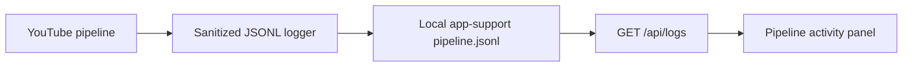
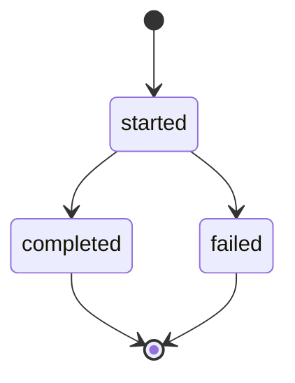

# Structured pipeline logs

## Mermaid flowchart

## Lifecycle/state diagram

## Human approval and external-side-effect boundaries

Logs are local observability only. They do not approve, schedule, publish, or mutate queue state.

## Failure and retry paths

A logging failure must not expose credentials or transcript content; pipeline errors remain reported by the existing pipeline path. Missing log files return an empty activity list.

## Invariants

- Events are append-only JSONL records.
- Only bounded metadata fields are persisted.
- Transcript text, captions, API keys, and OAuth tokens are excluded.
- The API returns at most 1,000 recent events.

## Implementation reconciliation and deviations

The pipeline records transcript-sync and render-and-queue stage events. The local publishing server exposes bounded recent events, and the approval UI renders them in a lightweight activity panel. This PR intentionally does not add remote telemetry or external publishing behavior.
