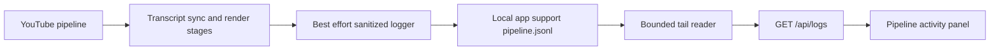
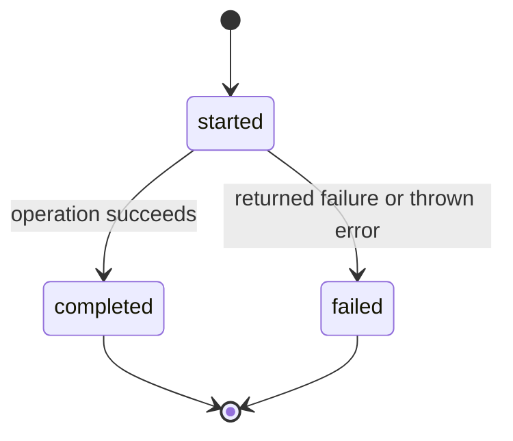

# Structured pipeline logs

## Mermaid flowchart

## Lifecycle/state diagram

## Human approval and external-side-effect boundaries

Logs are local observability only. Logging failures are contained and cannot stop YouTube synchronization, rendering, or queue creation. The approval queue remains local; these events do not approve, schedule, or publish anything externally.

## Failure and retry paths

Directory creation or append failures are reported only through an optional best-effort diagnostic callback and do not alter pipeline execution. Returned analysis/package/treatment failures and thrown stage errors produce failed terminal events; thrown errors continue through the existing error path after the event attempt. The reader reads a suffix capped at `min(8 MiB, max(64 KiB, limit × 16 KiB))` before parsing backward until it has the requested number of valid events or exhausts that suffix. Missing log files return an empty list. Invalid or incomplete records are skipped, leaving valid events available.

## Invariants

- Events are append-only JSONL records.
- Logger failures never control pipeline execution.
- Stage completion reflects the operation result; failure results and exceptions are not recorded as completed.
- API tail reads are bounded by the requested count (16 KiB budget per event), with a 64 KiB minimum and 8 MiB maximum; parsing proceeds backward through that suffix until the requested number of valid events is reached.
- Invalid JSONL records do not hide other valid events in the selected tail.
- Only bounded metadata fields are persisted.
- Transcript text, captions, API keys, and OAuth tokens are excluded.
- The API returns at most 1,000 recent events.

## Implementation reconciliation and deviations

The pipeline uses `runLoggedStage` for transcript sync and render-and-queue. Each stage records `started`, then `completed` only when its returned result has no failures; returned analysis/package/treatment failures and thrown errors record `failed`. Per-video sync failure events remain available. File write errors and event logger rejections are contained. `readPipelineEvents` reads a bounded suffix from the end of the file, discards a partial leading boundary when the suffix begins mid-record, parses backward until it collects the requested number of valid records, and skips malformed records. The publishing server and activity panel continue to use the local `/api/logs` endpoint. No remote telemetry or external publishing behavior was added.

Changed: isolate logging failures, report terminal stage outcomes, bound log-tail reads, and tolerate malformed records. Unchanged: event privacy allowlist, local-only observability, manual approval boundary, and external publishing behavior. Intentional deviation: tail reads use a limit-scaled byte budget (64 KiB minimum, 8 MiB maximum), so an unusually large event may result in fewer than `limit` returned entries.
