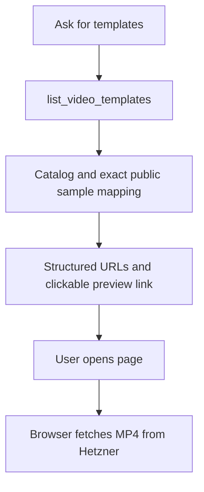
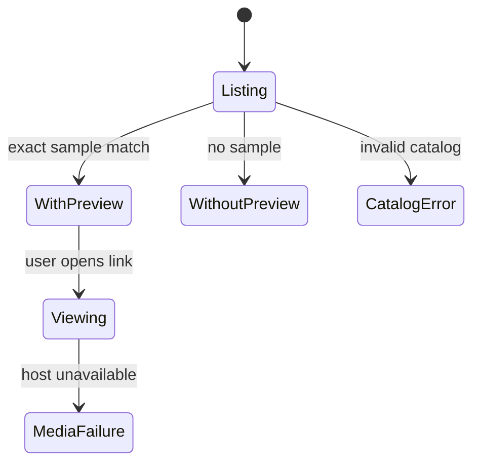

# Hetzner template preview links

## Purpose and scope

Add the existing public neutral Classic V1 sample to list_video_templates.
Return pageUrl, posterUrl and videoUrl on the matching variation and a clickable
page link in text. Preserve contractVersion 1 and all creation selections.
An embedded ChatGPT component is outside this change.

## Architecture and contracts

Use a source-controlled public preview map keyed by template ID, version and
variation. Only classic / 1 / default has an approved sample. Its page is
https://media.ferarana.work/templates/classic/v1/ with poster.jpg and demo.mp4.
An optional preview object has status video-configured and three HTTPS URLs.
Configured does not mean continuously available. Listing performs no remote
request: browsers fetch media directly from Hetzner when users open the link.
New catalog entries without a sample still appear without preview metadata.

## Mermaid flowchart

## Lifecycle/state diagram

## Human approval and external-side-effect boundaries

The user requested connecting the plugin to the exposed Hetzner media endpoint.
This change edits the existing server source. It creates no jobs, uploads no
files and changes no hosting configuration. The operator restarts the MCP
service and refreshes tools after deployment. No automatic UI rendering claim.
The feature-flow-diagrams skill is unavailable; use the previously authorized
feature-note structure. Design review confirms this narrow link-only scope.

## Failure and retry paths

Missing mapping omits preview without blocking the catalog. A hosting outage
does not block the tool; the browser reports failure and the user can retry.
Invalid catalog data retains the existing error response. Remove a mapping to
withdraw a sample. Do not attach another variation's sample as a fallback.

## Invariants

- Preview identity matches template, version and variation exactly.
- Only public neutral samples appear; no local paths or credentials.
- Listing starts no jobs and downloads no video bytes.
- Existing contract fields and Classic rendering remain unchanged.

## Verification plan

Test structured and text URLs through the MCP transport and exact identity
matching with additional versions and variations. Keep zero-job assertions.
Check public page/poster HTTP 200 and MP4 range HTTP 206.

## Implementation reconciliation and deviations

Reconciled against template-previews.mjs, template-listing.mjs and server.mjs.
The exact identity mapping adds optional validated HTTPS preview fields; the
tool description requests showing the sample and text includes a Markdown link.
All 33 focused listing, MCP transport and startup tests passed, including
unmatched identities and zero-job assertions. Public HTTPS checks passed on
2026-10-24: page and poster 200; MP4 range 0-1023 returned 206 with video/mp4.
The static curated map intentionally replaces the broader proposal's local
sample-registry lookup for this narrow release: deployed public samples remain
discoverable without the Mac render store. No runtime network dependency added.
Actual ChatGPT display and audio playback are not verified by these checks.
Rollout still requires an MCP restart and ChatGPT tool refresh. The broader
template-preview-chatgpt note remains a separate, unfinished UI design.
