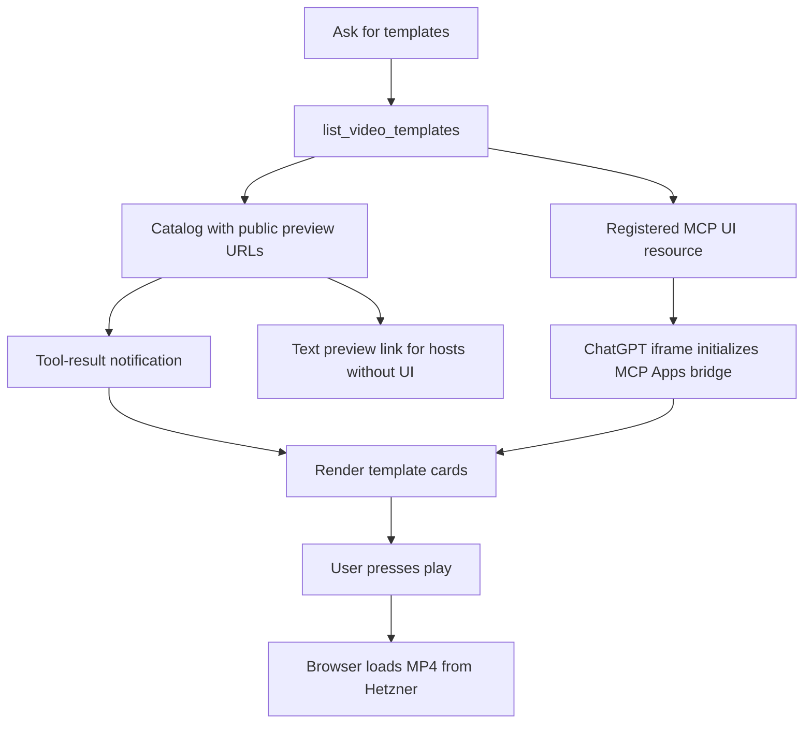
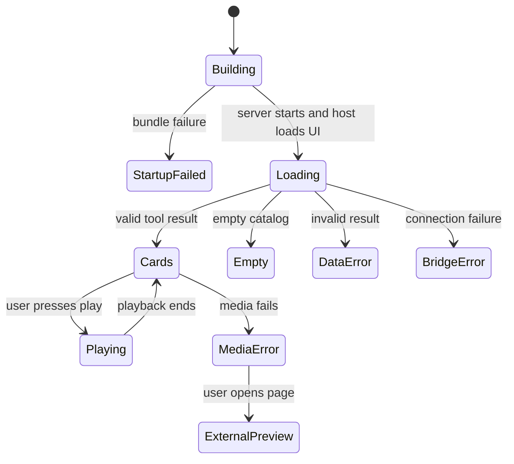

# Inline video template previews in ChatGPT

## Purpose and scope

Show the neutral Classic V1 sample in an inline player when the user calls
list_video_templates. Preserve text links for hosts without UI support.
The user approved implementation on 2026-10-24. No creation or publishing action
is part of the component. The feature-flow-diagrams skill is unavailable; use
the previously authorized feature-note structure.

## Architecture and contracts

The existing catalog and public preview map remain the source of tool results.
The MCP server exposes ui://video-templates/v1.html with MIME type
text/html;profile=mcp-app. The listing descriptor references it through
_meta.ui.resourceUri and the OpenAI outputTemplate compatibility alias.
The UI receives structuredContent through MCP Apps SDK tool-result notifications.

The server bundles vanilla JavaScript and the SDK with esbuild once per startup,
before opening its listener. Failure to bundle stops startup. Resource requests
return that in-memory HTML. No CDN scripts, dynamic code evaluation or nested
frames are needed. The SDK 1.7.5 is compatible with the existing MCP 1.29.0.

Page, poster and MP4 use https://media.ferarana.work. Resource CSP permits that
single media origin; connectDomains is empty. The UI validates media URLs,
rejects credentials and foreign origins, and renders names as DOM text.
The component displays exact template/version/variation identity, a native
video player with controls, playsinline and preload none, and an external link.
Playback never starts automatically. External links use the host openLink bridge.

## Mermaid flowchart

## Lifecycle/state diagram

## Human approval and external-side-effect boundaries

The user approved building and registering the inline component. No hosting,
DNS, SSH or plugin identity changes are required. Only public neutral sample
assets are used. Browsing does not create jobs or call other MCP tools. The
operator restarts the MCP service and refreshes ChatGPT tools for rollout.
Host acceptance must be verified in ChatGPT before declaring full completion.

## Failure and retry paths

Bundle failure aborts startup before listening. An invalid result shows an error
instead of stale cards. Missing preview metadata keeps the catalog card visible.
Media failure retains the external preview link. Bridge or external-link failure
points the user to the text link in the conversation. Retrying the listing
creates a fresh component. Removing the UI descriptor metadata rolls back to
text-only discovery; no media or job data needs migration.

## Invariants

- Classic V1 rendering and creation selections do not change.
- Browsing and playback create zero jobs.
- Media bytes travel directly from Hetzner to the browser.
- Media URLs must match the approved HTTPS origin without credentials.
- Tool text and structured output remain useful without inline UI.
- Local browser success is not proof of ChatGPT sandbox acceptance.

## Verification plan

Transport tests verify tool metadata, resources/list, resources/read, HTML MIME,
media CSP and zero-job behavior. Component tests cover rendering, native video
controls, media errors, external navigation, rejected URLs and malformed results.
Run the plugin suite, lint/type checks and feature-document gate. Verify the
SDK initialization and playback in a local browser harness. After restart and
refresh, verify the real ChatGPT card, play/pause/seek and audio.

## Implementation reconciliation and deviations

Implemented template-ui-resource.mjs, ui/template-preview.mjs and
ui/template-view.mjs; registered the resource in server.mjs. Tests retrieve the
bundled resource through the actual MCP transport. A local iframe harness
completed the SDK handshake, received the tool result and displayed Classic V1.
The native player loaded the Hetzner MP4 and its timer advanced to 0:01 / 0:11.
Audio listening and real ChatGPT sandbox playback remain pending.

This supersedes the earlier Cloudflare Stream proposal: the existing Hetzner
host now supplies all public sample assets. The curated preview map replaces
local registry lookup. Startup bundling replaces a separate generated artifact;
no UI flag or additional build command is required. Keep IN_PROGRESS until
ChatGPT acceptance is confirmed; no COMPLETE claim is made.

## References

- https://developers.openai.com/plugins/build/chatgpt-ui
- https://developers.openai.com/plugins/reference
