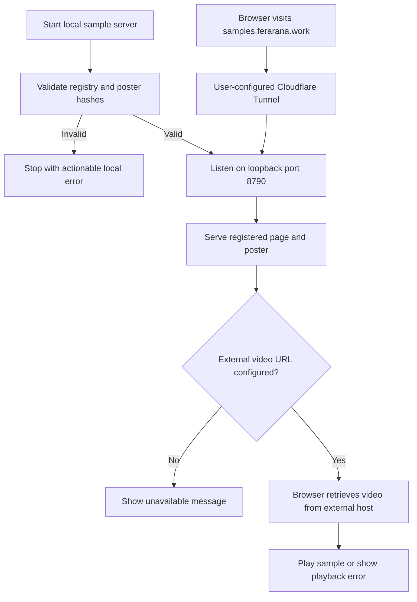
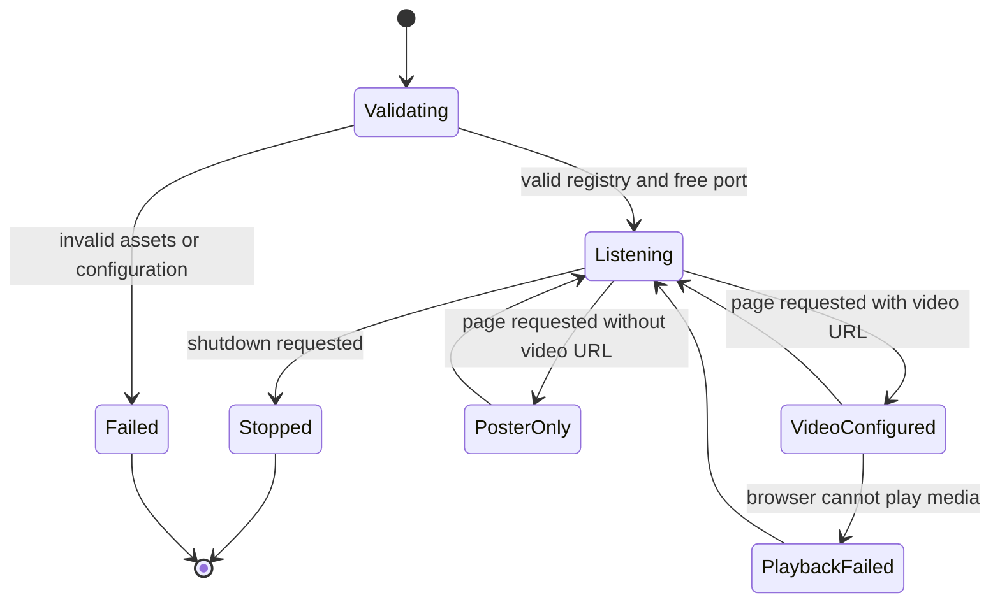

# Local template sample server

The user approved a dedicated local preview server with registered sample
assets and a configurable external video URL. This note is the design spec.
The existing feature-note structure is used under the user's permission to
proceed without the unavailable feature-flow-diagrams skill.

## Purpose and scope

Serve a Classic V1 demonstration page and poster from the user's Mac.
Bind to `127.0.0.1:8790` by default. Expose the page later through the user's
existing named Cloudflare Tunnel at `samples.ferarana.work`.
The user owns the dashboard route setup and wants to learn that process.
The route is not verified as created. Do not claim public availability yet.

The server does not serve or proxy MP4 bytes. The player uses an optional
external HTTPS video URL. Video hosting is a separate decision because
Cloudflare documents video-delivery restrictions for public Tunnel routes.
No provider subscription, upload, DNS change, tunnel installation, background
service installation, or MCP interface change is part of implementation.

The neutral sample will be 10–15 seconds, generated through the actual Classic
V1 renderer. Use original demonstration text and imagery, explicitly labeled
as a demonstration. Show the title, thumbnail, sinusoidal animation, and timed
transcript. Generate narration locally for this fixture; inspect and listen
to it before accepting the sample. Do not use user clips or external voice
services as an implicit fallback.

## Storage and registry contract

Store accepted demonstration assets outside checkouts, by default under
`<AUDIOGRAM_DATA_ROOT>/template-samples`. Reuse shared storage configuration.
An absolute `AUDIOGRAM_SAMPLE_ROOT` may override that location, but it must
remain outside source checkouts. Retain MP4 locally for later upload; only a
registered poster is publicly served by this server.

Keep the reproducible neutral fixture in the repository. Register each sample
by `templateId`, `templateVersion`, and `variationId`; validate those fields
against the existing template catalog. The registry records poster location,
poster hash, local video hash, and an optional external HTTPS video URL.
Separate immutable sample asset identity from mutable video-host configuration.
An asset revision in poster URLs avoids stale caches after sample replacement.

Reject duplicate identities, invalid selections, missing/changed posters,
symlinks, and paths outside the dedicated asset root before listening.
Reject external URLs with non-HTTPS schemes or embedded credentials. Render
all text and attributes with correct escaping. Do not fetch external video
URLs on the server; it is not a generic proxy.

## HTTP and page contract

Default port is 8790; `AUDIOGRAM_SAMPLE_PORT` may override it with a valid port.
A busy port fails clearly; do not choose a different port automatically.

- `/samples/classic/1/default/`: a preview page with name and description.
- `/samples/classic/1/default/poster.jpg`: registered poster, revalidated with
  an ETag and conservative caching.
- `/samples/classic/1/default/poster/<asset-revision>.jpg`: immutable poster URL.
- `/health`: minimal health response without local paths or credentials.

Only GET and HEAD are supported. Other methods return 405. Unknown routes,
MP4 routes, directory requests, and traversal attempts return 404. HEAD returns
headers without a response body. Responses include accurate content types and
`X-Content-Type-Options: nosniff`. The page's content security policy permits
only its own resources and the configured video origin; no wildcard origins.

Without a video URL, show the poster and “Sample video is not available yet.”
With one, use native controls, `playsinline`, no autoplay, and conservative
preloading. Display a readable playback failure message. Do not suggest that
an configured URL guarantees availability. Viewing never creates a job.

## Mermaid flowchart

## Lifecycle/state diagram

## Human approval and external-side-effect boundaries

Implementation writes local code and demonstration assets. Rendering a neutral
sample is a local preparation step; it does not enqueue or publish it.
Publishing the page makes its registered demonstration poster public.
The user will configure the Cloudflare route after local verification.
Do not point it at the existing queue or MCP port. Background startup for both
processes is deferred until foreground verification. External video-host choice
and upload need an explicit scoped decision. ChatGPT card integration is later
work; a web page alone does not establish in-chat playback.

## Failure and retry paths

Invalid startup configuration stops before listening. Missing or changed assets
at request time return a safe unavailable response without exposing paths.
No automatic rendering, provider calls, or uploads occur during requests.
Fix configuration or regenerate and verify the fixture, then restart explicitly.
Tunnel or Mac unavailability affects public access while local data remains.
An external video failure displays an error instead of an empty player.
Local success, HTTPS success, and ChatGPT playback are distinct checks.

## Invariants

- Only registered demonstration pages and posters are exposed.
- No MP4 bytes, ledgers, user clips, credentials, or arbitrary files are served.
- Sample identities resolve through the existing catalog.
- Durable sample assets remain outside source checkouts.
- The server never starts rendering or processing jobs from an HTTP request.
- HTTPS video location is configuration, not proof of playback.
- A Cloudflare page route does not solve MP4 hosting.
- Classic V1 composition and creation defaults remain unchanged.

## Verification plan

Test route isolation, HEAD, methods, escaping, schema validation, duplicate
identities, missing assets, hash changes, symlink escapes, and port conflict.
Test page states with absent and valid external URLs using a controlled fixture.
Visually inspect the real neutral render, poster, and page. Listen to narration.
Verify hashes and media properties before accepting assets. Test server reads
from another checkout with the same asset root. Run applicable tests, lint,
TypeScript checks, and `npm run verify:feature-docs`.

Public rollout is a separate operator check: user saves the dashboard route,
then verify HTTPS page and poster hashes and verify forbidden routes stay 404.
Real hosted-video playback remains pending until a host is chosen. No COMPLETE
claim may imply that external video or ChatGPT card work was performed.

## Implementation reconciliation and deviations

Pending reconciliation. This is an approved design, not an implemented server.
After local implementation and tests, record actual behavior and deviations.
Keep public rollout and hosted-video evidence explicitly separate. Set COMPLETE
only when the defined local deliverable and reconciliation are verified.

## References

- [Cloudflare route setup](https://developers.cloudflare.com/tunnel/get-started/)
- [Routing and automatic DNS](https://developers.cloudflare.com/tunnel/concepts/routing/)
- [Video-delivery restrictions](https://developers.cloudflare.com/fundamentals/reference/policies-compliances/delivering-videos-with-cloudflare/)
