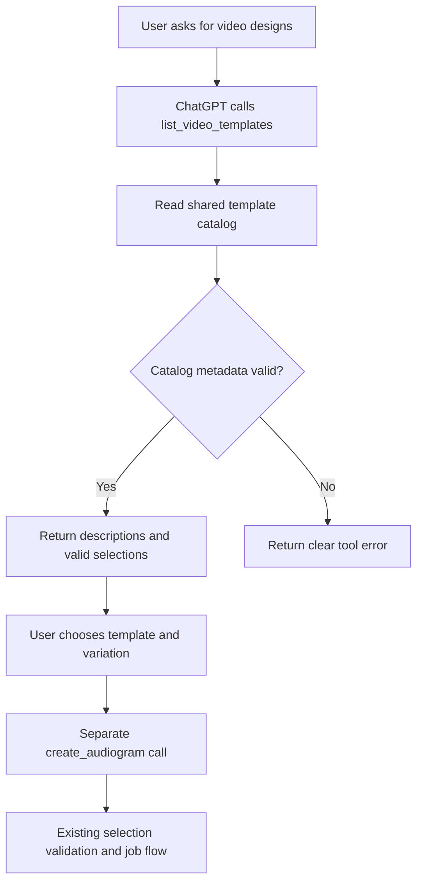
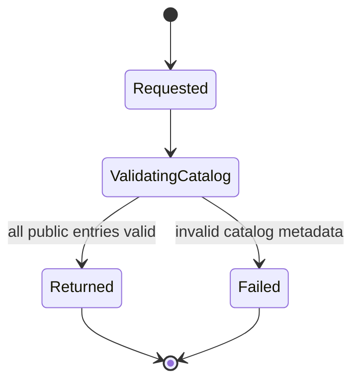

# Video template discovery through MCP

The user approved a read-only tool that lists available video designs.
The first version includes descriptions and valid selections. Preview images
are deferred. The user authorized this note to use the existing feature-note
structure without the unavailable feature-flow-diagrams skill.

## Purpose and scope

Add `list_video_templates` to the existing Audiogram MCP helper. ChatGPT can
use the result to explain the available choices. After the user chooses a
design, ChatGPT can pass its selection to `create_audiogram`.

Only implemented designs belong in the response. Classic V1 with its default
variation is the only current choice. New script generation, narration,
animated explainer designs, preview images, and media delivery are separate work.
Listing does not promise that credentials or render dependencies are ready.
It describes designs supported by the running server's catalog.

## Tool contract

`list_video_templates` accepts an empty input object and requires no arguments.
Return structured data with `contractVersion: 1` and a `templates` array.
Also return a short text result that explains the choices.

Each template includes:

- `templateId`, `templateVersion`, and `name`.
- `description`, which explains the visible design in plain language.
- `supportedInput`, which identifies the accepted source type.
- `variations`, with each variation's `variationId`, `name`, and `description`.
- `defaultSelection`, with the three fields accepted by `create_audiogram`.

The initial result is represented by this proposed response:

```json
{
  "contractVersion": 1,
  "templates": [
    {
      "templateId": "classic",
      "templateVersion": "1",
      "name": "Classic V1",
      "description": "A thumbnail, title, sinusoidal animation, and timed transcript with the original speaker's audio.",
      "supportedInput": "public-youtube-url",
      "variations": [
        {
          "variationId": "default",
          "name": "Default",
          "description": "The preserved Classic V1 design."
        }
      ],
      "defaultSelection": {
        "templateId": "classic",
        "templateVersion": "1",
        "variationId": "default"
      }
    }
  ]
}
```

Versions remain strings to match the existing creation interface. Return only
public choice information. Do not expose treatment IDs, composition IDs,
filesystem paths, credentials, or render settings.

## Files and interfaces

`src/templates/catalog.mjs` remains the single source for available templates
and valid selections. Add descriptive metadata there. Build the public listing
from `listTemplates()`; do not maintain a second list inside the MCP server.

`plugins/audiogram-helper/server.mjs` registers the tool and its input and
output schemas. The handler validates and projects catalog metadata into the
public response. It does not call the job runner. Existing creation, status,
and retry tools keep their behavior.

Extend catalog tests and MCP server tests. Update the helper README to explain
discovery followed by explicit selection. Adding a complete supported entry
to the catalog must make it discoverable without editing the listing handler.

## Mermaid flowchart



## Lifecycle/state diagram



Discovery has no persistent job state. Choosing a design does not itself start
a job. A later creation request uses the existing job lifecycle.

## Human approval and external-side-effect boundaries

Listing is read-only and needs no per-call approval. It must not create jobs,
write ledgers, modify the queue, fetch source videos, call model or voice
providers, render media, or publish anything. It reads the local catalog only.

The user chooses a design before ChatGPT submits a creation request in this
interaction. Creation retains its existing rules and is a separate tool call.
The server validates the selection again; a previous listing cannot authorize
an invalid or unavailable selection.

## Failure and retry paths

If any catalog entry lacks required metadata or contains an invalid selection,
return `isError: true` with a clear message. Do not return partial choices or
silently invent missing values. Unexpected errors use a safe message without
local paths or stack traces.

A repeated listing is safe because it changes no state. Do not implement
automatic retries or cache a separate catalog. If the server version changes
between listing and creation, creation validates against its current catalog.
An invalid choice requires a fresh listing and another user selection.

## Invariants

- Discovery and creation use the same template catalog.
- Every advertised template and variation forms a valid creation selection.
- Every default selection names a listed variation.
- Planned designs do not appear as available designs.
- Catalog metadata is projected into a stable public schema.
- Discovery changes no jobs, queue records, or files.
- Classic V1 remains unchanged visually and remains the creation default.
- Preview images and internal renderer details are absent from this version.

## Verification plan

Use the existing MCP test client to discover and call the registered tool.
Verify structured output and text output, Classic V1 metadata, the empty input
contract, and unchanged behavior of the existing tools.

For every catalog variation, pass its advertised selection through
`resolveTemplateSelection`. Verify that default selections are valid too.
Use a catalog fixture with another valid entry to prove the public projection
does not contain a separate hard-coded list. Check invalid metadata returns a
tool error. Verify the listing does not invoke the runner or change job-store
records. Check that public results contain no internal renderer fields.

Run focused catalog and MCP tests, applicable lint/type checks, and
`npm run verify:feature-docs`. A real render is not required for this read-only
addition. Validate live MCP discovery separately after an explicitly scoped
server rollout; repository tests do not prove a running server was updated.

## Implementation reconciliation and deviations

Implemented and reconciled against the shared catalog metadata, public projection,
MCP registration, declarations, tests, and helper README. The user authorized
this feature-note workflow without the unavailable diagram skill.

The public projection lives in `plugins/audiogram-helper/template-listing.mjs`.
This small module keeps schema validation and field filtering separate from
HTTP handling. The server accepts a catalog fixture for tests; production uses
`listTemplates()` by default. This is an intentional file-level addition to
the original design. No rendering or creation defaults changed.

Verification: 55 catalog/helper/MCP tests passed with no skips, including real
local MCP client discovery, repeated listing, empty-input validation, safe
catalog failure, valid selection checks, and added-entry projection. The MCP
listing does not call the job runner. Lint and TypeScript checks passed.
Live server rollout is not included: the running plugin must be restarted
before it exposes the new tool. No external providers or publication were used.
